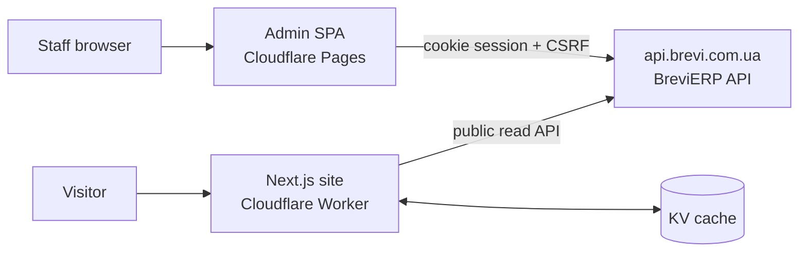

# Brevi ERP — web apps

Front ends for **Brevi**, a Ukrainian workwear manufacturer:

- **Admin panel** for staff (`apps/admin-react`). Pricing, commercial offers, CRM, production, warehouse, purchasing, accounting, website content and access rights, all in one place. It replaced a set of Google Sheets.
- **Public website** (`apps/site`). A fast, SEO-first catalogue site in Ukrainian and Russian that replaces the old OpenCart site. It has a product catalogue with prices and a request form, with no cart or online payment by design.

The backend and the API are in [BreviERP](https://github.com/Weretik/BreviERP).

> Status: in production and in active development.

## Tech stack

| App         | Stack                                                                                                                    | Hosting                                       |
| ----------- | ------------------------------------------------------------------------------------------------------------------------ | --------------------------------------------- |
| Admin       | React 19, TypeScript, MUI 9 (DataGrid, Charts), Redux Toolkit / RTK Query, React Router 7, Tiptap rich-text editor, Vite | Cloudflare Pages                              |
| Public site | Next.js 16 App Router, React Server Components, Tailwind CSS v4, shadcn/ui (Radix)                                       | Cloudflare Workers through OpenNext, KV cache |
| Monorepo    | Nx 24, npm workspaces, ESLint, Prettier, Husky                                                                           | —                                             |
| Tests       | Vitest + Testing Library (unit, component, integration), Playwright (admin E2E)                                          | GitHub Actions                                |
| API         | OpenAPI snapshot from the backend, generated TypeScript types (`openapi-typescript`)                                     | —                                             |

`apps/storefront` (Angular SSR) is an earlier storefront attempt. It was never deployed and will be removed.

## Architecture



**Admin.** The admin is split into domain library groups under `libs/admin/<domain>`: accounting, clients, content, production, quotes, warehouse, and more. Each group has the same layers:

```text
data-access  → API calls, response mappers
model        → entities, validators, pure rules
ui           → presentational components
feature      → pages and routes
```

Every page and action is checked against the user's access rights from the backend. The design system is shared across all pages.

**Public site.** Each site page is its own group of libraries under `libs/site/<page>`, split into `ui`, `seo` and `feature`. Pages render on the server. Data from the API is cached in KV with stale-while-revalidate (refreshed every 5 minutes, served for up to a day if the API is down), so staff changes in the admin appear on the site within minutes, without a rebuild. SEO is built in: localized metadata, `hreflang`, JSON-LD (Organization, Product, BreadcrumbList), sitemaps, and 301 redirects from old URLs.

**API contract.** `docs/contracts/openapi` holds a snapshot of the backend contract with its source commit. Types are generated from it. CI fails if the snapshot and the generated types differ.

Design decisions: [BreviERP ADRs](https://github.com/Weretik/BreviERP/tree/master/docs/adr) and the site ADR in [docs/architecture/site/adr](docs/architecture/site/adr/0001-nextjs-public-site.md).

## Run locally

### Requirements

- Node.js 24 and npm
- A running BreviERP API (see its README). The admin expects it at `https://localhost:7142`.

### Install

```bash
npm ci
```

### Admin

```bash
npx nx serve admin-react
# http://localhost:4300 — the Vite dev server proxies API calls to the local backend
```

The API base URL is set in `apps/admin-react/src/environments/environment.ts`.

### Public site

```bash
# apps/site/.env.local  (not committed)
BREVI_API_URL=http://localhost:5231

npx nx dev site
```

### Checks

```bash
npx nx test <project> -- <file-filter>   # focused tests
npm run test:site                        # all site libraries
npx nx lint <project>
npx nx typecheck <project>
npm run contracts:check                  # API snapshot is in sync
npm run docs:check                       # documentation links
```

CI runs lint, type checks, all unit and component tests, contract and docs checks, and production builds on every pull request.

## Repository layout

```text
apps/
  admin-react/      admin SPA
  admin-react-e2e/  Playwright tests
  site/             Next.js public site
  storefront/       legacy Angular storefront (to be removed)
libs/
  admin/<domain>/   data-access · model · ui · feature
  site/<page>/      ui · seo · feature (+ core, shared)
docs/               architecture, standards, feature map, specifications, API contract
tools/              contract sync, docs checks, design tokens
```

## License

[PolyForm Noncommercial 1.0.0](LICENSE.txt), the same as the backend. The source is shown for review and learning. Commercial use is not allowed.
