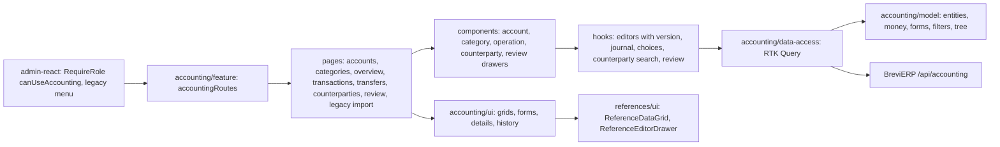

# Admin: Бухгалтерія

**Status:** stage 1 («Рахунки і каси», «Категорії»), stage 2 («Огляд», «Операції», «Перекази», archive «Домашня бухгалтерія», balances) stage 3 («Контрагенти», «Потребують перевірки») stage 4 (files of operations) implemented 2026-11-05 and stage 5 («Перенесення архіву») 2026-11-08; the pages were restyled the same day from the approved [mockup](https://claude.ai/artifact/AotN13KWseQLXkcTX2qoau). Backend decisions and later stages are in the BreviERP specification `docs/sdd/specs/accounting/001-finance`; the consumed contract is [backend/accounting](../../contracts/openapi/backend/accounting/finance.openapi.yaml).

The «Бухгалтерія» menu group is shown only to the director: every item has `requiredRoles: ['Director']`, and the routes are wrapped in `RequireRole` with `canUseAccounting`. The backend allows the same role (policy `CanUseAccounting`). Items of later stages («Імпорт виписок», «Звіти», «Журнал змін») are in the menu without a page yet.

`/accounting/legacy-import` «Перенесення архіву»: the one-off move of the old Calculator «Фінанси». «Обрати finance.json» gzips the file in the browser (about 40 MB → 3 MB, so it fits the request limit) and the server only checks it. The report shows the errors that stop the move (the first 100 and «і ще N»), warnings, «Що переноситься» per kind (in the file, to add, moved earlier, left out) with how clients and suppliers were found in Brevi, «Суми у файлі» by area and kind, and «Залишки після перенесення» (on 30.09, on 01.10, now) where only a missing confirmed balance or a difference is marked. «Перенести» appears only without errors and with something to add, asks first, and refreshes every list of «Бухгалтерія»; a second run adds only what is missing.

`/accounting/accounts` «Рахунки і каси»:

- header with «Додати рахунок», search by name, IBAN (spaces ignored) or note, chips «Активні / Без залишку на 01.10 / Архів» with counts;
- «Цех» table: name, type, IBAN, and «Залишок на 01.10». A confirmed balance shows the amount; a missing one shows only the problem pill «Не підтверджено». Active accounts carry no badge;
- the row menu opens the side panel (`ReferenceEditorDrawer`): view with the account, the balance on 01.10 (who and when confirmed), «Підтвердити залишок» / «Змінити залишок» / «Скасувати підтвердження», «Історія змін» and «Перенести в архів» / «Відновити з архіву»; «Редагувати» and «Додати рахунок» open the form. Money is typed as «62 546,40» and sent in kopecks;
- the table also shows «Поточний залишок» and «Домашня бухгалтерія» (legacy balance); the view has a «Залишки» section;
- «Видалити» asks first; an account with operations or transfers can only be moved to the archive (the backend answers 409). The log keeps the last snapshot. Every change sends the version the panel opened; if someone saved first, the panel stays open with the backend reason.

`/accounting/categories` «Категорії»:

- tabs «Поточний облік з 01.10.2026» and «Домашня бухгалтерія до 01.10.2026» (`?tab=archive`), chips «Витрати / Надходження» with counts, search that keeps the root of a matching subcategory;
- the table lists each root with its subcategories right under it (sorting off);
- the side panel: view with «Додати підкатегорію» (on a root) and «Історія змін»; the form has the direction and «Входить у» (root or one of the active roots) only when creating;
- deleting a root warns that its subcategories go with it; a category already used in operations is switched off instead (pill «Вимкнена»).

`/accounting/overview` «Огляд»: quick periods («Листопад», «Жовтень», «З 01.10», «Свій період…») and a «Домашня бухгалтерія» switch; a warning line with the review count split by reason and «Перевірити →» (only when something waits); one strip with «Залишок зараз», «Надходження», «Витрати» (with operation counts) and «Різниця»; «Залишки рахунків» with the account kind, where only accounts without a balance on 01.10 get a problem mark; «Куди пішли гроші» — the five largest expense root categories of the period as bars and the rest in one line.

`/accounting/transactions` «Операції» and `/accounting/transfers` «Перекази»:

- both share the area tabs (`?tab=archive` for «Домашня бухгалтерія», which opens on its own period ending the day before 01.10), a search field, quick periods and (operations) «Усі / Надходження / Витрати» applied at once, «Ще фільтри» (account, category, amounts, cancelled) applied on «Застосувати», server paging (50) and sorting, and one line of totals of the whole selection;
- operations: date, «Опис і контрагент» (description, and under it the counterparty with «Клієнт», «Постачальник», «Фінансовий» or «Разовий»; pills «Перевірити контрагента», «Немає в довіднику», «Анульовано»), «Категорія › Підкатегорія» or «Без категорії», account, signed amount; the side panel creates, edits («Зберегти і додати ще» keeps account and date) and cancels with the opened version;
- the «Контрагент» field searches finance counterparties, clients and suppliers in one list grouped by kind (an unconfirmed one carries «Не підтверджено»); «Додати «X» як фінансового контрагента» creates a confirmed one and picks it; a picked counterparty fills an empty category with its default; the switch «Разовий контрагент» replaces the field with a name for this operation only (the two never go together);
- «Файли» in the view of an operation: PDF, JPG or PNG up to 10 МБ, several at once (each is checked before sending and the server checks the content), «Відкрити» in a new tab through the session (the files are private, never a public link), «Видалити» after a confirmation; a cancelled operation only shows its files. «Історія змін» names the added or removed file. While the storage is not set up the server answers «Сховище файлів бухгалтерії ще не налаштоване»;
- transfers: from / to account, amount; a transfer between accounts of different currencies is refused before saving.

`/accounting/counterparties` «Контрагенти»:

- chips «Фінансові / Клієнти / Постачальники / Разові» with counts for the same search (`?tab=clients|suppliers|oneoffs`), «Показати архівні», search by name, other names, ЄДРПОУ or IBAN, 50 rows per page from the server;
- «Фінансові»: name with other names, ЄДРПОУ, default category, operation count, «Оборот з 01.10» (incomes minus expenses of the current books); only «Не підтверджено» and «Архів» are marked. The side panel shows the record and its history with «Підтвердити» (moves its operations out of review), «Обʼєднати з іншим» (a dialog picks the counterparty that keeps the operations), «Архівувати» / «Відновити»; the form has ЄДРПОУ/ІПН, IBAN, name in the bank, other names one per line, a default category of the current books and auto-apply (only for a confirmed one). «Додати контрагента» creates an unconfirmed one;
- «Клієнти» and «Постачальники» are read-only here with their operation count and turnover; a row opens the client card or «Контрагенти» of «Довідників»;
- «Разові»: operations with a one-off name of both areas; the row menu «Зробити постійним» creates a confirmed finance counterparty for that operation only; «Переглянути» opens «Перевірка операції».

`/accounting/review` «Потребують перевірки»: active operations of the current books without a category or with an unconfirmed finance counterparty (they already count in balances), one card each, filtered by «Усі / Без категорії / Новий контрагент». A card changes only the counterparty, category and subcategory (date, account and amount stay) and saves on «Підтвердити»; an unconfirmed counterparty is refused until «Підтвердити контрагента» right in the card. «Запамʼятати: наступні операції «X» одразу в «Y»» (on by default, finance counterparties only) makes the category the counterparty's default with auto-apply. «Огляд» shows the count of such operations with a «Перевірити» link.

## Structure diagram



## Code structure

```text
libs/admin/accounting/
├── model/src/entities/{accounts,categories,history,settings}/   # account, category, log entry, cutover date
├── model/src/entities/{movements,transactions,transfers,overview}/ # operations, transfers, totals, overview
├── model/src/entities/attachments/finance-attachment.ts            # file of an operation, types, 10 МБ
├── model/src/entities/import/legacy-finance-import.ts             # report of «Перенесення архіву», kind and movement labels
├── model/src/validators/attachments/finance-attachment-validation.ts # check of a picked file
├── model/src/entities/counterparties/finance-counterparty.ts      # kinds, tabs, counterparty, choice, row label
├── model/src/mappers/money/finance-money.ts                       # «62 546,40» ↔ kopecks, dates
├── model/src/forms/{accounts,...,transfers}/                     # form values ↔ request bodies
├── model/src/validators/{accounts,...,transfers}/                # field limits shared with BreviERP
├── model/src/queries/accounts/finance-account-filters.ts         # chips and search
├── model/src/queries/categories/finance-category-tree.ts         # root + subcategory rows, parents
├── model/src/queries/journal/finance-journal-filters.ts          # area tabs, journal filters → query params
├── model/src/queries/overview/finance-overview-periods.ts        # quick periods «Листопад», «З 01.10»
├── model/src/mappers/text/finance-{count,file-size}.ts           # «3 операції», «245 КБ»
├── model/src/queries/counterparties/finance-counterparty-filters.ts # `?tab=`, search → query params
├── data-access/src/api/{accounts,...,overview}/                  # endpoints; accounting.api.ts joins them
├── data-access/src/validators/accounting-response.ts             # runtime response checks
├── data-access/src/mappers/accounting.mapper.ts                  # response → model
├── data-access/src/mappers/accounting-movement.mapper.ts         # operations (with counterparty), transfers, overview
├── data-access/src/mappers/accounting-counterparty.mapper.ts     # counterparty pages and choices
├── data-access/src/api/attachments/finance-attachment-endpoints.ts # list, upload (multipart), delete
├── data-access/src/mappers/accounting-attachment.mapper.ts       # files of an operation
├── data-access/src/api/import/legacy-finance-import-endpoints.ts  # check or move of finance.json (gzip, multipart)
├── data-access/src/files/compress-finance-file.ts                # gzip in the browser
├── data-access/src/mappers/accounting-import.mapper.ts           # import report
├── data-access/src/files/finance-attachment-content.ts           # file content with the session (blob)
├── data-access/src/errors/accounting-api-error.ts                # keeps backend reasons (409)
├── ui/src/tables/{accounts,...,overview,counterparties}/         # «Цех» grids, balances, counterparties, parties
├── ui/src/forms/{accounts,categories,transactions,transfers}/   # account, balance, category, operation, review, transfer forms
├── ui/src/forms/transactions/finance-{category,counterparty}-fields.tsx # shared by the operation and review forms
├── ui/src/forms/counterparties/                                  # counterparty form, counterparty picker
├── ui/src/forms/overview/finance-period-form.tsx                 # «Свій період…»
├── ui/src/details/{accounts,...,transfers,counterparties}/       # read-only views in the side panel
├── ui/src/components/attachments/finance-attachment-list.tsx     # «Файли»: open, add, delete
├── ui/src/components/import/legacy-import-report.tsx             # errors, warnings, counts, totals, balances of the move
├── ui/src/components/{history,status,journal,overview}/          # history, problem pill and warning line, filters, segmented buttons, totals line, overview strip, «Куди пішли гроші»
├── ui/src/dialogs/finance-{delete,merge}-dialog.tsx               # confirmations, «Обʼєднати»
└── feature/src/
    ├── accounting.routes.tsx                                     # accounts, categories, overview, transactions, transfers, counterparties, review, legacy import
    ├── pages/{accounts,...,transfers,counterparties,review}/     # pages
    ├── components/{accounts,...,transfers,counterparties,review}/ # side panels; review cards
    ├── components/journal/                                       # area tabs, quick bar (search, periods, type, «Ще фільтри»)
    ├── hooks/                                                    # editors, journal, choices, settings, files of an operation, archive move
    └── testing/{render.tsx,finance-api-stub.ts}                  # render with the API store, stubbed API
libs/admin/core/auth/src/session/session-user.ts                  # canUseAccounting
apps/admin-react/src/app/router/{create-admin-router.tsx,legacy-menu.ts,admin-route-layout.tsx}
```

`libs/admin/references/ui` `ReferenceDataGrid` and its row menu accept text ids (uuid) as well as numbers.

## Tests

`npx nx test admin-accounting-feature`, `admin-accounting-ui`, `admin-accounting-data-access`, `admin-accounting-model`, and `npx nx test admin-react -- navigation-config`:

- `feature/src/pages/accounts/finance-accounts-page.component.test.tsx` — problem pill only for a missing balance, archive chip, create in kopecks, confirm the balance with the opened version;
- `feature/src/pages/accounts/finance-accounts-page.component.test.tsx` also checks that an account with movements offers only the archive;
- `feature/src/pages/categories/finance-categories-page.component.test.tsx` — root with subcategories, direction and area switch, subcategory from the root panel, delete warning;
- `feature/src/pages/overview/finance-overview-page.component.test.tsx` — warning line with reasons, period figures and counts, «Куди пішли гроші», problem mark only without the balance on 01.10, quick period and area switch;
- `feature/src/pages/transactions/finance-transactions-page.component.test.tsx` — signed amounts and totals, expense in kopecks with a subcategory, cancel with the version, archive period, quick type and «Ще фільтри», quick period and typed search, files of an operation (list, a wrong file refused before sending, multipart upload, delete after a confirmation);
- `feature/src/pages/transfers/finance-transfers-page.component.test.tsx` — totals, currency mismatch refused before saving;
- `feature/src/pages/transactions/finance-transactions-page.component.test.tsx` also: a picked counterparty brings its default category, a typed name becomes a confirmed finance counterparty;
- `feature/src/pages/counterparties/finance-counterparties-page.component.test.tsx` — «Не підтверджено» only on unconfirmed rows, «Підтвердити» with the version, create with other names, «Зробити постійним», read-only suppliers;
- `feature/src/pages/review/finance-review-page.component.test.tsx` — `needsReview` cards and the reason filter, an unconfirmed counterparty refused until «Підтвердити контрагента», review body with the version and `rememberCategory`;
- `model/src/validators/counterparties/finance-counterparty-validation.unit.test.ts`, `data-access/src/mappers/accounting-counterparty.mapper.unit.test.ts`;
- `model/src/queries/overview/finance-overview-periods.unit.test.ts`, `model/src/mappers/text/finance-count.unit.test.ts`, `model/src/queries/journal/finance-journal-filters.unit.test.ts`, `model/src/validators/transactions/finance-transaction-validation.unit.test.ts`, `data-access/src/mappers/accounting-movement.mapper.unit.test.ts`;
- `model/src/mappers/money/finance-money.unit.test.ts`, `model/src/validators/accounts/finance-account-validation.unit.test.ts`, `model/src/queries/categories/finance-category-tree.unit.test.ts`;
- `data-access/src/mappers/accounting.mapper.unit.test.ts`, `ui/src/components/history/finance-history-list.component.test.tsx`;
- `feature/src/pages/import/legacy-finance-import-page.component.test.tsx` — a check first (`dryRun=true`), counts, links, difference and warnings, «Перенести» after a confirmation sends multipart with `dryRun=false`; errors listed with «і ще N» and no move; `data-access/src/mappers/accounting-import.mapper.unit.test.ts`;
- the feature tests pin `Date` to 2026-11-05 (`feature/src/test-setup.ts`), the day the API stub answers, so they do not depend on the day they run;
- `apps/admin-react/src/app/router/navigation-config.unit.test.ts` — the group only for the director.
