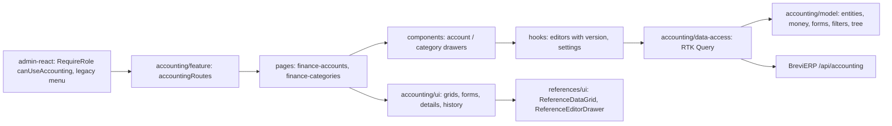

# Admin: Бухгалтерія

**Status:** stage 1 («Рахунки і каси», «Категорії») implemented 2026-11-05. Backend decisions and later stages are in the BreviERP specification `docs/sdd/specs/accounting/001-finance`; the consumed contract is [backend/accounting](../../contracts/openapi/backend/accounting/finance.openapi.yaml).

The «Бухгалтерія» menu group is shown only to the director: every item has `requiredRoles: ['Director']`, and the routes are wrapped in `RequireRole` with `canUseAccounting`. The backend allows the same role (policy `CanUseAccounting`). Items of later stages («Огляд», «Операції», «Перекази», «Контрагенти», «Потребують перевірки», «Імпорт виписок», «Звіти», «Журнал змін») are in the menu without a page yet.

`/accounting/accounts` «Рахунки і каси»:

- header with «Додати рахунок», search by name, IBAN (spaces ignored) or note, chips «Активні / Без залишку на 01.10 / Архів» with counts;
- «Цех» table: name, type, IBAN, and «Залишок на 01.10». A confirmed balance shows the amount; a missing one shows only the problem pill «Не підтверджено». Active accounts carry no badge;
- the row menu opens the side panel (`ReferenceEditorDrawer`): view with the account, the balance on 01.10 (who and when confirmed), «Підтвердити залишок» / «Змінити залишок» / «Скасувати підтвердження», «Історія змін» and «Перенести в архів» / «Відновити з архіву»; «Редагувати» and «Додати рахунок» open the form. Money is typed as «62 546,40» and sent in kopecks;
- «Видалити» asks first; the log keeps the last snapshot. Every change sends the version the panel opened; if someone saved first, the panel stays open with the backend reason.

`/accounting/categories` «Категорії»:

- tabs «Поточний облік з 01.10.2026» and «Домашня бухгалтерія до 01.10.2026» (`?tab=archive`), chips «Витрати / Надходження» with counts, search that keeps the root of a matching subcategory;
- the table lists each root with its subcategories right under it (sorting off);
- the side panel: view with «Додати підкатегорію» (on a root) and «Історія змін»; the form has the direction and «Входить у» (root or one of the active roots) only when creating;
- deleting a root warns that its subcategories go with it.

## Structure diagram



## Code structure

```text
libs/admin/accounting/
├── model/src/entities/{accounts,categories,history,settings}/   # account, category, log entry, cutover date
├── model/src/mappers/money/finance-money.ts                       # «62 546,40» ↔ kopecks, dates
├── model/src/forms/{accounts,categories}/                        # form values ↔ request bodies
├── model/src/validators/{accounts,categories}/                   # field limits shared with BreviERP
├── model/src/queries/accounts/finance-account-filters.ts         # chips and search
├── model/src/queries/categories/finance-category-tree.ts         # root + subcategory rows, parents
├── data-access/src/api/{accounts,categories}/                    # endpoints; accounting.api.ts joins them
├── data-access/src/validators/accounting-response.ts             # runtime response checks
├── data-access/src/mappers/accounting.mapper.ts                  # response → model
├── data-access/src/errors/accounting-api-error.ts                # keeps backend reasons (409)
├── ui/src/tables/{accounts,categories}/                          # «Цех» grids
├── ui/src/forms/{accounts,categories}/                           # account, balance on 01.10, category forms
├── ui/src/details/{accounts,categories}/                          # read-only views in the side panel
├── ui/src/components/{history,status}/                           # change history list, problem pill
├── ui/src/dialogs/finance-delete-dialog.tsx                      # delete confirmation
└── feature/src/
    ├── accounting.routes.tsx                                     # /accounting/accounts, /accounting/categories
    ├── pages/{accounts,categories}/                              # list pages
    ├── components/{accounts,categories}/                         # side panels
    ├── hooks/                                                    # editors, settings
    └── testing/render.tsx                                        # render with the API store
libs/admin/core/auth/src/session/session-user.ts                  # canUseAccounting
apps/admin-react/src/app/router/{create-admin-router.tsx,legacy-menu.ts,admin-route-layout.tsx}
```

`libs/admin/references/ui` `ReferenceDataGrid` and its row menu accept text ids (uuid) as well as numbers.

## Tests

`npx nx test admin-accounting-feature`, `admin-accounting-ui`, `admin-accounting-data-access`, `admin-accounting-model`, and `npx nx test admin-react -- navigation-config`:

- `feature/src/pages/accounts/finance-accounts-page.component.test.tsx` — problem pill only for a missing balance, archive chip, create in kopecks, confirm the balance with the opened version;
- `feature/src/pages/categories/finance-categories-page.component.test.tsx` — root with subcategories, direction and area switch, subcategory from the root panel, delete warning;
- `model/src/mappers/money/finance-money.unit.test.ts`, `model/src/validators/accounts/finance-account-validation.unit.test.ts`, `model/src/queries/categories/finance-category-tree.unit.test.ts`;
- `data-access/src/mappers/accounting.mapper.unit.test.ts`, `ui/src/components/history/finance-history-list.component.test.tsx`;
- `apps/admin-react/src/app/router/navigation-config.unit.test.ts` — the group only for the director.
