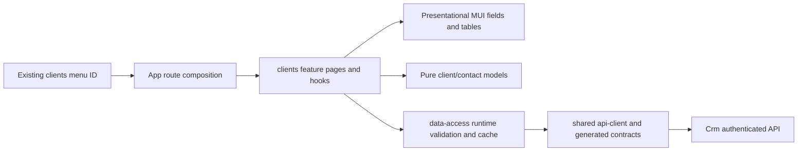
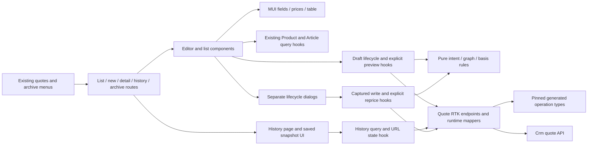
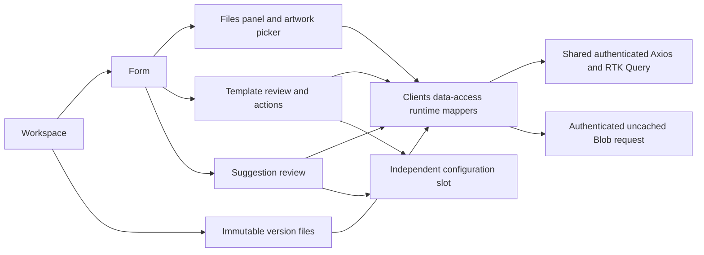
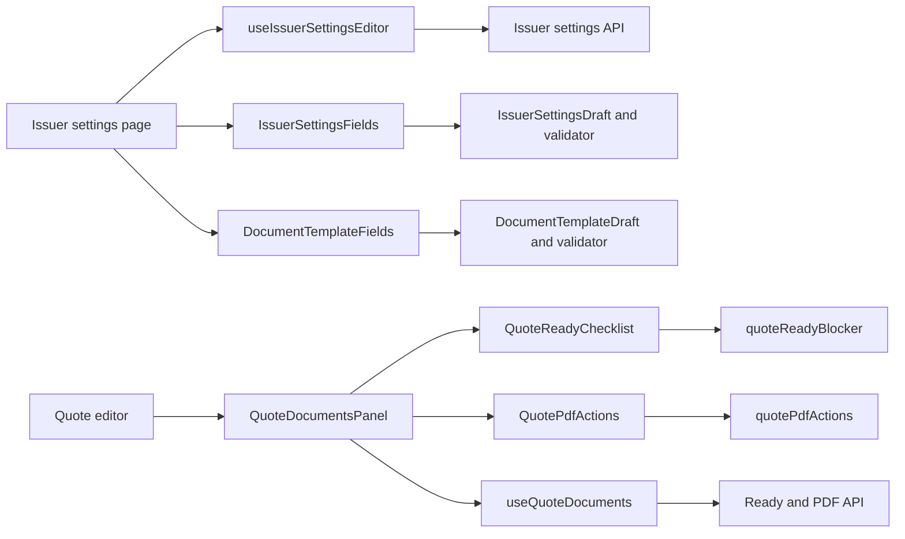
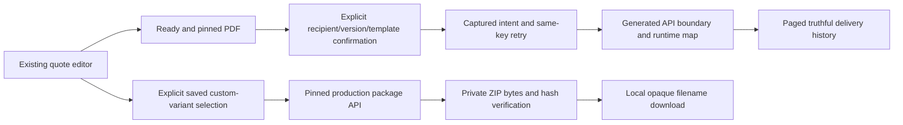

# Клієнти та контакти

**Реалізовані локальні slices:** clients, P2 draft quotes, P3 history/lifecycle та P4 custom (2026-10-28), Admin React; P5 FE-008 issuer/ready/PDF інтегровано локально 2026-10-29. Menu IDs `clients`, `quotes`, `quote-archive`, `issuer-settings` підключені до маршрутів. Ручне приймання PDF, FE-011 та історичний імпорт залишаються відкритими [CRM-001](../../specs/admin/clients/001-clients-quotes-custom-sewing/README.md). Production rollout pending.

## Поведінка і маршрути

| Маршрут                    | Призначення                                                                                               |
| -------------------------- | --------------------------------------------------------------------------------------------------------- |
| `/crm/clients`             | Серверний пошук за назвою/кодом/каналом, active/all filter, URL pagination, loading/empty/error/forbidden |
| `/crm/clients/new`         | Нова організація/особа з необов'язковими юридичними полями; перевірка схожих, без автозлиття              |
| `/crm/clients/:customerId` | Картка, редагування/деактивація, контакти/канали, primary, source identities, Admin merge                 |

Backend визначає область власника й права, `canEdit`/`canMerge` керують діями картки. User/anonymous отримують відмову API; помилка доступу не відображає дані. Менеджер створює записи від себе; браузер не задає довірений actor. Однакові назви/email не є глобально унікальними. Об'єднання явне, Admin-only з двома revision і підставою.

При 409 введення зберігається; refresh dirty-форми і вихід потребують явного відхилення. У pending іншої картки `currentData` не дозволяє показати старий кеш. RequestId зберігається для повтору того самого intent, змінюється для нового payload/revision. Кеш оновлює список і конкретні корені, не всі відкриті картки. Контакти/merge не відкриваються поверх незбереженої форми клієнта.

## Structure diagram



## Code structure

```text
apps/admin-react/src/app/router/
  legacy-menu.ts                      same clients ID with registered path
  admin-route-definitions.tsx          clients public route composition
```

```text
libs/admin/clients/
  model/src/
    entities/{customers,contacts}/     domain types, one primary type per file
    entities/quotes/                  reusable typed price selection and server basis
    models/                           editable drafts
    models/quotes/                    quote/item/variant editable graph
    queries/                          page model
    mappers/                          draft factories
    mappers/quotes/                   selection changes and immutable item/variant order
    validators/                       pure validation
    validators/quotes/                manual-price rules, basis expiry and draft checks
  data-access/src/
    api/customers/                    queries, customer/contact/merge mutations
    api/                              shared tagged API and builder type
    models/customers/                 write intents and list query
    mappers/customers/                request/response conversion
    validators/customers/             unknown response guards
    cache/customers/                  exact invalidation scope
    errors/                           transport error conversion
  ui/src/
    tables/customers/                 list/pagination
    forms/{customers,contacts}/       customer, contact and channel fields
    components/contacts/              contact list
  feature/src/
    clients.routes.tsx                lazy public routes
    pages/customers/{list,detail,create}/
    components/{customers,contacts,merge,changes}/
    hooks/{customers,contacts,merge}/  scenario orchestration and form state
    hooks/{navigation,requests}/      dirty guard and stable requestId
    errors/                           user-facing error mapping
```

Public imports use `@admin/clients/{model,data-access,ui,feature}`. Generated DTOs remain in data-access; no HTTP in feature/UI, no React/transport in model. One scenario/type/component per primary file, no generic catch-all folders. UI reuses existing MUI theme, Ukrainian labels and responsive spacing. UI interaction is tested in feature, so UI has no empty standalone test target.

[Pinned API decisions](../../specs/admin/clients/001-clients-quotes-custom-sewing/contracts/api-contract.md), [execution evidence](../../specs/admin/clients/001-clients-quotes-custom-sewing/evidence/clients-frontend-2026-10-26.md). No browser/manual acceptance or production deployment is claimed by automated checks.

[Структурний аудит і перевірки](../../specs/admin/clients/001-clients-quotes-custom-sewing/code-audit/audit.md). Кожна бібліотека групує файли спочатку за роллю, потім за можливістю. API збирається одним `injectEndpoints`; сторінки/діалоги викликають scenario hooks, UI не виконує запитів. Public aliases та маршрути збережено.

FE-003/004 реалізовані локально 2026-10-27 з backend SHA `1c1f51dc7837f3d5e3a0da7326cb17b48d23e4d9`. Новий preview втрачає чинність після expiry; saved snapshot зберігається для текстових правок. Заблоковані null-ціни дозволені в чернетці й не замінюються нулем. [Початкові model-only докази](../../specs/admin/clients/001-clients-quotes-custom-sewing/evidence/fe-003-models-2026-10-27.md) описують попередній checkpoint; [P2 evidence](../../specs/admin/clients/001-clients-quotes-custom-sewing/evidence/p2-frontend-2026-10-27.md) — поточну API/UI реалізацію.

Після [аудиту моделей](../../specs/admin/clients/001-clients-quotes-custom-sewing/evidence/fe-003-model-audit-2026-10-27.md) перевірка basis також відхиляє порожній токен і скопійований saved basis у нового варіанта. Порівняння вибору (`same-quote-selection.ts`) відокремлене від зміни стану (`change-quote-selection.ts`); reusable selection є entity value, а не editable draft.

## P2 quote routes and behavior

P3 FE-005 is implemented locally: history, immutable version comparison, explicit reprice confirmation, copy selected version, transfer, archive/restore and list filters. [Implementation evidence](../../specs/admin/clients/001-clients-quotes-custom-sewing/evidence/fe-005-2026-10-28.md): 108 passing scoped tests. Backend pinned to `f185138fc1cfc6c71cf94fe4e7103652e6719b5b`.

| Route                  | Implemented behavior                                                                                                                                            |
| ---------------------- | --------------------------------------------------------------------------------------------------------------------------------------------------------------- |
| `/crm/quotes`          | Scoped list, server search/status filter and paging in URL; loading/empty/error/forbidden states                                                                |
| `/crm/quotes/new`      | Customer/contact or named recipient, ordered items/alternatives, Catalog Product/Article or one-off PPE, reasoned manual PPE prices and explicit server preview |
| `/crm/quotes/:quoteId` | Saved current version, recipient/responsible/author, revision and immutable prices; text/visibility edits create a new version without repricing                |

Additional P3 routes:

| Route                          | Behavior                                                                             |
| ------------------------------ | ------------------------------------------------------------------------------------ |
| `/crm/quotes/archive`          | Same scoped list with archivedView; existing quote-archive menu                      |
| `/crm/quotes/:quoteId/history` | Saved snapshots, versions/events paging, parent comparison and copy selected version |

The editor separates public description/comment from internal notes. Three tier labels use semantic codes without guessed quantity cutoffs. PPE overrides and one-off prices require positive two-place amounts and a reason; Sewing final prices have no manual input. Catalog selection uses existing `@admin/products/data-access` APIs and never Product.Price. Missing source prices show readable blockers. Opening history and text-only editing retain saved prices. Explicit P3 repricing previews every saved variant on the server, compares saved/current basis, and confirms fresh tokens together; null/blockers/expiry prevent confirmation. No browser formula computes prices.

409 preserves the form and offers explicit reload/discard. Unknown write results freeze editing and replay the original captured payload/requestId. Concurrent submits are blocked; failed previews retry their key, successful preview refresh uses a new key, and stale responses cannot replace a changed selection. Dirty navigation and unload use the existing guard/dialog. Reads and mutation results are mapped at data-access; no generated DTO reaches UI/feature.

```text
libs/admin/clients/
  model/src/{entities,models,queries,mappers,validators}/quotes/
  data-access/src/
    api/quotes/                       queries, mutations, previews, tagged composition
    mappers/quotes/                   detail/item/variant/page/basis and request intent
    validators/quotes/                runtime wire-value checks
    errors/quotes/                    normalized API errors
    cache/quotes/                     protected cache purge on access loss
  ui/src/
    tables/quotes/                    list, version history and events
    components/quotes/history/        saved snapshot and typed parent comparison
    forms/quotes/                     item text and manual PPE prices
    components/quotes/                price/visibility and readable blocker messages
  feature/src/
    pages/quotes/{list,editor,history}/        thin route pages
    components/quotes/history/        independent version/event sections and pagination
    components/quotes/editor/         form and item/variant editor composition
    components/quotes/selection/      recipient and Catalog picker
    components/quotes/list/           list filters
    components/quotes/changes/        explicit reload confirmation
    hooks/quotes/{history,lifecycle,reprice}/  scenario state, captured replay and fresh tokens
    hooks/quotes/                     existing editor/write/preview composition
    components/quotes/lifecycle/      panel and separate copy/transfer/archive dialogs
    components/quotes/reprice/        explicit comparison and confirmation
    mappers/quotes/                   URL list filters
    models/quotes/                    shared dialog props
    hooks/requests/use-stable-request.ts
    errors/quotes/                    user-facing failure states
```



All changed screens use theme spacing/palette and xs/sm layouts; the table scrolls horizontally when needed. Automated DOM tests cover labels, dialog confirmation and disabled states. Browser/visual/manual acceptance and production deployment were not performed.

[P2 audit and refactoring — 2026-10-28](../../specs/admin/clients/001-clients-quotes-custom-sewing/evidence/p2-audit-refactor-2026-10-28.md): response mapping restores item/alternative order from unique `sortOrder`; preview checks the returned selection against the request; form submission also respects the access-error state. `use-quote-write.ts` owns mutations, captured retry intent and write errors; `use-quote-editor.ts` composes draft lifecycle, navigation, refresh and preview. Selection decoding is separate from basis decoding in data-access. Public routes, aliases and the pinned contract are unchanged.

## P3 lifecycle behavior

`/crm/quotes/archive` reuses QuotesPage with archive scope; `/crm/quotes/:quoteId/history` exposes paged versions/events, selected snapshot and parent comparison. List URL retains owner, creation dates and source quote filters. Assignees are searched by name in the eligible server directory.

Copy creates a new root from the selected saved version with source provenance. Transfer/archive require confirmation and reason where required; restore uses the same archive capability. Dirty forms and pending/unknown writes lock conflicting actions and navigation. A 409 retains input; unknown writes replay the captured intent/requestId.

Normal writes invalidate the exact quote and list; copy invalidates list. After access loss the shared protected admin API cache is reset, including loaded history; auth stays active and allowed data re-reads. A shared-store/editor/list integration test verifies this journey with intercepted HTTP, without a deployed backend.

[FE-005 functional audit and refactoring](../../specs/admin/clients/001-clients-quotes-custom-sewing/evidence/fe-005-audit-refactor-2026-10-28.md): reprice comparisons are bound to the exact saved version/revision, stale requests are canceled, and version/event sections are separate feature components. Current regression: 62 feature tests passed.

## P4 private custom editor — FE-006

[Follow-up audit/refactor](../../specs/admin/clients/001-clients-quotes-custom-sewing/evidence/fe-006-audit-refactor-2026-10-28.md): repeated server material/operation rows preserve their separate norms and order; client rules match backend acceptance. `custom-reload-action.tsx` owns reload dialog/progress, while the form composes sections and the hook retains request/access state. Focused26-case regression and targeted types/lint passed.

`/crm/custom-sewing/new` and `/crm/custom-sewing/:draftId` use the existing clients feature/role boundary. The existing quote variant picker opens an embedded workspace with independent fabric alternatives and paged immutable versions. Selecting a version preserves unsaved quote input, pins its public ID and requires explicit quote preview. Save draft, server Calculate and Save version are separate actions; no browser price formula, Product publication or global draft discovery.

Code: model `{entities,mappers,validators,queries}/custom-sewing`; data-access `{api,mappers,errors,cache,testing}/custom-sewing`; feature `pages/custom-sewing`, `hooks/custom-sewing`, `components/custom-sewing/{editor,versions}` and quote selection integration; UI `forms/custom-sewing` has independent identity/material/operation/application sections. Generated DTOs stay at data-access. Feature hook owns captured retries and edit/reload guards; workspace owns independent roots; the existing quote navigation guard also observes the custom dialog. Source-draft keyed picker prevents stale opener state after selection/reload.

FE-006 originally used backend `31424453f4bef63363167e3dc11e0bfa2857e64f`; the current snapshot advances to FE-007 below. Runtime decoding validates version identity, basis coherence and quote tier/snapshot agreement. Private local input/cache is cleared after access loss. [FE-006 evidence](../../specs/admin/clients/001-clients-quotes-custom-sewing/evidence/fe-006-2026-10-28.md): 64 focused tests, production typechecks for four affected libraries, spec typechecks, scoped lint/formatting.

## P4 private files, templates and suggestions — FE-007

[FE-007 audit/refactor](../../specs/admin/clients/001-clients-quotes-custom-sewing/evidence/fe-007-audit-refactor-2026-10-28.md): template HTTP408 preserves the captured request, late callbacks are suppressed after unmount, and `custom-template-selection.tsx` retains the reviewed snapshot/actions across background reads until pending/unknown writes resolve. `custom-editor-actions.tsx` owns buttons and preview expiry; editor form composes fields/panels. Fresh33-test regression, scoped lint and feature types passed.

Implemented in the same custom workspace; no new route/menu. Current contract pins clean backend `fdb8095d4dfd52a9680b5a2768c706aea1aa8c4b`. [FE-007 evidence](../../specs/admin/clients/001-clients-quotes-custom-sewing/evidence/fe-007-2026-10-28.md) records 114 focused passing cases and contract/type/lint checks.

Files stage actual PDF/JPEG/PNG bytes then explicitly finalize links/quote and production flags at the draft revision. Unsaved/unknown file operations block competing writes and navigation. Unknown results replay identical requests; confirmed local discard recovers after known conflicts. Artwork selectors use finalized server file identities. Saved-version file reads pin versionId and retain historical flags. Metadata and available bytes are distinguished; downloads use the existing authenticated transport, keep Blob bytes outside Redux and revoke temporary URLs. Access loss hides the workspace.

Paged reusable templates support own/administrator edits via server canEdit, new selection versions, archive/restore and introduction text. Explicit review applies the selected immutable template to a new server draft; source configuration remains intact. Price-free type/season suggestions show sample/range/variation and reject partial source-limit results. Confirmation opens a separate configuration; stale reviews cannot apply. Artwork/approval must be established for the new root. Calculate remains an explicit server action.



```text
libs/admin/clients/
  model/src/{entities,mappers}/custom-{files,templates,suggestions}/
  data-access/src/{api,mappers}/custom-{files,templates,suggestions}/
  feature/src/components/custom-files/       # upload, rows, artwork, discard, panel
  feature/src/hooks/custom-files/            # lifecycle and private download
  feature/src/components/custom-templates/   # list, retained selection/query, actions, review
  feature/src/hooks/custom-templates/        # captured write/retry state
  feature/src/components/custom-suggestions/ # norms and explicit review
  feature/src/components/custom-sewing/      # form, action/expiry controls, workspace, versions
libs/admin/shared/api-client/src/client/request-api-blob.ts
```

## FE-007 tests

From each clients library, `node ../../../../node_modules/vitest/vitest.mjs run` accepts the scoped `custom-files`, `custom-templates`, `custom-suggestions` paths. Exact commands/counts are in the evidence above. Editor/workspace regression covers independent new drafts, competing write locks, adopted file revision and denied private state. HTTP boundary tests exercise real multipart/binary requests with auth and generated contract fixtures; deployed backend and browser E2E are outside this verification.

## P5 issuer, ready and PDF — FE-008 local integration

The seller and public template forms have separate local models, validators and MUI field sections. Seller values begin empty; the approved VAT phrase is an editable initial template value. The issuer settings page creates an immutable version and activates it separately. The quote editor now calls server ready, PDF render/status and authenticated blob download through the generated P5 contract. It shows server-authoritative blockers, queue/failure/retry and download availability; no PDF is generated in the browser. The render action on a ready quote recovers its server artifact ID after a page reload. Automated HTTP, route and TypeScript checks passed; visual inspection of a real multipage PDF and privacy acceptance are still open.



```text
libs/admin/clients/
  model/src/models/documents/                 # seller/template drafts and ready/PDF view-state
  model/src/validators/documents/             # pure field rules and focused tests
  ui/src/forms/documents/                     # seller and public template fields
  ui/src/components/documents/                # ready checklist and PDF actions
  data-access/src/api/documents/              # typed issuer settings operations
  data-access/src/api/quotes/documents/       # ready/PDF JSON and authenticated PDF bytes
  data-access/src/cache/quotes/               # private document access-loss cache purge
  feature/src/pages/documents/                # issuer settings page
  feature/src/components/documents/           # quote documents panel
  feature/src/hooks/documents/                # server actions, polling and browser save
```

[Partial FE-008 evidence](../../specs/admin/clients/001-clients-quotes-custom-sewing/evidence/fe-008-form-slice-2026-10-29.md).
[Ready/PDF UI evidence](../../specs/admin/clients/001-clients-quotes-custom-sewing/evidence/fe-008-ready-pdf-ui-2026-10-29.md).
[FE-008 responsibility audit](../../specs/admin/clients/001-clients-quotes-custom-sewing/evidence/fe-008-audit-refactor-2026-10-29.md) kept the existing role/capability folders and fixed two test import-order lint errors.
[FE-008 integration evidence](../../specs/admin/clients/001-clients-quotes-custom-sewing/evidence/fe-008-integration-2026-10-29.md) records contract SHA, focused HTTP/route checks, responsibility split and open manual acceptance.

## First-contact selections — FE-011 integrated checkpoint

Route `/crm/quotes/introductions` opens from Quotes. Current generated source is backend `3ad90271721bc58b61fa1efa11ae6c2cd87e9866`. UI selects Catalog candidates and active Articles, displays server blockers, and checks an exact saved selection before creating a quote draft. Lists support own template read/revise/archive/restore; the backend remains authoritative for season, source approval and prices. No separate browser PDF or sender exists.

File roles under `libs/admin/clients/`: `model/src/models/introductions/` contains client records/layout/approval and UI option types; `data-access/src/api/introductions/` owns generated operation calls and cache behavior; `data-access/src/mappers/introductions/` validates responses; `ui/src/components/introductions/` contains pure pickers/form/list; `feature/src/pages/introductions/` composes the route, `feature/src/hooks/introductions/` separates draft state, actions and blocker messages, and existing `components/introductions/` gates check/apply.

By the user decision of 2026-10-30, creation of new templates stays blocked until P6 supplies the email-template version source. The UI explains and blocks that write while retaining existing stored references. This is an agreed deferral. [Consumer task and remaining acceptance](../../specs/admin/clients/001-clients-quotes-custom-sewing/tasks/documents/fe-011.md). Actual PDF visual/privacy acceptance remains open.

FE-011 follow-up audit separated Catalog query/dialog state into `feature/src/hooks/introductions/use-introduction-catalog-pickers.ts` and picker composition into `feature/src/components/introductions/introduction-catalog-pickers.tsx`. Editor read generations reject late responses after access loss/unmount. [Audit evidence](../../specs/admin/clients/001-clients-quotes-custom-sewing/evidence/fe-011-audit-2026-10-30.md).

## P6 — надсилання, історія та виробничий ZIP

У наявному `/crm/quotes/:quoteId` `QuoteDocumentsPanel` поєднує ready/PDF і два окремі блоки. Надсилання показує recipient/version/PDF/template confirmation, зберігає captured request/шаблон для явного safe retry і читає paged history. Queued/unknown не означають sent. Виробничий блок дозволяє лише явний вибір included/visible saved custom variants, показує private package version/hash/size та перевіряє ZIP перед download. Зміна quote/version/owner скидає scoped local state; access loss очищає private cache. OAuth credentials не потрапляють у браузер.

```text
libs/admin/clients/
  model/src/models/documents/{quote-delivery,email-template,production-package}-view.ts
  data-access/src/api/documents/{quote-delivery,production-package}.api.ts
  data-access/src/mappers/documents/            separate runtime validation and application projection
  feature/src/hooks/documents/{delivery,production}/  captured request and private artifact actions
  feature/src/hooks/documents/use-document-action.ts  safe replay/editor lock/cache loss
  feature/src/components/documents/{delivery,production}/  independent panel composition
  ui/src/components/documents/{delivery,production}/       MUI confirmation/history/selection
```



No Workshop order/send or client-side sent transition is implied. Active email template must exist; live Gmail activation and Admin template management remain separate.

## Tests

`data-access/src/mappers/documents/p6-documents.mapper.unit.test.ts` and `data-access/src/api/documents/p6-documents.integration.test.ts`: `npx vitest run --config libs/admin/clients/data-access/vitest.config.mts p6-documents`. Feature `components/documents/p6-panels.component.test.tsx`: `npx vitest run --config libs/admin/clients/feature/vitest.config.mts p6-panels.component use-quote-documents.unit`. [Commands/results and live-provider limits](../../specs/admin/clients/001-clients-quotes-custom-sewing/evidence/fe-009-delivery-production-2026-10-30.md).

### FE-009 API responsibilities

`data-access/src/api/documents/quote-document-api.ts` supplies shared document context; `quote-delivery.api.ts`, `email-template.api.ts`, `production-package.api.ts` own independent operations. `download-production-package.ts` owns only binary integrity/download. The shared `cache/quotes/quote-document-access-loss.ts` preserves the rejected outcome before clearing private cached state. [Audit and focused tests](../../specs/admin/clients/001-clients-quotes-custom-sewing/code-audit/fe-009-functional-audit-2026-10-30.md).

## Tests — FE-009 audit regression

`npx vitest run --config libs/admin/clients/data-access/vitest.config.mts p6-documents quote-document-access-loss documents.integration` and `npx vitest run --config libs/admin/clients/feature/vitest.config.mts p6-panels.component use-quote-documents.unit`. Tests cover explicit sends, cache rejection ordering, registry reads and verified ZIP, with no real Gmail send.
