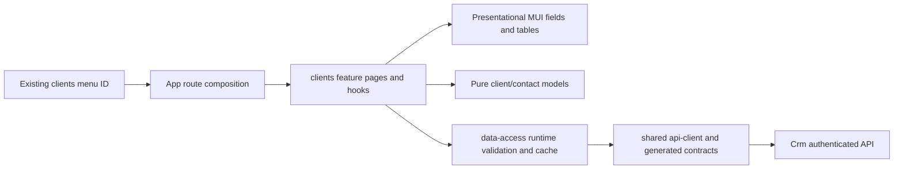
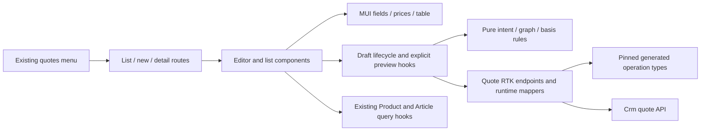

# Клієнти та контакти

**Реалізовані локальні slices:** clients (2026-10-26) і P2 draft quotes (2026-10-27), Admin React. Наявні menu IDs `clients` і `quotes` у `service-manager` підключені до API. Історія/lifecycle, custom, PDF та історичний імпорт залишаються наступними фазами [CRM-001](../../specs/admin/clients/001-clients-quotes-custom-sewing/README.md). Ручне приймання та production rollout pending.

## Поведінка і маршрути

| Маршрут                    | Призначення                                                                                               |
| -------------------------- | --------------------------------------------------------------------------------------------------------- |
| `/crm/clients`             | Серверний пошук за назвою/кодом/каналом, active/all filter, URL pagination, loading/empty/error/forbidden |
| `/crm/clients/new`         | Нова організація/особа з необов'язковими юридичними полями; перевірка схожих, без автозлиття              |
| `/crm/clients/:customerId` | Картка, редагування/деактивація, контакти/канали, primary, source identities, Admin merge                 |

Backend визначає область власника й права, `canEdit`/`canMerge` керують діями картки. User/anonymous отримують відмову API; помилка доступу не відображає дані. Менеджер створює записи від себе; браузер не задає довірений actor. Однакові назви/email не є глобально унікальними. Об'єднання явне, Admin-only з двома revision і підставою.

При 409 введення зберігається; refresh dirty-форми і вихід потребують явного відхилення. У pending іншої картки `currentData` не дозволяє показати старий кеш. RequestId зберігається для повтору того самого intent, змінюється для нового payload/revision. Кеш оновлює список і конкретні корені, не всі відкриті картки. Контакти/merge не відкриваються поверх незбереженої форми клієнта.

## Structure diagram



## Code structure

```text
apps/admin-react/src/app/router/
  legacy-menu.ts                      same clients ID with registered path
  admin-route-definitions.tsx          clients public route composition
```

```text
libs/admin/clients/
  model/src/
    entities/{customers,contacts}/     domain types, one primary type per file
    entities/quotes/                  reusable typed price selection and server basis
    models/                           editable drafts
    models/quotes/                    quote/item/variant editable graph
    queries/                          page model
    mappers/                          draft factories
    mappers/quotes/                   selection changes and immutable item/variant order
    validators/                       pure validation
    validators/quotes/                manual-price rules, basis expiry and draft checks
  data-access/src/
    api/customers/                    queries, customer/contact/merge mutations
    api/                              shared tagged API and builder type
    models/customers/                 write intents and list query
    mappers/customers/                request/response conversion
    validators/customers/             unknown response guards
    cache/customers/                  exact invalidation scope
    errors/                           transport error conversion
  ui/src/
    tables/customers/                 list/pagination
    forms/{customers,contacts}/       customer, contact and channel fields
    components/contacts/              contact list
  feature/src/
    clients.routes.tsx                lazy public routes
    pages/customers/{list,detail,create}/
    components/{customers,contacts,merge,changes}/
    hooks/{customers,contacts,merge}/  scenario orchestration and form state
    hooks/{navigation,requests}/      dirty guard and stable requestId
    errors/                           user-facing error mapping
```

Public imports use `@admin/clients/{model,data-access,ui,feature}`. Generated DTOs remain in data-access; no HTTP in feature/UI, no React/transport in model. One scenario/type/component per primary file, no generic catch-all folders. UI reuses existing MUI theme, Ukrainian labels and responsive spacing. UI interaction is tested in feature, so UI has no empty standalone test target.

[Pinned API decisions](../../specs/admin/clients/001-clients-quotes-custom-sewing/contracts/api-contract.md), [execution evidence](../../specs/admin/clients/001-clients-quotes-custom-sewing/evidence/clients-frontend-2026-10-26.md). No browser/manual acceptance or production deployment is claimed by automated checks.

[Структурний аудит і перевірки](../../specs/admin/clients/001-clients-quotes-custom-sewing/code-audit/audit.md). Кожна бібліотека групує файли спочатку за роллю, потім за можливістю. API збирається одним `injectEndpoints`; сторінки/діалоги викликають scenario hooks, UI не виконує запитів. Public aliases та маршрути збережено.

FE-003/004 реалізовані локально 2026-10-27 з backend SHA `1c1f51dc7837f3d5e3a0da7326cb17b48d23e4d9`. Новий preview втрачає чинність після expiry; saved snapshot зберігається для текстових правок. Заблоковані null-ціни дозволені в чернетці й не замінюються нулем. [Початкові model-only докази](../../specs/admin/clients/001-clients-quotes-custom-sewing/evidence/fe-003-models-2026-10-27.md) описують попередній checkpoint; [P2 evidence](../../specs/admin/clients/001-clients-quotes-custom-sewing/evidence/p2-frontend-2026-10-27.md) — поточну API/UI реалізацію.

Після [аудиту моделей](../../specs/admin/clients/001-clients-quotes-custom-sewing/evidence/fe-003-model-audit-2026-10-27.md) перевірка basis також відхиляє порожній токен і скопійований saved basis у нового варіанта. Порівняння вибору (`same-quote-selection.ts`) відокремлене від зміни стану (`change-quote-selection.ts`); reusable selection є entity value, а не editable draft.

## P2 quote routes and behavior

P3 FE-005 is in progress: pure `compare-quote-basis.ts` and presentational `QuotePriceComparison` are prepared and tested independently. They are not mounted on a route. [TS-005 audit/handoff](../../specs/admin/clients/001-clients-quotes-custom-sewing/evidence/p3-audit-handoff-2026-10-28.md) pins backend `f185138fc1cfc6c71cf94fe4e7103652e6719b5b`; current detail mapping accepts its new saved version actions. Connected history/lifecycle data-access and UI remain FE-005 work.

| Route                  | Implemented behavior                                                                                                                                            |
| ---------------------- | --------------------------------------------------------------------------------------------------------------------------------------------------------------- |
| `/crm/quotes`          | Scoped list, server search/status filter and paging in URL; loading/empty/error/forbidden states                                                                |
| `/crm/quotes/new`      | Customer/contact or named recipient, ordered items/alternatives, Catalog Product/Article or one-off PPE, reasoned manual PPE prices and explicit server preview |
| `/crm/quotes/:quoteId` | Saved current version, recipient/responsible/author, revision and immutable prices; text/visibility edits create a new version without repricing                |

The editor separates public description/comment from internal notes. Three tier labels use semantic codes without guessed quantity cutoffs. PPE overrides and one-off prices require positive two-place amounts and a reason; Sewing final prices have no manual input. Catalog selection uses existing `@admin/products/data-access` APIs and never Product.Price. Missing source prices show readable blockers. Saved unchanged selections have no reprice button; explicit same-selection repricing and history belong to P3.

409 preserves the form and offers explicit reload/discard. Unknown write results freeze editing and replay the original captured payload/requestId. Concurrent submits are blocked; failed previews retry their key, successful preview refresh uses a new key, and stale responses cannot replace a changed selection. Dirty navigation and unload use the existing guard/dialog. Reads and mutation results are mapped at data-access; no generated DTO reaches UI/feature.

```text
libs/admin/clients/
  model/src/{entities,models,queries,mappers,validators}/quotes/
  data-access/src/
    api/quotes/                       queries, mutations, previews, tagged composition
    mappers/quotes/                   detail/item/variant/page/basis and request intent
    validators/quotes/                runtime wire-value checks
    errors/quotes/                    normalized API errors
  ui/src/
    tables/quotes/                    read-only list presentation
    forms/quotes/                     item text and manual PPE prices
    components/quotes/                price/visibility and readable blocker messages
  feature/src/
    pages/quotes/{list,editor}/        thin route pages
    components/quotes/editor/         form and item/variant editor composition
    components/quotes/selection/      recipient and Catalog picker
    components/quotes/list/           list filters
    components/quotes/changes/        explicit reload confirmation
    hooks/quotes/                     separate editor lifecycle, write/replay and preview hooks
    hooks/requests/use-stable-request.ts
    errors/quotes/                    user-facing failure states
```



All changed screens use theme spacing/palette and xs/sm layouts; the table scrolls horizontally when needed. Automated DOM tests cover labels, dialog confirmation and disabled states. Browser/visual/manual acceptance and production deployment were not performed.

[P2 audit and refactoring — 2026-10-28](../../specs/admin/clients/001-clients-quotes-custom-sewing/evidence/p2-audit-refactor-2026-10-28.md): response mapping restores item/alternative order from unique `sortOrder`; preview checks the returned selection against the request; form submission also respects the access-error state. `use-quote-write.ts` owns mutations, captured retry intent and write errors; `use-quote-editor.ts` composes draft lifecycle, navigation, refresh and preview. Selection decoding is separate from basis decoding in data-access. Public routes, aliases and the pinned contract are unchanged.
