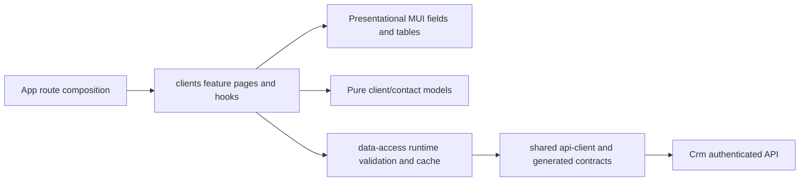

# Клієнти та контакти

**Стан:** клієнти з KeepinCRM, Admin React. Екрани КП, PDF, листів, архіву та індивідуального пошиття від Codex видалено 2026-11-04; нові КП описані в [«КП»](quotes.md). Історія рішень: [CRM-001](../../specs/admin/clients/001-clients-quotes-custom-sewing/README.md).

## Поведінка і маршрути

| Маршрут                    | Призначення                                                                                                                                                                    |
| -------------------------- | ------------------------------------------------------------------------------------------------------------------------------------------------------------------------------ |
| `/crm/clients`             | Переадресація на «Загальні довідники → Контрагенти → Клієнти» ([картка](references/counterparties.md)): клієнти з KeepinCRM, серверний пошук, фільтр активності, URL-пагінація |
| `/crm/clients/new`         | Переадресація на вкладку «Клієнти»; новий клієнт додається кнопкою «Додати клієнта» у боковій панелі (`CustomerCreateDrawer`), з перевіркою схожих, без автозлиття             |
| `/crm/clients/:customerId` | Картка, редагування/деактивація, контакти/канали, primary, source identities, Admin merge                                                                                      |

Backend визначає область власника й права, `canEdit`/`canMerge` керують діями картки. User/anonymous отримують відмову API; помилка доступу не відображає дані. Менеджер створює записи від себе; браузер не задає довірений actor. Однакові назви/email не є глобально унікальними. Об'єднання явне, Admin-only з двома revision і підставою.

При 409 введення зберігається; refresh dirty-форми і вихід потребують явного відхилення. У pending іншої картки `currentData` не дозволяє показати старий кеш. RequestId зберігається для повтору того самого intent, змінюється для нового payload/revision. Кеш оновлює список і конкретні корені, не всі відкриті картки. Контакти/merge не відкриваються поверх незбереженої форми клієнта.

## Structure diagram



## Code structure

```text
apps/admin-react/src/app/router/
  admin-route-definitions.tsx          clients routes (/crm/clients redirects and the card)
```

```text
libs/admin/clients/
  model/src/
    entities/{customers,contacts}/     domain types, one primary type per file
    models/                           editable drafts
    queries/                          page model
    mappers/                          draft factories, KeepinCRM sync text
    validators/                       pure validation
  data-access/src/
    api/customers/                    queries, customer/contact/merge/KeepinCRM sync mutations
    api/                              shared tagged API and builder type
    models/customers/                 write intents and list query
    mappers/customers/                request/response conversion
    validators/customers/             unknown response guards
    cache/customers/                  exact invalidation scope
    errors/                           transport error conversion
  ui/src/
    tables/customers/                 «Клієнти» grid
    forms/{customers,contacts}/       customer, contact and channel fields
    components/contacts/              contact list
  feature/src/
    clients.routes.tsx                lazy public routes
    pages/customers/{detail,reference}/
    components/{customers,contacts,merge,changes}/
    hooks/{customers,contacts,merge}/  scenario orchestration and form state
    hooks/{navigation,requests}/      dirty guard and stable requestId
    errors/                           user-facing error mapping
```

Public imports use `@admin/clients/{model,data-access,ui,feature}`. Generated DTOs stay in data-access; no HTTP in feature/UI, no React/transport in model. The «Клієнти» tab of «Контрагенти» lives here and is hosted by `references/feature`. «КП» reads client names through `@admin/clients/data-access` for its internal name field.

## Tests

Model, data-access, UI and feature tests sit next to their files (`*.unit.test.ts`, `*.component.test.tsx`). Focused runs: `npx nx test admin-clients-model`, `npx nx test admin-clients-data-access`, `npx nx test admin-clients-ui`, `npx nx test admin-clients-feature`.
