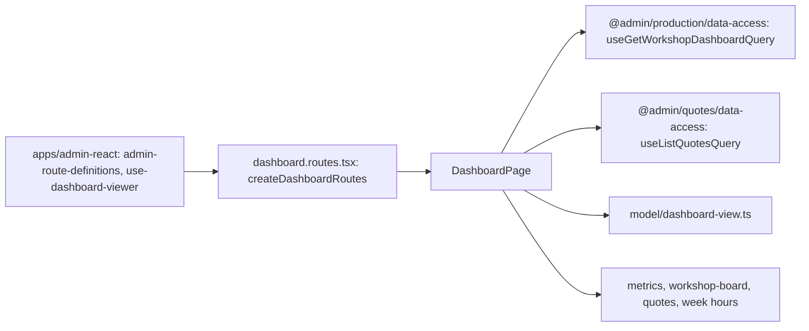

# Admin: Overview page «Огляд виробництва»

**Status:** implementation exists on real data, checked 2026-11-05. SDD: [«Швейний цех» stage 7](../../specs/admin/production/007-workshop-reports/README.md) (PRD-S22).

The root route `/` shows «Огляд виробництва» in the [design system «Цех»](../../standards/admin/design-system.md). For Admin, Manager and the head of the workshop: the metric strip («У цеху», «Прострочено», «Відвантажити»), «Дошка цеху» with the «Нове» orders by the stage of their slowest item (links to the order) from `GET /api/production/dashboard`. For Admin and Manager: «Останні КП» in work (links to the КП) and the buttons «Клієнти», «Новий розрахунок». For the head of the workshop and Admin: «Години цього тижня». The app decides the blocks from the session roles through `useViewer`; the server still refuses what the role may not see. Only problems are marked (late orders). The BreviERP description, privacy and terms are in the sidebar group [«Контент»](content.md).

## Structure diagram



## Code structure

```text
libs/admin/dashboard/feature/src/
├── dashboard.routes.tsx # route `/`, createDashboardRoutes({ useViewer })
├── pages/
│   └── dashboard-page.tsx # page composition by role
├── components/
│   ├── metrics/ # metric strip
│   ├── workshop-board/ # stage columns and order cards
│   ├── quotes/ # latest КП table and status pill
│   └── side-cards/ # hours of this week
└── model/
    ├── dashboard-view.ts # viewer, view models from the API data
    └── numeric-text.ts # mono tabular figures
apps/admin-react/src/app/router/use-dashboard-viewer.ts # blocks by session roles
```

## Tests

- `libs/admin/dashboard/feature/src/pages/dashboard-page.test.tsx`
- `apps/admin-react/src/app/router/app-router.integration.test.tsx` (overview on `/`, profile link)
