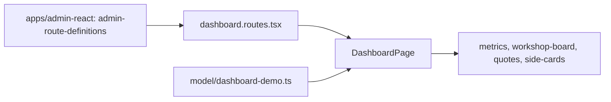

# Admin: Overview page «Цех»

**Status:** implementation exists on demo data, checked 2026-11-01.

The root route `/` shows «Огляд виробництва» in the [design system «Цех»](../../standards/admin/design-system.md): a metric strip, the workshop board by production stage, recent quotes, the workshop cash box, and seamstress load. There is no dashboard API yet, so every value comes from local demo data and the page carries a «Демо-дані» label. «Новий розрахунок», «Клієнти», and «Усі КП» link to real pages. The «Про BreviERP, конфіденційність та умови» link moved from the old start page to the profile menu in the top bar.

## Structure diagram



## Code structure

```text
libs/admin/dashboard/feature/src/
├── dashboard.routes.tsx # route `/`
├── pages/
│   └── dashboard-page.tsx # page composition
├── components/
│   ├── metrics/ # metric strip
│   ├── workshop-board/ # stage columns and order cards
│   ├── quotes/ # recent quotes table and status pill
│   └── side-cards/ # cash box, seamstress load
└── model/
    ├── dashboard-demo.ts # demo data and view models
    └── numeric-text.ts # mono tabular figures
```

**Replacing demo data:** add a `dashboard` data-access library with the real API and pass its data to the same components; keep the «Демо-дані» label only while any block still uses demo values.

## Tests

- `libs/admin/dashboard/feature/src/pages/dashboard-page.test.tsx`
- `apps/admin-react/src/app/router/app-router.integration.test.tsx` (overview on `/`, profile link)

Focused run: `npx nx test admin-dashboard-feature`.
