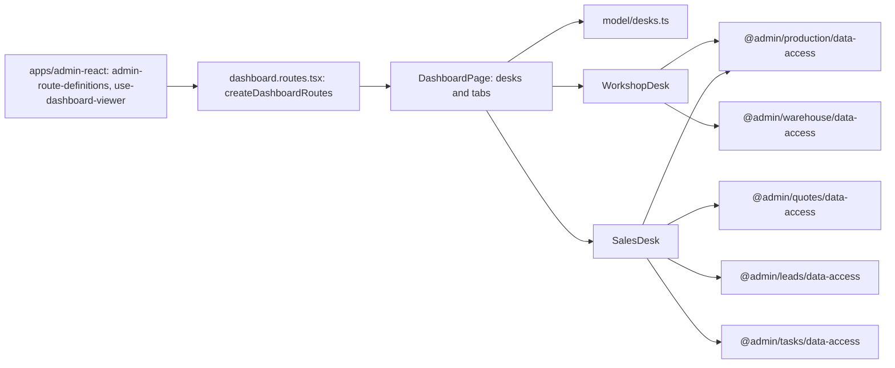

# Admin: «Робочий стіл»

**Status:** all 5 stages implemented 2026-11-11. SDD: [DESK-001](../../specs/admin/dashboard/001-role-desks/README.md); the workshop blocks come from [«Швейний цех» stage 7](../../specs/admin/production/007-workshop-reports/README.md) (PRD-S22).

The root route `/` (the «Робочий стіл» tile at the top of the sidebar) shows the desks of «Права доступу» → «Робочі столи» the person may see, in the [design system «Цех»](../../standards/admin/design-system.md). With «Головне» (`desk-main`: Admin, the director) every other visible desk folds under the main desk; an unfolded desk loads only when open and stays unfolded in this browser (`brevi-admin:desks-open`). Without it one desk opens as it is; several get tabs, and the last chosen tab is kept in this browser. Every block also needs view on its own page; the server still refuses what the role may not see. Only problems are marked.

- **Головне** (`desk-main`: Admin, the director): metrics «Гроші» (`accounting`, balance and the month's difference), «КП за місяць» (`quotes`, `GET /api/crm/quotes/period`, created and sent), «Дзвінки сьогодні» (`lead-stats`), «Цех» (`production-orders`, late marked); «Потребує уваги» lists the problems of every source the person may see (late orders, fabric and hardware shortages, managers' overdue calls, operations to review, purchase invoices with problems, site pages and SEO settings), each linking where it is fixed; «Менеджери сьогодні» joins calls and open leads with КП of the month.
- **Цех** (`desk-workshop`: head of the workshop, Admin): the metric strip («У цеху», «Прострочено», «Відвантажити») and «Дошка цеху» from `GET /api/production/dashboard` (`production-orders`); «Години цього тижня»; «Не вистачає тканини» from «Бронь і що замовити» (`fabric-booking`) and «Фурнітура до замовлення» (`hardware-order`), each at most five lines and only when something is missing.
- **Продажі** (`desk-sales`: Manager, Admin): «Клієнти», «Ціна вишивки», «Новий розрахунок»; metrics «Дзвінки сьогодні», «Мої завдання», «Мої КП», «Замовлення в цеху»; «Черга дзвінків» from «Мій день» (`leads`), «Завдання, що горять» (`tasks`, only overdue or urgent), «Мої КП» (`quotes`, own), «Мої замовлення в цеху» (`production-orders`, `GET /api/production/orders?managerUserId=`, late ones marked). «Мої» is the signed-in person.
- **SEO** (`desk-seo`: Seo, Admin): buttons «Товари сайту», «Статті», «Сторінки сайту», «Бібліотека фото»; from `GET /api/content/seo-overview` (`content-seo-overview`) the problems of «Налаштування SEO сайту», pages on the site per part with the number that miss something, and «Що виправити для пошуку» (at most five pages, first problem marked, link to «SEO-огляд»).
- **Бухгалтерія** (`desk-accounting`: Accountant): «Операції», «Виписки», «Звіти»; from `GET /api/accounting/overview` (current books, this month) the metrics «Залишок» (marked when an account is not confirmed), «Надходження», «Витрати», «Різниця» (marked when negative), «Потребують перевірки» by reason and «Куди пішли гроші» (`accounting`); «Рахунки на закупку з проблемами» from `GET /api/purchasing/invoices?filter=NeedsReview` (`purchase-invoices`). The Accountant has both pages by default (view and edit, owner 2026-11-12); a role without them sees that the director opens them on «Права доступу».

## Structure diagram



## Code structure

```text
libs/admin/dashboard/feature/src/
├── dashboard.routes.tsx # route `/`, createDashboardRoutes({ useViewer })
├── pages/
│   └── dashboard-page.tsx # visible desks, tabs
├── hooks/
│   ├── use-chosen-desk.ts # remembered tab (localStorage `brevi-admin:desk`)
│   └── use-open-desks.ts # desks unfolded under the main desk (`brevi-admin:desks-open`)
├── components/
│   ├── desks/ # main-desk, workshop-desk, sales-desk, seo-desk, accounting-desk
│   ├── desk-list/ # a short block of lines with problem marks or values
│   ├── metrics/ # metric strip
│   ├── workshop-board/ # stage columns and order cards
│   ├── quotes/ # latest КП table and status pill
│   └── side-cards/ # hours of this week
└── model/
    ├── desks.ts # desks, their «Права доступу» pages
    ├── dashboard-view.ts # viewer, view models from the API data
    ├── desk-list.ts # block lines, at most five
    ├── sales-view.ts # manager desk lines and metrics
    ├── seo-view.ts # SEO desk lines and metrics
    ├── accounting-view.ts # accountant desk lines and metrics
    ├── main-view.ts # main desk metrics, «Потребує уваги», managers
    ├── stock-shortages.ts # shortage lines from the warehouse reports
    └── numeric-text.ts # mono tabular figures
apps/admin-react/src/app/slots/dashboard/use-dashboard-viewer.ts # canSee(page) and userId from the session
```

## Tests

- `libs/admin/dashboard/feature/src/pages/dashboard-page.test.tsx`
- `apps/admin-react/src/app/router/app-router.integration.test.tsx` (manager desk on `/`, profile link)
