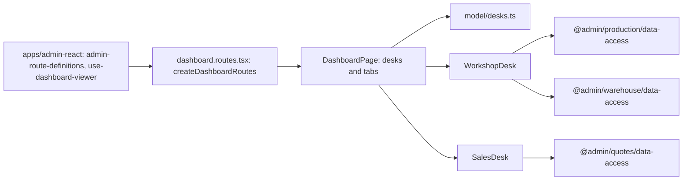

# Admin: «Робочий стіл»

**Status:** stage 1 implemented 2026-11-11. SDD: [DESK-001](../../specs/admin/dashboard/001-role-desks/README.md); the workshop blocks come from [«Швейний цех» stage 7](../../specs/admin/production/007-workshop-reports/README.md) (PRD-S22).

The root route `/` (the «Робочий стіл» tile at the top of the sidebar) shows the desks of «Права доступу» → «Робочі столи» the person may see, in the [design system «Цех»](../../standards/admin/design-system.md). One desk opens as it is; several get tabs, and the last chosen tab is kept in this browser. Every block also needs view on its own page; the server still refuses what the role may not see. Only problems are marked.

- **Цех** (`desk-workshop`: head of the workshop, Admin): the metric strip («У цеху», «Прострочено», «Відвантажити») and «Дошка цеху» from `GET /api/production/dashboard` (`production-orders`); «Години цього тижня»; «Не вистачає тканини» from «Бронь і що замовити» (`fabric-booking`) and «Фурнітура до замовлення» (`hardware-order`), each at most five lines and only when something is missing.
- **Продажі** (`desk-sales`: Manager, Admin; until the manager desk): «Клієнти», «Новий розрахунок», «Останні КП» (`quotes`).

## Structure diagram



## Code structure

```text
libs/admin/dashboard/feature/src/
├── dashboard.routes.tsx # route `/`, createDashboardRoutes({ useViewer })
├── pages/
│   └── dashboard-page.tsx # visible desks, tabs
├── hooks/
│   └── use-chosen-desk.ts # remembered tab (localStorage `brevi-admin:desk`)
├── components/
│   ├── desks/ # workshop-desk, sales-desk
│   ├── metrics/ # metric strip
│   ├── workshop-board/ # stage columns and order cards
│   ├── quotes/ # latest КП table and status pill
│   ├── side-cards/ # hours of this week
│   └── stock/ # fabric shortages, hardware to order
└── model/
    ├── desks.ts # desks, their «Права доступу» pages
    ├── dashboard-view.ts # viewer, view models from the API data
    ├── stock-shortages.ts # shortage lines from the warehouse reports
    └── numeric-text.ts # mono tabular figures
apps/admin-react/src/app/router/use-dashboard-viewer.ts # canSee(page) from the session rights
```

## Tests

- `libs/admin/dashboard/feature/src/pages/dashboard-page.test.tsx`
- `apps/admin-react/src/app/router/app-router.integration.test.tsx` (manager desk on `/`, profile link)
