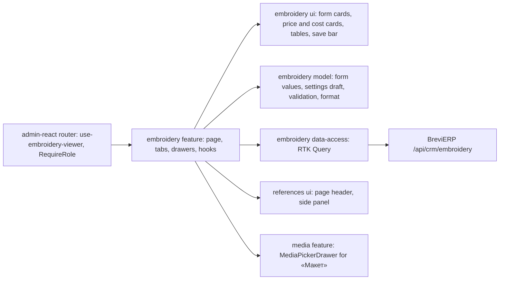

# «Ціна вишивки»: embroidery and chevron price

**State:** stages 1–2 implemented 2026-11-04, stage 4 («Макет», link to production orders) 2026-11-05, Admin React. Specification: [Admin «Ціна вишивки»](../../specs/admin/embroidery/001-embroidery-price/README.md); formulas and rules in BreviERP `docs/sdd/specs/crm/005-embroidery-price/README.md`. Look: [«Цех»](../../standards/admin/design-system.md), variant A.

## Behavior and routes

| Route                          | Purpose                                                                 |
| ------------------------------ | ----------------------------------------------------------------------- |
| `/crm/embroidery`              | «Менеджер сервісу › Ціна вишивки» (Manager or Admin role): «Розрахунок» |
| `/crm/embroidery?tab=saved`    | «Збережені»: saved calculations, search, side panel, «Повторити»        |
| `…?tab=saved&calculation=42`   | Opens «ВШ-0042» in «Збережені» (link from a production order)           |
| `/crm/embroidery?tab=settings` | «Налаштування» (Admin role; the tab is hidden for a Manager)            |

- The form on the left, live prices on the right; the server computes prices 300 ms after the last change, so a Manager never receives rates or cost.
- Director and Admin also see the cost card, «Розшифровка собівартості», material sums and the roll layout.
- «Зберегти розрахунок» stores the priced form with frozen rates and an optional client; «Збережені» lists them, a row opens a read-only side panel with «Повторити розрахунок» (Admin also deletes). «Додати в КП» from that panel appends a row to a chosen КП with one saved price in all three columns.
- «Макет» in the saved side panel picks one photo of the design from «Медіа» (`MediaPickerDrawer`) or clears it; the workshop sees it in the production order, and «Медіа» does not delete a photo in use.
- «Налаштування» is saved whole with a version (409 → «Оновити»); hoops and extra costs open in `ReferenceEditorDrawer`; the stitch rate comes from «Параметри ціноутворення».

## Structure diagram



## Code structure

```text
apps/admin-react/src/app/router/
  use-embroidery-viewer.ts          signed-in user → EmbroideryViewer (Admin edits settings)
  admin-route-definitions.tsx       embroideryRoutes = createEmbroideryRoutes({ useEmbroideryViewer })
  create-admin-router.tsx           /crm/embroidery behind Manager or Admin
  legacy-menu.ts                    «Ціна вишивки»
libs/admin/embroidery/
  model/src/
    entities/                       codes and labels, form setup, calculation, settings, saved
    forms/                          calculation values and request, settings draft and sections
    validators/                     calculation limits, settings rules and counts
    mappers/embroidery-format.ts    money, numbers, minutes, copied price text
  data-access/src/
    api/                            form, calculate (query), settings, saved list/get/save/delete
    mappers/                        contract ↔ model
    validators/                     response shape checks
    errors/                         Ukrainian API messages
  ui/src/
    forms/                          number field, form card
    forms/calculation/              «Що вишиваємо», «Програма», «Як рахувати флізелін», «Додаткові витрати»
    forms/settings/                 «Ставки», «Націнки», «Матеріали», hoop and cost forms
    forms/saved/                    name and client form, «Додати в КП» form
    components/saved/               saved form facts and frozen rates
    components/calculation/         price cards, cost card, roll layout, cost row text
    components/settings/            sticky save bar
    tables/                         cost breakdown, hoops, extra costs, shared settings table, saved list
  feature/src/
    embroidery.routes.tsx           route factory
    pages/embroidery-price-page.tsx header, tabs, keeps both tabs mounted
    components/calculation/         «Розрахунок» layout and copy
    components/settings/            «Налаштування» tab, row side panel, leave dialog
    components/saved/               «Збережені» tab, save panel, saved side panel, «Додати в КП» panel, «Макет»
    hooks/calculation/              form state, debounce, calculate query, copy
    hooks/saved/                    client and КП search for the panels
    hooks/settings/                 settings editor, leave guard
    model/embroidery-viewer.ts      viewer, tab from ?tab=
```

## Tests

- Model: `forms/*.unit.test.ts`, `mappers/embroidery-format.unit.test.ts`. Run `npx nx test admin-embroidery-model`.
- Data access: `mappers/embroidery.mapper.unit.test.ts` (no overrides, Manager without cost, shape check, empty rate vs 0), `mappers/embroidery-saved.mapper.unit.test.ts`. Run `npx nx test admin-embroidery-data-access`.
- UI: number field, price cards, cost row text. Run `npx nx test admin-embroidery-ui`.
- Feature: `pages/embroidery-price-page.component.test.tsx` (Manager calculates without the tab, chevron fields, «Орієнтовна», save with 409 «Оновити», no save with problems, «Зберегти розрахунок», «Збережені», «Повторити» and «Додати в КП»). Run `npx nx test admin-embroidery-feature`.
- Menu and routes: `apps/admin-react/src/app/router/*.test.ts(x)`. Run `npx nx test admin-react -- src/app/router`.
