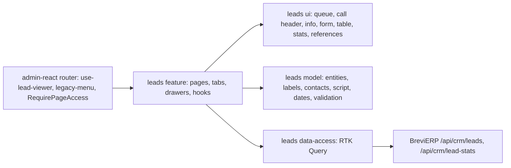

# Leads: «Ліди», «Статистика лідів» and «Заявки з сайту»

**State:** implemented 2026-11-08, Admin React. Backend rules R-* and scenarios SC-* in BreviERP `docs/sdd/specs/crm/006-leads/README.md` (LEAD-001); contract [`crm/leads.openapi.yaml`](../../contracts/openapi/backend/crm/leads.openapi.yaml). Look: [«Цех»](../../standards/admin/design-system.md), concept C «Мій день» chosen by the owner on 2026-11-08.

An AI fills the Google Sheet «Лиды Brevi». BreviERP reads it every weekday morning (the 09:00 sync job) and on «Синхронізувати зараз»; managers take leads, call them and record results here instead of the sheet.

## Behavior and routes

| Route                | Page key        | Default rights             | Purpose                                                       |
| -------------------- | --------------- | -------------------------- | ------------------------------------------------------------- |
| `/crm/leads`         | `leads`         | Admin, Manager: view, edit | «Менеджер сервісу › Ліди»: tabs «Мій день» and «Усі ліди»     |
| `/admin/leads`       | `lead-stats`    | Admin: view, create, edit  | «Адміністрування › Статистика лідів»: «Зведення», «Довідники» |
| `/crm/site-requests` | `site-requests` | Admin, Manager: view, edit | «Менеджер сервісу › Заявки з сайту» (LEAD-002)                |

- «Мій день» (`?lead=<id>` opens one lead): the queue on the left (progress of the day, today's leads with overdue first, «Пізніше», «Набрати вільних» which opens «Усі ліди» on free leads) and one lead on the right: the call button from «Открытый контакт», «Що сказати» built from the signal, the offer and whom to ask, three cells (signal, why 50+ units, what to offer), the rest of the sheet row, the result buttons from «Довідники», a date with quick picks («Завтра», «Через 3 дні», «Через тиждень»), a comment, and «Зберегти → наступний». The history of calls is under the form.
- A result with a next contact makes the server create the task «Подзвонити: …» in «Мої завдання» (R-08); a task with a lead links back to it («Відкрити в «Ліди › Мій день»»).
- «Усі ліди»: search, chips «Вільні / Мої / Усі» with counts (a manager starts on «Вільні»), the server-paged table and the side panel (`ReferenceEditorDrawer`) with «Взяти собі», «Дзвонити зараз» for own leads and «Повернути у вільні» for the owner or Admin (R-04).
- `leads` edit = take and record calls; without it the page is read-only.
- «Зведення» (`lead-stats` view): period chips, metric strip, managers table, call results, industries × categories and the last sync; only a failed sync shows as a problem. «Синхронізувати зараз» needs `lead-stats` create (Director and Admin by default).
- «Заявки з сайту» (BreviERP LEAD-002, contract [`crm/site-requests.openapi.yaml`](../../contracts/openapi/backend/crm/site-requests.openapi.yaml)): what visitors sent from the site form «Заявка». Chips «Нові та в роботі / Мої / Закриті / Усі» with counts, the server-paged table (time, phone, what and how many, a file mark, manager, state; only a failed Telegram send is marked), and the side panel with the phone link, the file, a note and «Беру», «Готово», «Не заявка», «Повернути в нові». Anyone with `site-requests` edit takes a free request; the owner or Admin closes or frees a taken one (R-05). The bot posts each request to the groups ticked «Надсилати сюди заявки з сайту» in «Нагадування › Чати Telegram».
- «Довідники» (`lead-stats` edit): call results (name, what it does, retry days, order, shown to managers) and category descriptions, edited in the side panel.

## Structure diagram



## Code structure

```text
apps/admin-react/src/app/router/
  use-lead-viewer.ts               session → LeadViewer (edit, Admin), LeadStatsViewer (edit, sync), SiteRequestViewer
  admin-route-definitions.tsx      createLeadsRoutes(...) inside RequirePageAccess
  legacy-menu.ts                   «Ліди» (leads), «Заявки з сайту» (site-requests), «Статистика лідів» (lead-stats)
libs/admin/leads/
  model/src/
    entities/lead.ts               lead, call, my day, stats, viewers
    entities/site-request.ts       site request, page, scope, viewer
    forms/                         call form, call result form
    validators/                    call and call result rules
    mappers/                       labels, contacts, script, dates and stats periods; site-request-rules (actions, labels, phone)
  data-access/src/
    api/                           all /api/crm/leads and /api/crm/lead-stats endpoints; site-requests.api.ts
    mappers/                       contract → model, form → input
    errors/                        Ukrainian API messages
  ui/src/
    components/{queue,call,info,contacts,history,status}/ «Мій день» parts, stage pill
    forms/                         call result form, «Довідники» result fields
    tables/leads-table.tsx         server-paged «Усі ліди»
    tables/site-requests-table.tsx server-paged «Заявки з сайту»
    stats/                         metric strip, managers, results, industries, sync card
    references/                    call results and categories lists
  feature/src/
    leads.routes.tsx               route factory: /crm/leads, /admin/leads, /crm/site-requests
    pages/{work,stats,site-requests}/ «Ліди», «Статистика лідів», «Заявки з сайту»
    components/{my-day,all,stats,references,notice,site-requests}/ tabs, side panels, snackbar
    hooks/{my-day,all,stats,references,notice,site-requests}/      page state and actions
```

## Tests

- Model: `mappers/*.unit.test.ts`, `validators/*.unit.test.ts`. Run `npx nx test admin-leads-model`.
- Data access: `mappers/lead.mapper.unit.test.ts`. Run `npx nx test admin-leads-data-access`.
- UI: `forms/lead-call-form.component.test.tsx`, `components/queue/lead-queue.component.test.tsx`. Run `npx nx test admin-leads-ui`.
- Feature: `pages/work/leads-page.component.test.tsx` (lead to call, recording a call, free leads first), `pages/stats/lead-stats-page.component.test.tsx` (stats, sync button by right). Run `npx nx test admin-leads-feature`.
- Menu and routes: `apps/admin-react/src/app/router/*.test.ts(x)`. Run `npx nx test admin-react -- src/app/router`.
