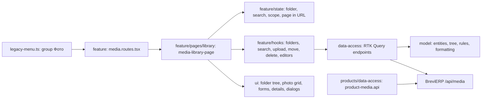

# Admin: photo library «Фото»

**Status:** implementation exists, checked 2026-11-03. [SDD](../../specs/admin/media/001-photo-library/README.md), [consumer contract](../../specs/admin/media/001-photo-library/contracts/api-contract.md).

The sidebar group «Фото» opens `/media` (the old `/references/media` redirects there). The left column is the folder tree with «Усі фото» and photo counts; the right side has the search row, the chips «З підпапками» / «Лише ця папка», and a grid of photo cards with selection and pages of 48. «Завантажити фото» or dropping files anywhere on the page uploads several photos into the open folder (a full-screen drop overlay names the target folder). Results and errors show as toasts in the top right corner: green for success, yellow for warnings, red for errors; they hide by themselves. Grid cards load the small WebP preview (`thumbnailUrl`) and fall back to the original, and show the size in pixels when known. A photo opens in the side panel with its usages and «Редагувати» (name, alt, folder); selected photos can be moved or deleted. The folder menu creates subfolders, renames, moves and deletes empty folders. Data comes from the BreviERP Media API; folders are virtual and never change CDN URLs.

## Structure diagram



## Code structure

```text
libs/admin/media/
  model/src/
    entities/{media-folder,media-file}.ts          # types and backend limits (8 levels, 15 MB, name lengths)
    mappers/media-folder-tree.ts                   # flat list → tree, counts with subfolders, paths, select options
    mappers/format-media.ts                        # size, date, dimensions
    validators/{media-folder,media-file}-validation.ts # same name, depth and upload rules as the backend
  data-access/src/
    api/media-{folders,files}.api.ts               # endpoints; media-base-api.ts adds tags
    mappers/media-{folder,file}.mapper.ts          # runtime-checked response → model
    validators/media-response.ts                   # runtime primitives
    errors/media-api-error.ts                      # 400 field message, 404/409 texts
  ui/src/
    components/folder-tree/                        # tree, row, folder menu
    components/gallery/                            # photo grid, preview with broken-image state
    forms/  details/  dialogs/  feedback/          # folder/photo forms, folder select, details, confirm, upload progress, toasts, drop overlay
  feature/src/
    media.routes.tsx                               # /media and the old /references/media redirect
    pages/library/media-library-page.tsx           # composes the page
    state/media-library-url-state.ts               # ?folder=&q=&sub=0&page=
    hooks/{library,folders,files}/                 # search, selection, toasts, tree state, editors, upload queue, file drop, move, delete
    model/media-upload-summary.ts                  # upload result → toast text and tone
    components/{library,folders,files}/            # folder panel, filters, results, upload button, side panels
    dialogs/media-delete-dialogs.tsx               # photo and folder confirmations
```

The product editor still uses `libs/admin/products/data-access/src/api/product-media.api.ts` (all library pages for its dropdown, upload) until the «Вибрати фото» picker (stage 4).

**Where to look:** [route](../../../libs/admin/media/feature/src/media.routes.tsx), [page](../../../libs/admin/media/feature/src/pages/library/media-library-page.tsx), [tree](../../../libs/admin/media/model/src/mappers/media-folder-tree.ts), [API](../../../libs/admin/media/data-access/src/api/media-files.api.ts).

## Tests

- `libs/admin/media/model/src/mappers/media-folder-tree.test.ts`, `libs/admin/media/model/src/validators/media-validation.test.ts`
- `libs/admin/media/data-access/src/mappers/media-file.mapper.test.ts`
- `libs/admin/media/ui/src/components/folder-tree/media-folder-tree.component.test.tsx`
- `libs/admin/media/ui/src/components/gallery/media-file-preview.component.test.tsx` (preview → original → note)
- `libs/admin/media/feature/src/pages/library/media-library-page.component.test.tsx` (includes drop upload)
- `libs/admin/media/feature/src/hooks/library/use-media-toasts.unit.test.ts`
- `libs/admin/products/data-access/src/products.api.integration.test.ts` (product editor paging and upload)
- E2E (run only on request): `apps/admin-react-e2e/src/media.spec.ts`

Focused run: `npx nx run-many -t test -p admin-media-model admin-media-data-access admin-media-ui admin-media-feature`.
