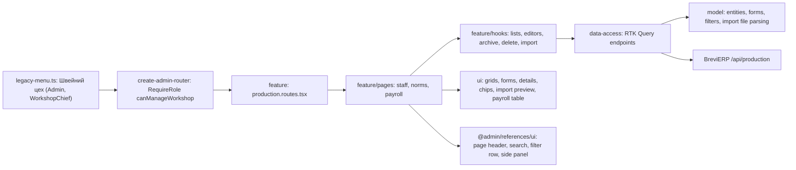

# Admin: «Швейний цех», stage 1

**Status:** implementation exists, checked 2026-11-04. [SDD](../../specs/admin/production/001-workshop-references/README.md), [consumer contract](../../specs/admin/production/001-workshop-references/contracts/api-contract.md).

The sidebar group «Швейний цех» gets three pages for the head of the workshop (role `WorkshopChief`), Admin and the director; the other items of the group stay placeholders for later stages. «Працівники цеху» (`/production/staff`) is the list of workers: they do not sign in, the head of the workshop records their work. Chips switch «Працюють» / «Архів» and filter by position; a worker who left goes «В архів» instead of being deleted. «Норми витрати тканини» (`/production/fabric-norms`) shows every sewing model of «Товари» with its fabric per item in metres (one, two or three colours); only problems get a mark. Both lists have «Імпорт» of the transfer JSON with a server preview first. «Правила зарплати» (`/production/payroll-rules`) shows the payroll coefficients read from «Параметри ціноутворення», with a link there.

## Structure diagram



## Code structure

```text
libs/admin/production/
  model/src/
    entities/                     # worker, fabric norm row and values, import result, payroll parameter
    forms/                        # worker and norm form values, validation (comma as decimal point), totals
    queries/                      # list filters and chip counts
    validators/production-import-file.ts # reads workshop-staff.json and fabric-norms.json
    mappers/format-production.ts  # metres, parameter values, dates
  data-access/src/
    api/{workshop-staff,fabric-norms,payroll-parameters}.api.ts # endpoints; production-base-api.ts adds tags
    mappers/                      # runtime-checked response → model
    validators/production-response.ts
    errors/production-api-error.ts
  ui/src/
    staff/  norms/  payroll/  import/  dialogs/
  feature/src/
    production.routes.tsx         # three routes; the app wraps them in RequireRole
    pages/{staff,norms,payroll}/
    hooks/{staff,norms,import,payroll}/
    components/{staff,norms,import}/ # side panels
apps/admin-react/src/app/router/  # legacy-menu.ts items, create-admin-router.tsx guard
libs/admin/core/auth/src/session/session-user.ts # WorkshopChief, canManageWorkshop
```

## Tests

- `libs/admin/production/model/src/forms/production-forms.test.ts`, `libs/admin/production/model/src/validators/production-import-file.test.ts`
- `libs/admin/production/data-access/src/mappers/production-mappers.test.ts`
- `libs/admin/production/ui/src/payroll/payroll-parameters-table.component.test.tsx`
- `libs/admin/production/feature/src/pages/staff/workshop-staff-page.component.test.tsx`, `libs/admin/production/feature/src/pages/norms/fabric-norms-page.component.test.tsx`
- `apps/admin-react/src/app/router/navigation-config.unit.test.ts` (who sees the items)

Focused run: `npx nx run-many -t test -p admin-production-model admin-production-data-access admin-production-ui admin-production-feature`.
