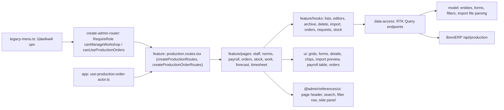

# Admin: «Швейний цех»

**Status:** implementation exists, checked 2026-11-05. SDD: [stage 1](../../specs/admin/production/001-workshop-references/README.md) ([consumer contract](../../specs/admin/production/001-workshop-references/contracts/api-contract.md)), [stage 2 «Виробничі завдання»](../../specs/admin/production/002-production-orders/README.md), [stage 3 stages, shipments, files, Telegram](../../specs/admin/production/003-order-tracking/README.md), [stage 4 «Склад тканин»](../../specs/admin/production/004-fabric-stock/README.md), [stage 5 «Журнал робіт» and «Прогноз пошиття»](../../specs/admin/production/005-work-log/README.md), [stage 6 «Робочий час» and «Зарплата»](../../specs/admin/production/006-timesheet-payroll/README.md).

The sidebar group «Швейний цех» gets three reference pages for the head of the workshop (role `WorkshopChief`), Admin and the director; the other items of the group without a page stay placeholders for later stages. «Працівники цеху» (`/production/staff`) is the list of workers: they do not sign in, the head of the workshop records their work. Chips switch «Працюють» / «Архів» and filter by position; a worker who left goes «В архів» instead of being deleted. «Норми витрати тканини» (`/production/fabric-norms`) shows every sewing model of «Товари» with its fabric per item in metres (one, two or three colours); only problems get a mark. Both lists have «Імпорт» of the transfer JSON with a server preview first. «Правила зарплати» (`/production/payroll-rules`) shows the payroll coefficients read from «Параметри ціноутворення», with a link there.

«Виробничі завдання» (`/production/orders`, Admin, Manager and the head of the workshop) is what the workshop sews. A manager makes an order from a sent КП at `/production/orders/new`: for each sewing item they pick the fabric and fill in quantity, «Готово до», colours, sizes, technical changes, comment and applications, and see the planned fabric. The list has search, status chips, «Прострочені», a manager filter, «Експорт» to CSV and, for Admin, «Імпорт» of the old orders. The card `/production/orders/:id` has «Опис» and «Історія змін», edit in side panels, «Копіювати», «Друк» and, for Admin, «Видалити». Who sees «Розцінка пошиття» and the КП price comes from the server's `permissions`.

An embroidery can point to a saved «Ціна вишивки» calculation («Розрахунок вишивки», searched by name, client or «ВШ-0042»); the КП «Вишивка» rows are put into every item of a new order, and the manager removes what does not apply. The item card then shows the number, stitches, hoop, hoopings, флізелін and fabric metres and the mockup, without prices; a manager or Admin opens the calculation, a removed one stays as its number. Materials are shown only; the stock does not change.

After «Передати в цех» every item shows its «Етапи» (the head of the workshop and Admin tick them; the furthest colours the item) and «Відвантаження» («Відвантажити» side panel, cancel with ×). The header gets «Закрити» when everything is shipped, «Скасувати» with a reason and, for Admin, «Повернути в роботу». Files of the order and of each item are uploaded to the CDN with their kind; old ones are Google Drive links. The Telegram block sends the one message to the workshop group and shows a failure with its reason. The list has an «Етап» column and filter and, for Admin, «Імпорт етапів». «Налаштування цеху» (`/production/settings`) picks the Brevi bot's group and topic.

«Склад тканин» (`/production/fabric-stock`, the same people as «Виробничі завдання») shows each fabric and colour with its balance, the reservation of «Нове» orders and what is available; the value in UAH only for Admin and the head of the workshop. A row opens its card with the reservation and every movement. The head of the workshop and Admin record «Прихід» (supplier from the server's `choices`), «Початковий залишок», «Коригування» with a reason and «Сторно». Every item of an order card has «Тканина»: the plan by colour, what issues covered and «Видати тканину» (planned, replacement and extra lines) or «Сторно видачі». The page also has «Зведення витрати» for a period, «Excel» and, for Admin, «Імпорт» of the old stock.

«Журнал робіт» (`/production/work`, the head of the workshop and Admin) lists the work of a month by worker and order: who sewed or cut how many pieces of which item, at which rate. «Додати роботу» records it; within the plan the item's quantity is the limit, more goes as «понад план» with a reason. A wrong record is cancelled by «Сторно» with a reason and stays crossed out. The same «Робота» section is on every item of an order card for those who see the sewing rate. Admin also has «Імпорт» of the old log. «Прогноз пошиття» (`/production/forecast`, the same people as «Виробничі завдання») shows the «Нове» orders in the order they are sewn with the approximate end of sewing from «Параметри ціноутворення»; the head of the workshop and Admin move orders up or down; only problems are marked.

«Робочий час» (`/production/timesheet`, the head of the workshop and Admin) marks the hours of each worker per day in steps of 0,25 with quick 8 / 0 buttons, keeps the history of changes and shows the month by day and by worker. «Зарплата» (`/production/payroll`, the same people) shows a month: master and chief, embroidery, what each worker earned (sewing, cutting, bonus, shares, embroidery, other), was paid and is due, a worker's detail in a side panel and «Excel»; Admin adds payments and adjustments, cancels them with a reason, types «Видано», closes and reopens the month. «Історія за рік» sums the months. All shares come from «Параметри ціноутворення»; only problems are marked.

## Structure diagram



## Code structure

```text
libs/admin/production/
  model/src/
    entities/                     # worker, fabric norm, import result, payroll parameter, production order, tracking (stages, files, Telegram, settings), fabric stock, work, sewing forecast, timesheet, payroll
    forms/                        # worker, norm, order item and order forms, shipment and cancel reason, workshop settings, receipt, correction, issue, work (and months), timesheet hours, payment and adjustment
    queries/                      # list filters, chip counts, orders, stock and payroll CSV
    validators/                   # reads workshop-staff.json, fabric-norms.json, production-orders.json, production-progress.json, fabric-stock.json, production-work.json
    mappers/format-production.ts  # metres, parameter values, dates
    mappers/format-application.ts # application text, linked embroidery details and link
  data-access/src/
    api/{workshop-staff,fabric-norms,payroll-parameters,production-orders,production-tracking,workshop-settings,fabric-stock,production-work,payroll}.api.ts # endpoints; production-base-api.ts adds tags
    mappers/                      # runtime-checked response → model
    validators/production-response.ts
    errors/production-api-error.ts
  ui/src/
    staff/  norms/  payroll/  import/  dialogs/
    orders/                       # grid, chips, status, item form and card, applications with «Розрахунок вишивки», embroidery block, history, КП list, print sheet
    tracking/                     # stage pill and toggles, shipments, files, Telegram block, shipment form
    settings/                     # workshop settings form
    stock/                        # stock grid and chips, line details, movements, receipt and correction forms, consumption, item «Тканина», issue form
    work/                         # work records table, «Додати роботу» form, item «Робота»
    forecast/                     # forecast queue table with problem marks and up/down
    timesheet/                    # day table, month summary, change history
    payroll/                      # parameters table; month table with «Видано», payments and adjustments, worker detail, year, roles/embroidery and entry forms
  feature/src/
    production.routes.tsx         # createProductionRoutes (workshop) and createProductionOrderRoutes; the app wraps them in RequireRole
    pages/{staff,norms,payroll}/
    pages/orders/                 # list, create from КП, card
    pages/settings/               # «Налаштування цеху»
    pages/stock/                  # «Склад тканин»
    pages/work/                   # «Журнал робіт»
    pages/forecast/               # «Прогноз пошиття»
    pages/timesheet/              # «Робочий час»
    pages/payroll/                # «Правила зарплати», «Зарплата»
    hooks/{staff,norms,import,payroll}/
    hooks/orders/                 # list, export, create, card, editor, copy and delete, «Розрахунок вишивки» search
    hooks/requests/               # debounce, request id against duplicates
    hooks/tracking/               # stages and shipments, close/cancel/reopen
    hooks/files/  hooks/telegram/  hooks/settings/
    hooks/stock/                  # stock list, receipt, correction, issue, «Сторно» reason (also used for work)
    hooks/work/                   # «Додати роботу» editor
    hooks/timesheet/              # a day: typed hours, changes, save
    hooks/payroll/                # payment and adjustment editors, month actions («Видано», cancel, close, reopen)
    components/{staff,norms,import}/ # side panels
    components/orders/            # header and item side panels, header actions, КП item line, order summary
    components/tracking/          # item work (stages, shipments, work, fabric, files), order work (files, Telegram), shipment side panel
    components/stock/             # line card, receipt, correction, consumption and issue side panels, item «Тканина»
    components/work/              # «Додати роботу» side panel, «Сторно» dialog, item «Робота»
    components/payroll/           # month view, roles and embroidery, payment / adjustment / worker side panels
apps/admin-react/src/app/router/  # legacy-menu.ts items, create-admin-router.tsx guards, use-production-order-actor.ts
libs/admin/core/auth/src/session/session-user.ts # WorkshopChief, canManageWorkshop
```

## Tests

- `libs/admin/production/model/src/forms/production-forms.test.ts`, `libs/admin/production/model/src/forms/production-order-forms.test.ts`, `libs/admin/production/model/src/validators/production-import-file.test.ts`, `libs/admin/production/model/src/forms/fabric-stock-forms.test.ts`, `libs/admin/production/model/src/forms/production-work-form.test.ts`, `libs/admin/production/model/src/forms/timesheet-form.test.ts`, `libs/admin/production/model/src/forms/payroll-forms.test.ts`
- `libs/admin/production/data-access/src/mappers/production-mappers.test.ts`, `libs/admin/production/data-access/src/mappers/production-order.mapper.test.ts`, `libs/admin/production/data-access/src/mappers/production-tracking.mapper.test.ts`, `libs/admin/production/data-access/src/mappers/fabric-stock.mapper.test.ts`, `libs/admin/production/data-access/src/mappers/production-work.mapper.test.ts`, `libs/admin/production/data-access/src/mappers/payroll.mapper.test.ts`
- `libs/admin/production/ui/src/payroll/payroll-parameters-table.component.test.tsx`, `libs/admin/production/ui/src/forecast/sewing-forecast-table.component.test.tsx`, `libs/admin/production/ui/src/timesheet/timesheet-day-table.component.test.tsx`, `libs/admin/production/ui/src/payroll/payroll-month-table.component.test.tsx`
- `libs/admin/production/feature/src/pages/staff/workshop-staff-page.component.test.tsx`, `libs/admin/production/feature/src/pages/norms/fabric-norms-page.component.test.tsx`
- `libs/admin/production/feature/src/pages/orders/production-order-create-page.component.test.tsx`, `libs/admin/production/feature/src/pages/orders/production-order-page.component.test.tsx`
- `apps/admin-react/src/app/router/navigation-config.unit.test.ts` (who sees the items)

Focused run: `npx nx run-many -t test -p admin-production-model admin-production-data-access admin-production-ui admin-production-feature`.
