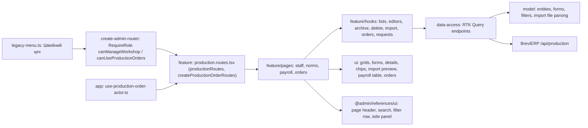

# Admin: «Швейний цех»

**Status:** implementation exists, checked 2026-11-04. SDD: [stage 1](../../specs/admin/production/001-workshop-references/README.md) ([consumer contract](../../specs/admin/production/001-workshop-references/contracts/api-contract.md)), [stage 2 «Виробничі завдання»](../../specs/admin/production/002-production-orders/README.md), [stage 3 stages, shipments, files, Telegram](../../specs/admin/production/003-order-tracking/README.md).

The sidebar group «Швейний цех» gets three pages for the head of the workshop (role `WorkshopChief`), Admin and the director; the other items of the group stay placeholders for later stages. «Працівники цеху» (`/production/staff`) is the list of workers: they do not sign in, the head of the workshop records their work. Chips switch «Працюють» / «Архів» and filter by position; a worker who left goes «В архів» instead of being deleted. «Норми витрати тканини» (`/production/fabric-norms`) shows every sewing model of «Товари» with its fabric per item in metres (one, two or three colours); only problems get a mark. Both lists have «Імпорт» of the transfer JSON with a server preview first. «Правила зарплати» (`/production/payroll-rules`) shows the payroll coefficients read from «Параметри ціноутворення», with a link there.

«Виробничі завдання» (`/production/orders`, Admin, Manager and the head of the workshop) is what the workshop sews. A manager makes an order from a sent КП at `/production/orders/new`: for each sewing item they pick the fabric and fill in quantity, «Готово до», colours, sizes, technical changes, comment and applications, and see the planned fabric. The list has search, status chips, «Прострочені», a manager filter, «Експорт» to CSV and, for Admin, «Імпорт» of the old orders. The card `/production/orders/:id` has «Опис» and «Історія змін», edit in side panels, «Копіювати», «Друк» and, for Admin, «Видалити». Who sees «Розцінка пошиття» and the КП price comes from the server's `permissions`.

After «Передати в цех» every item shows its «Етапи» (the head of the workshop and Admin tick them; the furthest colours the item) and «Відвантаження» («Відвантажити» side panel, cancel with ×). The header gets «Закрити» when everything is shipped, «Скасувати» with a reason and, for Admin, «Повернути в роботу». Files of the order and of each item are uploaded to the CDN with their kind; old ones are Google Drive links. The Telegram block sends the one message to the workshop group and shows a failure with its reason. The list has an «Етап» column and filter and, for Admin, «Імпорт етапів». «Налаштування цеху» (`/production/settings`) picks the Brevi bot's group and topic.

## Structure diagram



## Code structure

```text
libs/admin/production/
  model/src/
    entities/                     # worker, fabric norm, import result, payroll parameter, production order, tracking (stages, files, Telegram, settings)
    forms/                        # worker, norm, order item and order forms, shipment and cancel reason, workshop settings
    queries/                      # list filters, chip counts, orders CSV
    validators/                   # reads workshop-staff.json, fabric-norms.json, production-orders.json, production-progress.json
    mappers/format-production.ts  # metres, parameter values, dates
  data-access/src/
    api/{workshop-staff,fabric-norms,payroll-parameters,production-orders,production-tracking,workshop-settings}.api.ts # endpoints; production-base-api.ts adds tags
    mappers/                      # runtime-checked response → model
    validators/production-response.ts
    errors/production-api-error.ts
  ui/src/
    staff/  norms/  payroll/  import/  dialogs/
    orders/                       # grid, chips, status, item form and card, history, КП list, print sheet
    tracking/                     # stage pill and toggles, shipments, files, Telegram block, shipment form
    settings/                     # workshop settings form
  feature/src/
    production.routes.tsx         # workshop routes and createProductionOrderRoutes; the app wraps them in RequireRole
    pages/{staff,norms,payroll}/
    pages/orders/                 # list, create from КП, card
    pages/settings/               # «Налаштування цеху»
    hooks/{staff,norms,import,payroll}/
    hooks/orders/                 # list, export, create, card, editor, copy and delete
    hooks/requests/               # debounce, request id against duplicates
    hooks/tracking/               # stages and shipments, close/cancel/reopen
    hooks/files/  hooks/telegram/  hooks/settings/
    components/{staff,norms,import}/ # side panels
    components/orders/            # header and item side panels, header actions, КП item line, order summary
    components/tracking/          # item work (stages, shipments, files), order work (files, Telegram), shipment side panel
apps/admin-react/src/app/router/  # legacy-menu.ts items, create-admin-router.tsx guards, use-production-order-actor.ts
libs/admin/core/auth/src/session/session-user.ts # WorkshopChief, canManageWorkshop
```

## Tests

- `libs/admin/production/model/src/forms/production-forms.test.ts`, `libs/admin/production/model/src/forms/production-order-forms.test.ts`, `libs/admin/production/model/src/validators/production-import-file.test.ts`
- `libs/admin/production/data-access/src/mappers/production-mappers.test.ts`, `libs/admin/production/data-access/src/mappers/production-order.mapper.test.ts`, `libs/admin/production/data-access/src/mappers/production-tracking.mapper.test.ts`
- `libs/admin/production/ui/src/payroll/payroll-parameters-table.component.test.tsx`
- `libs/admin/production/feature/src/pages/staff/workshop-staff-page.component.test.tsx`, `libs/admin/production/feature/src/pages/norms/fabric-norms-page.component.test.tsx`
- `libs/admin/production/feature/src/pages/orders/production-order-create-page.component.test.tsx`, `libs/admin/production/feature/src/pages/orders/production-order-page.component.test.tsx`
- `apps/admin-react/src/app/router/navigation-config.unit.test.ts` (who sees the items)

Focused run: `npx nx run-many -t test -p admin-production-model admin-production-data-access admin-production-ui admin-production-feature`.
