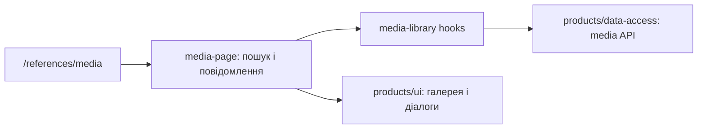

# Admin: медіатека товарів

**Стан:** сторінка і API-код наявні, звірено 2026-10-16.

`/references/media` відкриває галерею з пошуком за назвою, завантаженням і видаленням фото. Сторінка зберігає локальний пошук і повідомлення про дії; hooks `media-library` виконують запити, `products/ui` показує галерею та діалоги, `products/data-access` працює з media endpoints. Вона належить продуктовому домену, але має окремий маршрут і сценарій.

## Схема будови



## Структура в коді

```text
libs/admin/products/
├── data-access/src/api/
│   └── product-media.api.ts # API
├── feature/src/
│   ├── hooks/media-library/
│   │   ├── use-media-deletion.ts # видалення
│   │   ├── use-media-library.ts # hook завантаження
│   │   └── use-media-upload.ts # завантаження
│   ├── pages/media-library/
│   │   └── media-page.tsx # сторінка
│   └── products.routes.tsx # маршрут
├── model/src/product-media/
│   └── product-media.ts # модель медіа
└── ui/src/media/
    └── media-gallery.tsx # галерея
```

**Де шукати:** [маршрут](../../../../libs/admin/products/feature/src/products.routes.tsx), [сторінка](../../../../libs/admin/products/feature/src/pages/media-library/media-page.tsx), [hook завантаження](../../../../libs/admin/products/feature/src/hooks/media-library/use-media-library.ts), [API](../../../../libs/admin/products/data-access/src/api/product-media.api.ts).
