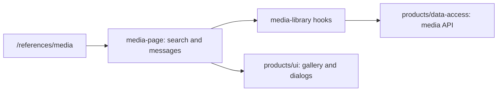

# Admin: Product Media Library

**Status:** page and API code exist, checked 2026-10-16.

`/references/media` opens a gallery with name search, photo upload, and
deletion. The page keeps local search and action messages; `media-library`
hooks make requests, `products/ui` displays the gallery and dialogs, and
`products/data-access` handles media endpoints. It belongs to the products
domain but has a separate route and scenario.

## Structure diagram



## Code structure

```text
libs/admin/products/
├── data-access/src/api/
│   └── product-media.api.ts # API
├── feature/src/
│   ├── hooks/media-library/
│   │   ├── use-media-deletion.ts # deletion
│   │   ├── use-media-library.ts # loading hook
│   │   └── use-media-upload.ts # upload
│   ├── pages/media-library/
│   │   └── media-page.tsx # page
│   └── products.routes.tsx # route
├── model/src/product-media/
│   └── product-media.ts # media model
└── ui/src/media/
    └── media-gallery.tsx # gallery
```

**Where to look:** [route](../../../../libs/admin/products/feature/src/products.routes.tsx), [page](../../../../libs/admin/products/feature/src/pages/media-library/media-page.tsx), [loading hook](../../../../libs/admin/products/feature/src/hooks/media-library/use-media-library.ts), [API](../../../../libs/admin/products/data-access/src/api/product-media.api.ts).

## Tests

- `libs/admin/products/feature/src/pages/media-library/media-page.component.test.tsx`
- `libs/admin/products/model/src/product-media/product-photos.test.ts`
- E2E (run only on request): `apps/admin-react-e2e/src/media.spec.ts`

Focused run: `npx nx test admin-products-feature -- media-library`; `npx nx test admin-products-model -- product-photos`.
