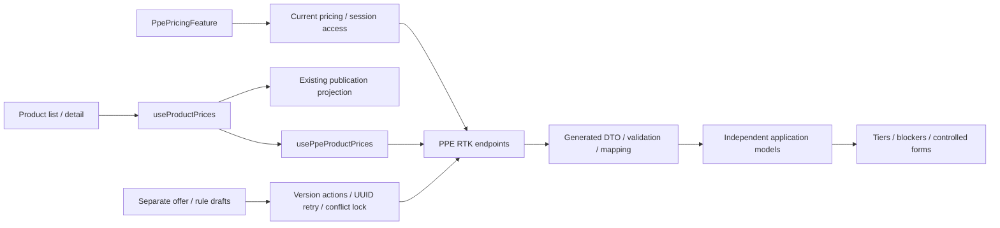

# Admin: PPE pricing

TS-006 consumes Brevi-owned rule/offer versions. A Product card shows server-calculated retail, wholesale and large-wholesale prices, or actionable blockers. Source review and Brevi approval are separate. Managers explicitly save/approve offer and rule values; rule edits warn that the rule is shared. No approval or price arithmetic runs automatically in the client.

Product list/detail load PPE IDs through one bounded batch query. Enrolled PPE never falls back to legacy prices during blocked/loading/error states. Non-enrolled PPE is blocked until explicit onboarding; old metadata amounts never supply current prices. Sewing still selects its published Article prices through its own batch. There is no new route, store, theme, runtime Sheet/XML call or quote behavior.

## Structure diagram



## Code structure

```text
libs/admin/products/
  model/src/
    entities/ppe-pricing/                 # one model per file: values, tiers, versions, Product price
    queries/ppe-pricing/                  # authoritative wholesale/status selection; no formula
    forms/ppe-pricing/                    # string markup drafts, preserving blank versus zero
    validators/ppe-pricing/               # explicit form input validation, no price arithmetic
  data-access/src/
    contracts/ppe-pricing/                # private generated operation aliases
    validators/pricing/                  # consumed scalar primitives shared with Sewing
    validators/ppe-pricing/               # readiness, approval, identity and scope checks
    mappers/ppe-pricing/                  # explicit independent models, no transport actor fields
    api/ppe-pricing/                      # Product batch / offer / rule endpoints and errors
  feature/src/
    hooks/pricing/use-product-prices.ts    # combines separate Sewing and PPE projections
    hooks/ppe-pricing/                   # Product batch / typed mutation adapter / request lifecycle
    model/pricing/                       # shared safe error presentation
    components/product-detail/product-current-pricing.tsx # detail pricing status / PPE onboarding boundary
    components/ppe-pricing/
      ppe-pricing-feature.tsx             # read/access/loading/error orchestration
      ppe-pricing-inputs-editor.tsx       # shared write status and child identity
      ppe-offer-version-editor.tsx        # offer draft/provenance, keyed only by offer version
      ppe-rule-version-editor.tsx         # rule draft/provenance, keyed only by rule version
  ui/src/
    components/ppe-pricing/               # panel, three tier values, actionable blockers
    forms/ppe-pricing/                    # separate controlled offer and rule forms
    product-detail/product-wholesale-price-label.ts # explicit PPE/Sewing states
```

An unchanged failed request retains its UUID; edited content gets another UUID. Conflicts lock writes until explicit reload. Each editor survives refreshes of the other resource, preserving unsaved drafts. During background reads its controls are disabled; old prices are hidden. Readers and stale/error permission reads have no write controls; backend policies remain authoritative.

[SDD](../../../specs/admin/products/007-ppe-pricing/README.md) · [Contract pin](../../../specs/admin/products/007-ppe-pricing/contracts/api-contract.md) · [Evidence](../../../specs/admin/products/007-ppe-pricing/verification.md) · [Scoped audit](../../../specs/admin/products/007-ppe-pricing/code-audit/audit.md).

[Structural audit follow-up](../../../specs/admin/products/007-ppe-pricing/code-audit/audit.md) separates typed mutations from UUID/retry/conflict state.

[TS-007 cutover](../../../specs/admin/products/007-ppe-pricing/cutover/README.md) removes old price views and percent controls; initial cost can only prefill an unapproved draft.
