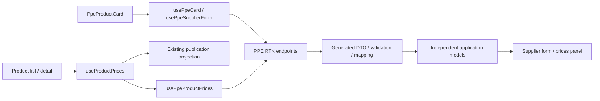

# Admin: PPE pricing

TS-006 consumes Brevi-owned rule/offer versions. Since [spec 010](../../../specs/admin/products/010-ppe-product-card/README.md) the PPE card edits the sheet «ЗІЗ» supplier fields (`GET`/`PUT /api/v1/products/{id}/ppe-offer`); a changed supplier price or rule makes the backend append an approved offer version. Rules are edited only in «Параметри ціноутворення». The card shows server-calculated retail, wholesale and large-wholesale prices, or the sheet reasons. No price arithmetic runs in the client.

Product list/detail load PPE IDs through one bounded batch query. Enrolled PPE never falls back to legacy prices during blocked/loading/error states. Non-enrolled PPE is blocked until explicit onboarding; old metadata amounts never supply current prices. Sewing still selects its published Article prices through its own batch. There is no new route, store, theme, runtime Sheet/XML call or quote behavior.

## Structure diagram



## Code structure

```text
libs/admin/products/
  model/src/
    entities/ppe-pricing/                 # one model per file: values, tiers, versions, Product price
    queries/ppe-pricing/                  # authoritative wholesale/status selection; no formula
    forms/ppe-pricing/                    # string markup drafts, preserving blank versus zero
    validators/ppe-pricing/               # explicit form input validation, no price arithmetic
  data-access/src/
    contracts/ppe-pricing/                # private generated operation aliases
    validators/pricing/                  # consumed scalar primitives shared with Sewing
    validators/ppe-pricing/               # readiness, approval, identity and scope checks
    mappers/ppe-pricing/                  # explicit independent models, no transport actor fields
    api/ppe-pricing/                      # Product batch / offer / rule endpoints and errors
  feature/src/
    hooks/pricing/use-product-prices.ts    # combines separate Sewing and PPE projections
    hooks/ppe-pricing/use-ppe-product-prices.ts # Product batch
    hooks/ppe-card/                       # card data and supplier form state
    components/ppe-card/                  # PPE card and its metric strip
  ui/src/
    components/ppe-card/                  # supplier form, prices panel
    product-detail/product-wholesale-price-label.ts # explicit PPE/Sewing states
```

The save sends the current offer version; a newer version returns 409 and the card asks to reload. Readers see the form disabled.

[SDD](../../../specs/admin/products/007-ppe-pricing/README.md) · [Contract pin](../../../specs/admin/products/007-ppe-pricing/contracts/api-contract.md) · [Evidence](../../../specs/admin/products/007-ppe-pricing/verification.md) · [Scoped audit](../../../specs/admin/products/007-ppe-pricing/code-audit/audit.md).

[Structural audit follow-up](../../../specs/admin/products/007-ppe-pricing/code-audit/audit.md) separates typed mutations from UUID/retry/conflict state.

[TS-007 cutover](../../../specs/admin/products/007-ppe-pricing/cutover/README.md) removes old price views and percent controls; initial cost can only prefill an unapproved draft.

## Tests

- `libs/admin/products/data-access/src/`: `api/ppe-pricing/`, `mappers/ppe-pricing/`
- `libs/admin/products/feature/src/`: `components/ppe-card/`, `hooks/ppe-pricing/`
- `libs/admin/products/model/src/`: `queries/ppe-pricing/`, `validators/ppe-pricing/`, `queries/ppe-card/`
- `libs/admin/products/data-access/src/mappers/ppe-card/`
- `libs/admin/products/ui/src/product-editor/ppe/`

Focused run: `npx nx test admin-products-data-access -- ppe`; `npx nx test admin-products-feature -- ppe`; `npx nx test admin-products-model -- ppe`; `npx nx test admin-products-ui -- ppe`.
