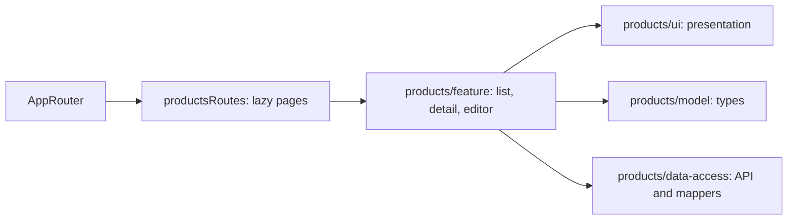

# Admin: Products

**Status:** routes and pages implemented, checked 2026-10-16.

`/references/products` is the «Товари» page ([spec 008](../../../specs/admin/products/008-products-page/README.md)): tabs «Швейна продукція» (one row per model) and «ЗІЗ» (`?tab=ppe`), section chips, search, a drawer for code, section, season, active, «Перевірено», the current site link and the quote description, and bulk deletion. Site texts, SEO and photos are not shown there; they go to the planned «Контент сайту» module. `/create`, `/:id`, and `/:id/edit` open create, detail, and edit
pages. For a sewing model `/:id` is the «Цех» card ([spec 009](../../../specs/admin/products/009-sewing-product-card/README.md)): header, metrics and tabs «Артикули», «Комплектація», «Трудовитрати», «Ціни» (`?tab=`); A PPE product's `/:id` is the PPE card ([spec 010](../../../specs/admin/products/010-ppe-product-card/README.md)): supplier fields of the sheet tab «ЗІЗ» and the three prices. `products/feature` owns scenarios, local state, and loading/error/empty
handling; `products/ui` provides presentation; `products/model` provides domain
models; and `products/data-access` provides API endpoints, mappers, and
response validation. The route file lazy-loads pages; `AppRouter` imports only
`productsRoutes`.

Saved Sewing Products also expose the [Article and composition editor](sewing-composition.md) through a separate API/draft boundary. Base Product saves preserve the new records; PPE pricing uses its separate versioned input workflow.

[Article pricing](sewing-pricing.md) adds explicit calculation/publication beside the selected Article. Product cards/lists display published Sewing wholesale prices through one bounded page projection, with loading/error/unpublished states and no legacy price fallback. PPE uses only its current versioned pricing endpoint.

## Structure diagram



## Code structure

```text
libs/admin/products/
├── data-access/src/
│   ├── api/
│   │   └── products.api.ts # API
│   │   └── product-overview/product-overview.api.ts # «Товари» page API
│   └── mappers/
│       └── product.mapper.ts # mapper
├── feature/src/
│   ├── components/product-editor/
│   │   └── product-editor.tsx # editor
│   ├── components/sewing-card/
│   │   └── sewing-product-card.tsx # sewing model card
│   ├── components/ppe-card/
│   │   └── ppe-product-card.tsx # PPE card
│   ├── pages/
│   │   ├── product-detail/
│   │   │   └── product-detail-page.tsx # details
│   │   ├── product-editor/
│   │   │   └── product-create-page.tsx # creation
│   │   └── product-list/
│   │       ├── products-page.tsx # «Товари» tabs
│   │       └── product-overview-content.tsx # one table with chips and drawer
│   └── products.routes.tsx # routes
├── model/src/product-editor/
│   └── product-draft.ts # draft
└── ui/src/product-editor/core/
    └── product-base-fields.tsx # form fields
```

**Where to look:** [routes](../../../../libs/admin/products/feature/src/products.routes.tsx), [list page](../../../../libs/admin/products/feature/src/pages/product-list/products-page.tsx), [editor](../../../../libs/admin/products/feature/src/components/product-editor/product-editor.tsx), [API](../../../../libs/admin/products/data-access/src/api/products.api.ts), [product specifications](../../../specs/admin/products/README.md).

[PPE three-tier pricing and input approval](ppe-pricing.md) supplies current prices for enrolled PPE Products; non-enrolled Products show explicit onboarding/blocker states.

## Tests

- `libs/admin/products/model/src/`: `queries/product-overview/`, `forms/product-overview/`; `libs/admin/products/data-access/src/mappers/product-overview/`
- `libs/admin/products/feature/src/`: `pages/product-list/`, `pages/product-detail/`, `components/product-editor/`, `components/sewing-card/`, `components/ppe-card/`, `hooks/product-detail/`
- `libs/admin/products/model/src/queries/sewing-card/`; `libs/admin/products/data-access/src/mappers/sewing-pricing/sewing-article-summary.mapper.unit.test.ts`
- `libs/admin/products/data-access/src/products.api.integration.test.ts`
- `libs/admin/products/model/src/`: `product-editor/`, `ordering/`, `sewing/product-fabrics.test.ts`
- `libs/admin/products/ui/src/`: `product-detail/`, `product-editor/`, `product-content/`
- `libs/admin/products/model/src/queries/ppe-card/`; `libs/admin/products/data-access/src/mappers/ppe-card/`
- E2E (run only on request): `apps/admin-react-e2e/src/products.spec.ts`

Focused run: `npx nx test admin-products-model -- product-overview`; `npx nx test admin-products-feature -- product-list product-detail product-editor sewing-card ppe-card`; `npx nx test admin-products-data-access -- products.api`; `npx nx test admin-products-model -- product-editor ordering product-fabrics`; `npx nx test admin-products-ui -- product-detail product-editor product-content`; `npx nx test admin-products-model -- ppe-card`.
