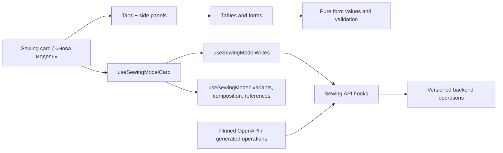

# Admin: Sewing fabrics and composition

**Implemented code:** 2026-10-25, reworked 2026-11-04. **Surface:** sewing model card at `/references/products/:id` and «Нова модель» steps 2–4. Specifications: [original](../../../specs/admin/products/004-sewing-articles-and-composition/implementation.md), [review marks removed](../../../specs/admin/products/015-remove-review-marks/README.md), [fabric variants](../../../specs/admin/products/016-fabric-variants/README.md).

A sewing model has fabric variants and one shared composition. A variant is a fabric with its metres per product, a sale SKU on the site and «Продається». Accessories, other costs and operations belong to the whole model. A variant's price is the shared part plus its fabric; the backend recalculates and publishes it after every change.

The card tabs are «Тканини» (one row per fabric with live cost and three prices), «Комплектація» and «Трудовитрати». Each is a table; a row opens the right side panel (`ReferenceEditorDrawer`) for view, «Редагувати» for edit, and «Додати …» for a new line. Every save goes to the server at once: there are no drafts, scopes or unsaved-changes dialogs. Only problems are marked: a missing price with its reason and a switched-off fabric. Managers and administrators edit; others only view.

```text
libs/admin/products/
├── feature/src/
│   ├── hooks/sewing-model/                     # model queries, writes, side-panel state, card hook
│   ├── components/sewing-model/                # «Тканини», «Комплектація», «Трудовитрати» tabs and their drawers
│   ├── components/sewing-card/                 # card shell, metrics, «Розрахунок» tab
│   └── hooks/product-editor/use-legacy-sewing-norm-lock.ts # legacy norm policy
├── model/src/
│   ├── entities/sewing-articles/               # variant and its write input
│   ├── entities/sewing-composition/            # shared composition and line contracts
│   ├── forms/{sewing-variant,sewing-material,sewing-operation}/ # side-panel values and conversion
│   ├── validators/sewing-variant/              # fabric, metres and SKU rules
│   ├── queries/sewing-variants/                # variant rows with fabric names and live prices
│   ├── queries/sewing-card/                    # labour and material lines, blocker reasons, totals
│   └── mappers/sewing-composition/             # composition view to the shared draft
├── ui/src/
│   ├── components/sewing-card/                 # variants grid, materials and labour tables, row actions, delete dialog
│   └── forms/{sewing-variant,sewing-material,sewing-operation}/ # side-panel fields
└── data-access/src/
    ├── api/sewing-access/                      # session capability query
    ├── api/sewing-articles/                    # variant list, create, update, delete
    ├── api/sewing-composition/                 # shared composition read/replace, cache tags, errors
    ├── mappers/{sewing-access,sewing-articles,sewing-composition}/ # request and response conversion
    └── validators/{sewing-access,sewing-articles,sewing-composition}/ # runtime response validation
```



Every write sends the composition version; a 409 asks to refresh. Saving the composition sends the model code from «Товари», so it never restores an old code. Session roles enable editing controls; server-side Catalog policies enforce access. See [Product feature](products.md) and [calculation and published prices](sewing-pricing.md).

## Tests

- `libs/admin/products/data-access/src/`: `api/sewing-articles/`, `api/sewing-composition/`, `mappers/sewing-articles/`, `mappers/sewing-composition/`, `mappers/sewing-access/`
- `libs/admin/products/feature/src/components/sewing-card/sewing-product-card.component.test.tsx`, `pages/product-create/sewing-create-page.component.test.tsx`
- `libs/admin/products/model/src/`: `forms/sewing-variant/`, `forms/sewing-material/`, `queries/sewing-card/`, `mappers/sewing-composition/`

Focused run: `npx nx test admin-products-data-access -- sewing-articles sewing-composition sewing-access`; `npx nx test admin-products-feature -- sewing-card product-create`; `npx nx test admin-products-model -- sewing-variant sewing-material sewing-card sewing-composition`.
