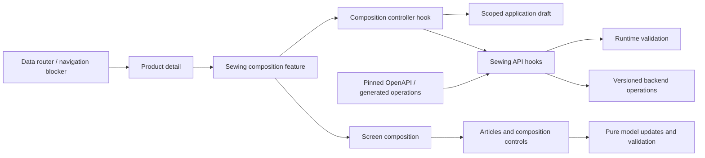

# Admin: Sewing Articles and composition

**Implemented code:** 2026-10-25. **Surface:** saved Sewing Product detail at `/references/products/:id`. [Specification and evidence](../../../specs/admin/products/004-sewing-articles-and-composition/implementation.md).

An authorized user views Articles, common materials/operations, selected-Article materials and calculation-readiness blockers. Managers and administrators can create a sale SKU and save reviewed norms. Effective composition is displayed with explicit scope; shared lines are never duplicated into Article-specific writes. Price publication is not part of this screen.

```text
libs/admin/products/
├── feature/src/
│   ├── components/sewing-composition/          # thin public entry, screen composition, scope editors, feedback and dialogs
│   ├── hooks/sewing-composition/               # controller and named queries/drafts/writes/selection/navigation owners
│   ├── hooks/product-editor/use-legacy-sewing-norm-lock.ts # legacy norm policy
│   └── model/sewing-composition/               # scope/pending-transition contracts and error translation
├── model/src/
│   ├── entities/sewing-articles/               # one Article contract per file
│   ├── entities/sewing-composition/            # one composition/line contract per file
│   ├── queries/sewing-composition/             # defaults and editable-draft comparison
│   ├── mappers/sewing-composition/             # scoped drafts and pure material/operation review invalidation
│   └── validators/sewing-composition/          # material, operation and lookup-reference validation
├── ui/src/
│   ├── components/sewing-articles/             # Article list
│   ├── forms/sewing-articles/                  # Article panel and separate creation form
│   ├── forms/sewing-composition/               # presentation, private props, sections and rows
│   └── hooks/sewing-composition/               # local form errors, temporary keys and actions
└── data-access/src/
    ├── api/sewing-access/                      # session capability query
    ├── api/sewing-articles/                    # Article list/create endpoints
    ├── api/sewing-composition/                 # composition endpoints, cache tags and error normalization
    ├── contracts/{sewing-articles,sewing-composition}/ # aliases to generated operation DTOs
    ├── models/                                # private technical request/capability contracts
    ├── mappers/{sewing-access,sewing-articles,sewing-composition}/ # request and response conversion
    └── validators/{sewing-access,sewing-articles,sewing-composition}/ # runtime response validation
```



Session roles enable editing controls; server-side Catalog policies enforce access. Optimistic versions prevent stale saves. The composition screen remains conservative about OtherCost readiness; price calculation/publication is not integrated into this screen. See [API dependency](../../../specs/admin/products/004-sewing-articles-and-composition/contracts/api-contract.md) and [Product feature](products.md).

Dirty composition blocks browser-history and SPA navigation through the data router; explicit confirmation controls leave/stay. Tab/window close has a separate unload warning. The [application routing document](../../../architecture/admin/runtime/application.md) describes the composition root change; domain route ownership and lazy page boundaries remain in place.

The [responsibility audit](../../../specs/admin/products/004-sewing-articles-and-composition/code-audit/audit.md) records why these files were split or kept and the focused verification. The [structural remediation](../../../specs/admin/products/005-sewing-composition-structure/README.md) owns the dependency-ordered work; the original product specification still owns behavior.

The [controller/form follow-up](../../../specs/admin/products/005-sewing-composition-structure/follow-up.md) records the subsequent split and keep decisions.

Selecting an Article also opens its [calculation and publication panel](sewing-pricing.md). Unsaved composition disables pricing writes; backend publication revalidates the saved inputs.
