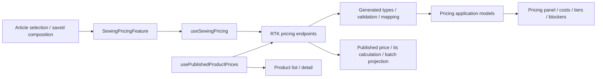

# Admin: Sewing Article pricing

Read-only consumer of versioned backend pricing. Open a saved Sewing Product and select an Article on «Розрахунок» or in the composition section: the panel shows the current published price and the retained calculation behind it. The backend publishes a new price after every saved input change ([spec 013](../../../specs/admin/products/013-automatic-sewing-prices/README.md)); there are no calculate or publish buttons. Imported composition is reviewed through the existing editor, never automatically.

The panel shows three prices for 1–9, 10–40 and 41+ units with their date, then component costs, minutes/minute cost, full cost and composition/settings revisions. Unsaved composition changes show a hint to save. Saving a composition, an Article or a Reference price input refreshes the cached `Product` queries.

Product cards/lists use the latest published wholesale Article price (10–40 tier), with explicit loading/error/unpublished states. A page uses one bounded Product-ID batch request rather than per-row reads. Publication refreshes the relevant caches. Errors have retry actions and never revive legacy Sewing price amounts. PPE current price ownership is documented in its separate feature; nullable legacy manufacturing details are accepted.

## Structure diagram



## Code structure

```text
libs/admin/products/
  model/src/
    entities/sewing-pricing/                       # tiers / calculation / publication / Product projection
    queries/sewing-pricing/apply-published-sewing-price.ts # source selection only; no price formula
  data-access/src/
    contracts/sewing-pricing/                      # private aliases from generated operations
    validators/sewing-pricing/                     # consumed values, readiness, IDs, dates and UUIDs
    mappers/sewing-pricing/                        # scope matching and independent application models
    api/sewing-pricing/
      calculations.api.ts                         # read the calculation behind a publication
      publications.api.ts                         # current published price
      products.api.ts                             # one bounded batch request for Product views
      pricing-errors.ts                           # normalized Ukrainian transport messages
  ui/src/
    components/sewing-pricing/                     # panel shell, shared tier display and formatting
      calculation/                                # saved calculation, costs and blockers
      publication/                                # current published price and read states
    product-detail/product-wholesale-price-label.ts # publication/loading/error labels and PPE compatibility
  feature/src/
    components/sewing-pricing/sewing-pricing-feature.tsx # thin selected-Article entry point
    hooks/sewing-pricing/use-sewing-pricing.ts       # published price and its calculation
    hooks/sewing-pricing/use-published-product-prices.ts # page/card projection and retry
    model/pricing/pricing-error-message.ts   # only normalized errors may be displayed
```

No new route, reducer, theme or Nx project is added. Server payloads stay in RTK Query; the feature holds no pricing state. Domain models contain no React/HTTP dependency. UI imports no DTO or API hook. The panel shell composes the publication and calculation sections. Batch response validation is separate from mapping. No UI network calls or formulas are introduced. Capability folders stay below eight direct production files; see the structural follow-up in the scoped audit.

[Specification](../../../specs/admin/products/006-sewing-pricing/README.md) · [API/provenance](../../../specs/admin/products/006-sewing-pricing/contracts/api-contract.md) · [Verification](../../../specs/admin/products/006-sewing-pricing/verification.md) · [Scoped boundary review](../../../specs/admin/products/006-sewing-pricing/code-audit/audit.md).

TS-007 retires the old Product sale-price arithmetic and manufacturing price-band display; [cutover](../../../specs/admin/products/007-ppe-pricing/cutover/README.md). Historical TS-005 evidence remains unchanged.

## Tests

- `libs/admin/products/data-access/src/`: `api/sewing-pricing/`, `mappers/sewing-pricing/`
- `libs/admin/products/feature/src/`: `components/sewing-pricing/`, `hooks/sewing-pricing/`, `hooks/pricing/`
- `libs/admin/products/model/src/queries/sewing-pricing/`
- `libs/admin/products/ui/src/product-detail/`: `product-wholesale-price-label.unit.test.ts`; `libs/admin/products/feature/src/components/sewing-card/sewing-product-card.component.test.tsx`

Focused run: `npx nx test admin-products-data-access -- sewing-pricing`; `npx nx test admin-products-feature -- sewing-pricing hooks/pricing`; `npx nx test admin-products-model -- sewing-pricing`; `npx nx test admin-products-ui -- wholesale-price`.
