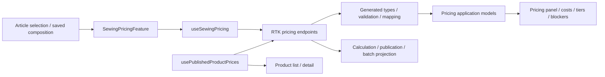

# Admin: Sewing Article pricing

Implemented TS-005 consumer of versioned backend pricing. Open a saved Sewing Product and select an Article in the composition section. Managers can save a calculation and publish it explicitly; readers inspect the current publication and its retained calculation. Imported composition is reviewed through the existing editor, never automatically.

The panel shows component costs, minutes/minute cost, full cost, composition/settings revisions and three prices for 1–9, 10–40 and 41+ units. Blockers explain required data/review. Dirty composition and stale/blocked calculations cannot publish. Network retry retains the calculation request UUID; publication uses the saved calculation UUID. Switching Article isolates the workflow.

Product cards/lists use the latest published wholesale Article price (10–40 tier), with explicit loading/error/unpublished states. A page uses one bounded Product-ID batch request rather than per-row reads. Publication refreshes the relevant caches. Errors have retry actions and never revive legacy Sewing price amounts. PPE current price ownership is documented in its separate feature; nullable legacy manufacturing details are accepted.

## Structure diagram



## Code structure

```text
libs/admin/products/
  model/src/
    entities/sewing-pricing/                       # tiers / calculation / publication / Product projection
    queries/sewing-pricing/apply-published-sewing-price.ts # source selection only; no price formula
  data-access/src/
    contracts/sewing-pricing/                      # private aliases from generated operations
    validators/sewing-pricing/                     # consumed values, readiness, IDs, dates and UUIDs
    mappers/sewing-pricing/                        # scope matching and independent application models
    api/sewing-pricing/
      calculations.api.ts                         # read/save calculations and immutable cache upsert
      publications.api.ts                         # current read / explicit publication and invalidation
      products.api.ts                             # one bounded batch request for Product views
      pricing-errors.ts                           # normalized Ukrainian transport messages
  ui/src/
    components/sewing-pricing/                     # panel shell, shared tier display and formatting
      calculation/                                # saved calculation, costs and blockers
      publication/                                # current published price and read states
      workflow/                                   # permission/stale/dirty gates and action controls
    product-detail/product-wholesale-price-label.ts # publication/loading/error labels and PPE compatibility
  feature/src/
    components/sewing-pricing/sewing-pricing-feature.tsx # thin selected-Article entry point
    hooks/sewing-pricing/use-sewing-pricing.ts       # read queries, selected calculation and view orchestration
    hooks/sewing-pricing/use-sewing-pricing-actions.ts # save/publish commands, safe retry UUID and conflict state
    hooks/sewing-pricing/use-published-product-prices.ts # page/card projection and retry
    model/pricing/pricing-error-message.ts   # only normalized errors may be displayed
```

No new route, reducer, theme or Nx project is added. Server payloads stay in RTK Query; feature state retains selected calculation identity, retry identity and transient workflow flags. Domain models contain no React/HTTP dependency. UI imports no DTO or API hook. The panel shell composes calculation, publication and workflow sections. The read orchestrator delegates writes to a command hook; server payloads remain in RTK Query. Batch response validation is separate from mapping. No UI network calls or formulas are introduced. Capability folders stay below eight direct production files; see the structural follow-up in the scoped audit.

[Specification](../../../specs/admin/products/006-sewing-pricing/README.md) · [API/provenance](../../../specs/admin/products/006-sewing-pricing/contracts/api-contract.md) · [Verification](../../../specs/admin/products/006-sewing-pricing/verification.md) · [Scoped boundary review](../../../specs/admin/products/006-sewing-pricing/code-audit/audit.md).

TS-007 retires the old Product sale-price arithmetic and manufacturing price-band display; [cutover](../../../specs/admin/products/007-ppe-pricing/cutover/README.md). Historical TS-005 evidence remains unchanged.
