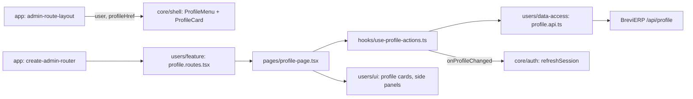

# Admin: «Мій кабінет» and the profile menu

**Status:** implementation exists, checked 2026-11-04. Backend: BreviERP `docs/sdd/features/identity/own-profile.md`.

The avatar at the right of the top bar opens the profile menu: photo, name, email and role of the signed-in person, «Мій кабінет» (`/profile`) and «Вийти». Without a photo the avatar shows the first letter of the name on a colour derived from the name (`UserAvatar` in `libs/admin/shared/ui`); the same avatar appears on «Користувачі».

«Мій кабінет» is open to every staff role and has two cards:

- **Фото профілю:** upload (JPG, PNG or WebP, up to 2 MB, at least 128×128; the server crops it to a 256×256 square) or remove with a confirmation. The browser checks type, size and dimensions first. Photos go to the same CDN storage as «Фото», folder `avatars/`; a server without that storage answers 503 and the card says so.
- **Особисті дані:** name, phone, email (login), role and password. Each change opens a right side panel.

Who changes what (the backend checks the same):

| Role                | Own name and photo | Own phone, email, password                           | Other people's accounts                                             |
| ------------------- | ------------------ | ---------------------------------------------------- | ------------------------------------------------------------------- |
| Manager, Accountant | yes                | no, the card says an admin or the director does it   | no                                                                  |
| Admin               | yes                | yes; email and password ask for the current password | name, email, phone, role, password, block, delete; not the director |
| Director            | yes                | yes                                                  | everything, including the director's own row                        |

Other people's name, email and phone are changed on «Користувачі» → row menu → «Змінити дані» ([users](users.md)). After any own change the app re-reads the session (`refreshSession`), so the header shows the new name or photo at once.

## Structure diagram



## Code structure

```text
libs/admin/shared/ui/src/data-display/user-avatar.tsx   # photo or first letter on a stable colour
libs/admin/core/shell/src/components/top-bar/actions/
  profile-menu.tsx      # avatar button, «Мій кабінет», «Вийти»
  profile-card.tsx      # photo, name, email, role at the top of the menu
libs/admin/users/
  model/src/entities/staff-profile.ts          # own profile, canChangeOwnCredentials
  model/src/validators/avatar-file-rules.ts    # photo limits as the backend
  model/src/validators/profile-rules.ts        # name, email, phone (7–15 digits)
  data-access/src/api/profile.api.ts           # GET /api/profile and the changes
  data-access/src/mappers/staff-profile.mapper.ts
  ui/src/profile/                              # photo card, details card
  ui/src/panels/                               # edit text, email, password, staff details
  feature/src/profile.routes.tsx               # /profile for every staff role
  feature/src/pages/profile-page.tsx
  feature/src/hooks/use-profile-actions.ts
  feature/src/model/check-avatar-file.ts       # decodes the photo to check its size
  feature/src/errors/profile-error-message.ts  # wrong password, 413, 503 → Ukrainian text
```

## Tests

- `libs/admin/users/model/src/validators/profile-rules.unit.test.ts`
- `libs/admin/users/data-access/src/mappers/staff-profile.mapper.unit.test.ts`
- `libs/admin/users/ui/src/details/profile/profile-details-card.component.test.tsx`
- `libs/admin/users/feature/src/errors/profile-error-message.unit.test.ts`
- `libs/admin/shared/ui/src/data-display/user-avatar.component.test.tsx`
- `libs/admin/core/shell/src/layout/admin-layout.component.test.tsx` (profile menu)

Focused run: `npx nx run-many -t test -p admin-shared-ui,admin-users-model,admin-users-data-access,admin-users-ui,admin-users-feature,admin-core-shell`.
