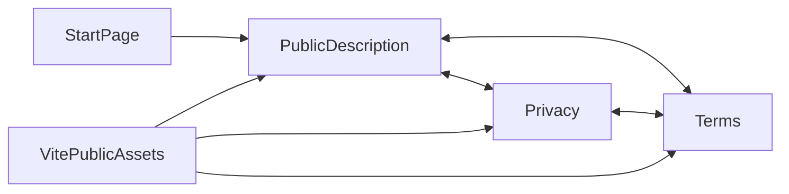

# BreviERP public information and legal pages

Public HTML delivered from Admin Vite public assets, independent of React, session, API and auth guards. Routes: /brevi-erp/index.html, /brevi-erp/privacy.html, /brevi-erp/terms.html. Shared styles, reciprocal links and contact pp.brevi@gmail.com. Canonical origin: https://office.brevi.com.ua. StartPage links to the public description. Ukrainian content covers the agreed send-only/manual-review mode; publication requires matching runtime and owner details, as tracked by [FE-EN-003](../../specs/admin/clients/001-clients-quotes-custom-sewing/tasks/readiness/fe-en-003.md).

## Structure diagram



## Code structure

```text
apps/admin-react/
  public/brevi-erp/
    index.html       # product description and entry to documents
    privacy.html     # data processing and Google disclosures
    terms.html       # service use and mail responsibilities
    legal.css        # shared accessible responsive presentation
  src/app/pages/start-page.tsx # in-product link
```

```text
tools/legal/
  erp-public-pages.test.mjs # anonymous HTTP and document navigation
```

## Tests

`node --test tools/legal/erp-public-pages.test.mjs` — Vite static HTTP, unauthenticated documents without JavaScript, document/CSS links and privacy disclosures. No browser or live Google interaction. [Evidence and release gates](../../specs/admin/clients/001-clients-quotes-custom-sewing/evidence/fe-en-003-public-pages-2026-10-30.md).
