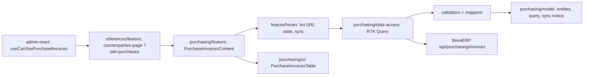

# Admin: Рахунки на закупку

**Status:** stage 1 implemented 2026-11-05 (read-only register). Backend decisions and later stages are in the BreviERP specification `docs/sdd/specs/purchasing/001-purchase-invoices`; the consumed contract is [backend/purchasing](../../contracts/openapi/backend/purchasing/purchase-invoices.openapi.yaml).

`/references/counterparties?tab=purchases` («Контрагенти → Рахунки на закупку») shows the purchase invoices that staff post to Telegram and the Google sheet «финансы» collects. The tab is visible only to the accountant and Admin (the director also holds Admin); for others `?tab=purchases` opens «Постачальники». The backend allows the same roles (policy `CanUsePurchaseInvoices`).

The page has:

- a header with «Оновити зараз» (the same sheet sync as the daily `brevierp-sync` step) and the time of the last successful sync;
- a warning with the reason when the last sync failed (sheet not shared, header changed, a UID moved);
- search by text, chat, author or exact UID, and the chips «Усі / Потребують перевірки» with server counts;
- a server-paged «Цех» table, one row per Telegram message: date and UID, message text with chat and author, original links (safe Dropbox links open in a new tab, others say «Посилання потребує перевірки»), the source payment mark («Відмічено в джерелі» is a note from the sheet, not a payment) and problems with their reason. Rows without problems carry no badge.

Search, the filter and the page are kept in the URL. Supplier link, note, checked JSON and CDN copies come in later stages.

## Structure diagram



## Code structure

```text
libs/admin/purchasing/
├── model/src/entities/invoices/{purchase-invoice,purchase-sync}.ts   # card, page, sync state/result
├── model/src/queries/purchase-invoice-query.ts                      # filters, page sizes
├── model/src/mappers/invoices/describe-purchase-sync.ts             # «Оновити зараз» notice
├── data-access/src/api/invoices/purchase-invoice-endpoints.ts       # list, sync-state, POST sync
├── data-access/src/validators/purchase-response.ts                  # runtime response checks
├── data-access/src/mappers/invoices/                                # response → model
├── data-access/src/errors/purchase-api-error.ts                     # keeps backend reasons (409/422/503)
├── ui/src/tables/invoices/purchase-invoices-table.tsx               # server-paged table
└── feature/src/
    ├── components/invoices/purchase-invoices-content.tsx           # the tab
    └── hooks/invoices/use-purchase-invoice-{list,sync}.ts          # URL state, counts, sync
libs/admin/references/feature/src/pages/counterparties/counterparties-page.tsx  # tabs host
libs/admin/references/feature/src/references.routes.tsx                          # createReferencesRoutes
apps/admin-react/src/app/router/use-can-see-purchase-invoices.ts                 # role check
libs/admin/core/auth/src/session/session-user.ts                                 # canUsePurchaseInvoices
```

## Tests

`npx nx test admin-purchasing-feature`, `admin-purchasing-ui`, `admin-purchasing-data-access`, `admin-purchasing-model`, and `npx nx test admin-references-feature -- counterparties`:

- `feature/src/components/invoices/purchase-invoices-content.component.test.tsx` — cards, problems only, URL filter and search, sync errors;
- `ui/src/tables/invoices/purchase-invoices-table.component.test.tsx` — empty and nothing-found texts;
- `data-access/src/mappers/invoices/purchase-invoice.mapper.unit.test.ts`, `model/src/mappers/invoices/describe-purchase-sync.unit.test.ts`;
- `references/feature/src/pages/counterparties/counterparties-tab.unit.test.ts` — the tab only for allowed roles.
