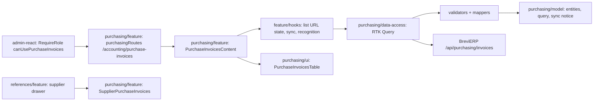

# Admin: Рахунки на закупку

**Status:** stage 1 (register), stage 2 (supplier link and note) and stage 3 (invoice recognition) implemented 2026-11-05. Backend decisions and later stages are in the BreviERP specification `docs/sdd/specs/purchasing/001-purchase-invoices`; the consumed contract is [backend/purchasing](../../contracts/openapi/backend/purchasing/purchase-invoices.openapi.yaml).

`/accounting/purchase-invoices` («Бухгалтерія → Рахунки на закупку», its own menu item since client corrections item 10, 2026-11-08) shows the purchase invoices that staff post to Telegram and the Google sheet «финансы» collects. Only the Director sees it, and the supplier card tab with the supplier's invoices; the backend allows the same role (policy `CanUsePurchaseInvoices`). The old link `/references/counterparties?tab=purchases` takes the Director to the new page with the same filters.

The page has:

- a header with «Розпізнати всі нові» and «Оновити зараз» (the same sheet sync as the daily `brevierp-sync` step) and the time of the last successful sync. «Розпізнати всі нові» repeats `POST recognize-new` (5 never-tried originals per call, newest first) with progress «Розпізнано N з M», until none remain, the server gives a stop reason (AI off, monthly limit, already running) or «Зупинити» is pressed; the list reloads after each batch;
- a warning with the reason when the last sync failed (sheet not shared, header changed, a UID moved);
- search by text, chat, author or exact UID, and the chips «Усі / Помилки і перевірка / Без постачальника / Не розпізнані» with server counts;
- «Дата рахунку з … по …» and «Усі / З ПДВ / Без ПДВ» over the checked facts (URL `from`, `to`, `vat`; invoices not recognized yet drop out while set) and «Скинути дату і ПДВ»;
- the supplier card («Контрагенти → Постачальники», view mode) has the tab «Рахунки на закупку» for the same roles: that supplier's invoices (`supplierId`), a row opens the register searched by its UID;
- a server-paged table (concept A «Розгортні рядки», chosen 2026-11-05 from the [register concepts](https://claude.ai/artifact/UvyxSBWgn7NN8NNe9gcDWk)), one row per Telegram message: the arrow, the state, date and UID, supplier (from the recognized invoice, else the linked one) with chat and author, «№ number · date» (+N for more invoices), the sum, the VAT chip («Без ПДВ» stands out in blue, «З ПДВ» is quiet) and «Відмічено» when the sheet says «СПЛАЧЕНО» (a note from the sheet, not a payment).
- The state is one of four marks. The user asked for all four on this register, «Розпізнано» included, as an exception to the problems-only rule:
  - «✓ Розпізнано»: every original has checked facts;
  - «! Попередження»: sheet problems, a link that is not Dropbox, or a supplier removed from the directory;
  - «✕ Помилка»: the AI answer failed the kopeck check, or the file could not be read;
  - «○ Не розпізнано»: not tried yet, or an Excel file.
- A row click or its arrow opens the row in place. The open row shows:
  - the message, and the reasons for the state;
  - each original with its state, and either its facts (positions, line discounts as «знижка N %», totals, who checked) or what the AI read, with wrong lines highlighted;
  - the buttons «Виправити» / «Заповнити вручну», «Розпізнати» / «Розпізнати знову» (no JSON files: the data is filled in or fixed only in the form);
  - «Постачальник і примітка», which opens the side panel.
- «Виправити» opens the side panel form with the facts as saved or as the AI read them:
  - fields: document type, number, date, supplier, «Без ПДВ / З ПДВ» (with «Ціни вже з ПДВ»), the positions (add or remove), the VAT sum and «До оплати»;
  - the sum of the positions is counted while typing and compared with «До оплати» to the kopeck;
  - a line up to 30 % below quantity × price is shown as a discount;
  - «Зберегти» sends the facts only when they add up; they replace the earlier facts, which the server keeps in history.
- The side panel (`ReferenceEditorDrawer`) for the supplier and note: problems, supplier and note with who changed them and when, the message, originals with their state and the same buttons. «Редагувати» shows the form: an active supplier from `GET /api/purchasing/invoices/suppliers` (the accountant cannot read the Reference list) and a note up to 1000 characters. The save sends the version the user opened; if someone saved first, the panel stays open with the backend reason.

Search, the filter and the page are kept in the URL. The OpenAI key, models and limit are set on [«Налаштування ШІ»](ai.md). Supplier and client card tabs (stage 4) and CDN copies with previews (stage 5) come later.

## Structure diagram



## Code structure

```text
libs/admin/purchasing/
├── model/src/entities/invoices/{purchase-invoice,purchase-sync}.ts   # card, page, sync state/result
├── model/src/queries/purchase-invoice-query.ts                      # filters, page sizes
├── model/src/mappers/invoices/describe-purchase-sync.ts             # «Оновити зараз» notice
├── model/src/entities/invoices/purchase-document.ts                 # facts, recognition, batch, JSON save
├── model/src/mappers/invoices/describe-purchase-document.ts         # dates, money, VAT label, batch progress
├── model/src/entities/invoices/purchase-review.ts                   # supplier option, saved review, input
├── model/src/forms/review/purchase-review-form.ts                   # form values ↔ request
├── model/src/validators/review/purchase-review-validation.ts        # note limit
├── data-access/src/api/invoices/purchase-invoice-endpoints.ts       # list, sync, suppliers, review, recognize, recognize-new, JSON
├── data-access/src/validators/purchase-response.ts                  # runtime response checks
├── data-access/src/mappers/invoices/                                # response → model
├── data-access/src/errors/purchase-api-error.ts                     # keeps backend reasons (409/422/503)
├── model/src/mappers/invoices/purchase-invoice-status.ts            # four states, line discount, sheet issues
├── model/src/forms/documents/purchase-document-form.ts              # «Виправити» values ↔ template / server JSON
├── model/src/validators/documents/purchase-document-validation.ts   # kopeck check while typing
├── ui/src/tables/invoices/purchase-invoices-table.tsx               # server-paged table with expandable rows, own scroll
├── ui/src/tables/suppliers/supplier-purchase-invoices-table.tsx     # compact list for the supplier card
├── ui/src/components/filters/purchase-invoice-narrowing.tsx         # invoice date and VAT filters
├── ui/src/components/status/purchase-status-chip.tsx                # state and VAT chips
├── ui/src/components/documents/purchase-draft-view.tsx              # what the AI read, wrong lines highlighted
├── ui/src/forms/documents/purchase-document-form.tsx                # «Виправити» form
├── ui/src/components/invoices/purchase-invoice-details.tsx          # read-only card, actions per original
├── ui/src/components/documents/purchase-document-view.tsx           # checked facts of one original
├── ui/src/forms/review/purchase-review-form.tsx                     # supplier and note form
└── feature/src/
    ├── purchasing.routes.tsx, purchasing-paths.ts                  # /accounting/purchase-invoices
    ├── pages/purchase-invoices-page.tsx                            # the page
    ├── components/invoices/purchase-invoices-content.tsx           # the register
    ├── components/suppliers/supplier-purchase-invoices.tsx         # supplier card tab «Рахунки на закупку»
    ├── components/review/purchase-invoice-drawer.tsx               # side panel: view → edit
    ├── components/invoices/purchase-invoice-row-details.tsx       # open row: message, reasons, originals
    ├── components/documents/purchase-file-actions.tsx              # «Виправити», «Розпізнати»
    ├── components/documents/purchase-document-editor.tsx           # side panel «Виправити»
    ├── components/documents/purchase-link-draft.tsx                # last AI answer of a failed original
    ├── hooks/documents/use-purchase-document-editor.ts             # template → form → save with replace
    ├── hooks/documents/use-purchase-file-actions.ts                # one original: recognize
    ├── hooks/documents/use-purchase-recognition-batch.ts           # «Розпізнати всі нові» loop and «Зупинити»
    ├── hooks/review/use-purchase-review-editor.ts                  # form state, save with version
    └── hooks/invoices/use-purchase-invoice-{list,sync}.ts          # URL state, counts, sync
libs/admin/references/feature/src/pages/counterparties/counterparties-page.tsx  # old ?tab=purchases link
libs/admin/references/feature/src/components/suppliers/supplier-drawer.tsx      # passes the supplier tab to the card
libs/admin/references/feature/src/references.routes.tsx                          # createReferencesRoutes
apps/admin-react/src/app/router/use-can-see-purchase-invoices.ts                 # supplier tab role check
apps/admin-react/src/app/router/create-admin-router.tsx, legacy-menu.ts          # route guard, menu item
libs/admin/core/auth/src/session/session-user.ts                                 # canUsePurchaseInvoices
```

## Tests

`npx nx test admin-purchasing-feature`, `admin-purchasing-ui`, `admin-purchasing-data-access`, `admin-purchasing-model`, and `npx nx test admin-references-feature -- counterparties`:

- `feature/src/components/invoices/purchase-invoices-content.component.test.tsx` — cards, problems only, URL filter and search, sync errors, side panel save, stale version, «Без постачальника», «Не розпізнані», batch recognition and its stop reason, one-file recognition, states and arrow, «Виправити» blocked until the sums add up and then saved, date and VAT filters in the URL;
- `feature/src/components/suppliers/supplier-purchase-invoices.component.test.tsx` — the supplier tab: query by supplier, row opens the register, empty text;
- `model/src/mappers/invoices/purchase-invoice-status.unit.test.ts`, `model/src/validators/documents/purchase-document-validation.unit.test.ts` — four states, discounts, form check and server JSON;
- `model/src/mappers/invoices/describe-purchase-document.unit.test.ts` — dates, money, batch progress;
- `model/src/validators/review/purchase-review-validation.unit.test.ts` — note limit and request;
- `ui/src/tables/invoices/purchase-invoices-table.component.test.tsx` — empty and nothing-found texts, state, «Без ПДВ», arrow;
- `data-access/src/mappers/invoices/purchase-invoice.mapper.unit.test.ts`, `model/src/mappers/invoices/describe-purchase-sync.unit.test.ts`;
- `references/feature/src/pages/counterparties/counterparties-tab.unit.test.ts` — «Контрагенти» tabs without the register;
- `apps/admin-react/src/app/router/navigation-config.unit.test.ts` — the menu item in «Бухгалтерія», Director only.
