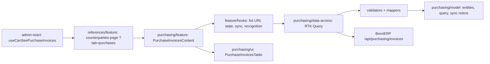

# Admin: Рахунки на закупку

**Status:** stage 1 (register), stage 2 (supplier link and note) and stage 3 (invoice recognition) implemented 2026-11-05. Backend decisions and later stages are in the BreviERP specification `docs/sdd/specs/purchasing/001-purchase-invoices`; the consumed contract is [backend/purchasing](../../contracts/openapi/backend/purchasing/purchase-invoices.openapi.yaml).

`/references/counterparties?tab=purchases` («Контрагенти → Рахунки на закупку») shows the purchase invoices that staff post to Telegram and the Google sheet «финансы» collects. The tab is visible only to the accountant and Admin (the director also holds Admin); for others `?tab=purchases` opens «Постачальники». The backend allows the same roles (policy `CanUsePurchaseInvoices`).

The page has:

- a header with «Розпізнати всі нові» and «Оновити зараз» (the same sheet sync as the daily `brevierp-sync` step) and the time of the last successful sync. «Розпізнати всі нові» repeats `POST recognize-new` (5 never-tried originals per call, newest first) with progress «Розпізнано N з M», until none remain, the server gives a stop reason (AI off, monthly limit, already running) or «Зупинити» is pressed; the list reloads after each batch;
- a warning with the reason when the last sync failed (sheet not shared, header changed, a UID moved);
- search by text, chat, author or exact UID, and the chips «Усі / Потребують перевірки / Без постачальника / Не розпізнані» with server counts;
- a server-paged «Цех» table, one row per Telegram message: date and UID, message text with chat and author, original links (safe Dropbox links open in a new tab, others say «Посилання потребує перевірки»), the linked supplier with the note, the source payment mark («Відмічено в джерелі» is a note from the sheet, not a payment), the column «Рахунок» (number · date, total, «З ПДВ»/«Без ПДВ» chip, «+N» for more documents) and problems with their reason. Rows without problems carry no badge.
- a row click opens the card in the side panel (`ReferenceEditorDrawer`): problems, supplier and note with who changed them and when, the message, originals. Under each safe original: its checked facts (number, date, supplier, VAT chip, positions, totals, who checked it) and the buttons «Розпізнати» / «Розпізнати знову» (fast model, then the strong one; the result or its problems appear under the buttons), «Шаблон JSON» (download the facts or an empty template) and «Завантажити JSON» (checked by the server in kopecks; replacing other facts asks first, old facts go to history). «Редагувати» shows the form: an active supplier from `GET /api/purchasing/invoices/suppliers` (the accountant cannot read the Reference list) and a note up to 1000 characters. The save sends the version the user opened; if someone saved first, the panel stays open with the backend reason.

Search, the filter and the page are kept in the URL. The OpenAI key, models and limit are set on [«Налаштування ШІ»](ai.md). Supplier and client card tabs (stage 4) and CDN copies with previews (stage 5) come later.

## Structure diagram



## Code structure

```text
libs/admin/purchasing/
├── model/src/entities/invoices/{purchase-invoice,purchase-sync}.ts   # card, page, sync state/result
├── model/src/queries/purchase-invoice-query.ts                      # filters, page sizes
├── model/src/mappers/invoices/describe-purchase-sync.ts             # «Оновити зараз» notice
├── model/src/entities/invoices/purchase-document.ts                 # facts, recognition, batch, JSON save
├── model/src/mappers/invoices/describe-purchase-document.ts         # dates, money, VAT label, batch progress
├── model/src/entities/invoices/purchase-review.ts                   # supplier option, saved review, input
├── model/src/forms/review/purchase-review-form.ts                   # form values ↔ request
├── model/src/validators/review/purchase-review-validation.ts        # note limit
├── data-access/src/api/invoices/purchase-invoice-endpoints.ts       # list, sync, suppliers, review, recognize, recognize-new, JSON
├── data-access/src/validators/purchase-response.ts                  # runtime response checks
├── data-access/src/mappers/invoices/                                # response → model
├── data-access/src/errors/purchase-api-error.ts                     # keeps backend reasons (409/422/503)
├── ui/src/tables/invoices/purchase-invoices-table.tsx               # server-paged table, row opens the panel
├── ui/src/components/invoices/purchase-invoice-details.tsx          # read-only card, actions per original
├── ui/src/components/documents/purchase-document-view.tsx           # checked facts of one original
├── ui/src/forms/review/purchase-review-form.tsx                     # supplier and note form
└── feature/src/
    ├── components/invoices/purchase-invoices-content.tsx           # the tab
    ├── components/review/purchase-invoice-drawer.tsx               # side panel: view → edit
    ├── components/documents/purchase-file-actions.tsx              # «Розпізнати», «Шаблон JSON», «Завантажити JSON»
    ├── hooks/documents/use-purchase-file-actions.ts                # one original: recognize, template, upload with replace
    ├── hooks/documents/use-purchase-recognition-batch.ts           # «Розпізнати всі нові» loop and «Зупинити»
    ├── hooks/review/use-purchase-review-editor.ts                  # form state, save with version
    └── hooks/invoices/use-purchase-invoice-{list,sync}.ts          # URL state, counts, sync
libs/admin/references/feature/src/pages/counterparties/counterparties-page.tsx  # tabs host
libs/admin/references/feature/src/references.routes.tsx                          # createReferencesRoutes
apps/admin-react/src/app/router/use-can-see-purchase-invoices.ts                 # role check
libs/admin/core/auth/src/session/session-user.ts                                 # canUsePurchaseInvoices
```

## Tests

`npx nx test admin-purchasing-feature`, `admin-purchasing-ui`, `admin-purchasing-data-access`, `admin-purchasing-model`, and `npx nx test admin-references-feature -- counterparties`:

- `feature/src/components/invoices/purchase-invoices-content.component.test.tsx` — cards, problems only, URL filter and search, sync errors, side panel save, stale version, «Без постачальника», «Не розпізнані», batch recognition and its stop reason, one-file recognition, JSON replace confirm;
- `model/src/mappers/invoices/describe-purchase-document.unit.test.ts` — dates, money, batch progress;
- `model/src/validators/review/purchase-review-validation.unit.test.ts` — note limit and request;
- `ui/src/tables/invoices/purchase-invoices-table.component.test.tsx` — empty and nothing-found texts;
- `data-access/src/mappers/invoices/purchase-invoice.mapper.unit.test.ts`, `model/src/mappers/invoices/describe-purchase-sync.unit.test.ts`;
- `references/feature/src/pages/counterparties/counterparties-tab.unit.test.ts` — the tab only for allowed roles.
