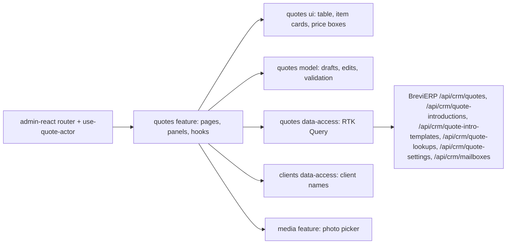

# «КП» — commercial proposals

**State:** stages 1–4, 5a and 5b implemented 2026-11-04 (list, «Товари та ціни» editor, «Сформувати КП» PDF, «Налаштування КП», «Надіслати КП» from each person's own Gmail, «КП для знайомства» with «Готові шаблони», «Виріб з нуля», «Змінити склад» of a model), Admin React. Specification: [Admin «КП»](../../specs/admin/quotes/001-quotes/README.md); backend rules R-* in BreviERP `docs/sdd/specs/crm/003-quotes/README.md`. Look: [«Цех»](../../standards/admin/design-system.md).

## Behavior and routes

| Route                          | Purpose                                                                                                                                    |
| ------------------------------ | ------------------------------------------------------------------------------------------------------------------------------------------ |
| `/crm/quotes`                  | List: search by number, client or company; «Відповідальний» filter for Director and Admin; «Нове КП» menu                                  |
| `/crm/quotes/new`              | Empty editor; the number is given on the first save, then the URL becomes `/crm/quotes/:quoteId`; `?custom=1` opens «Виріб з нуля» at once |
| `/crm/quotes/:quoteId`         | «Товари та ціни» editor of a saved КП                                                                                                      |
| `/crm/quote-introductions/new` | «КП для знайомства»: a new selection; after the first save the URL becomes `/crm/quote-introductions/:quoteId`                             |
| `/crm/quote-settings`          | «Налаштування КП» (Director and Admin; others are sent to the list)                                                                        |

- Menu «Менеджер сервісу»: «КП» links to the list; «Налаштування КП» is shown only for the Admin role (Director also holds it). «Нове КП» on the list asks which kind: «КП під запит», «КП з нуля (новий виріб)» or «КП для знайомства». In the editor the add buttons sit in the products block («Додати ще товар» / «Додати ще виріб з нуля» / «Додати ще разовий ЗІЗ» under the last item). The list has a «Вид» column and opens each КП in its own editor.
- «КП для знайомства»: four steps (основа, отримувач, лист, сторінки каталогу). Each page starts with the fixed main model of its season (codes in «Налаштування КП», default «Імпульс» and «Прайм») and three more models of that season picked in «Обрати модель»; one fabric each; only the від 41 шт. price from the Catalog, never typed. A saved model keeps its price. «Зберегти як шаблон» and «Готові шаблони» share selections between all staff; applying one takes current Catalog data, and a model or fabric that is gone leaves its slot empty with the reason. Its PDF is the promotional catalogue and «Надіслати КП» starts with the chosen letter and the saved email.
- «Сформувати КП» in the editor footer saves unsaved changes first, then downloads `КП <number>.pdf`. The server builds the PDF from the saved КП only, with the shown prices and the responsible manager's contact from the settings.
- «Надіслати КП» (main footer action) saves unsaved changes, then opens a side panel: sender (the signed-in person's Gmail), letter variant, «Кому» (several addresses through a comma), subject and text, and the PDF name. The server sends from that Gmail with the PDF of the saved КП, then marks the КП «Надіслано» with the date; a refusal keeps the panel open with the reason and changes nothing. Without a connected Gmail the panel offers «Підключити мій Gmail».
- Gmail is connected in «Налаштування КП» → «Контакти менеджерів у КП» → «Підключити Gmail» (Director for anyone, a manager for themselves). Google returns to the same page with `?gmail=…`, shown as a notice; the button is disabled while the page has unsaved changes. Until the Google keys are set on the server (BreviERP `docs/sdd/operations/configuration/crm-gmail.md`) the panel says sending is not on yet.
- «Налаштування КП»: Brevi requisites and logo, each staff member's contact in the КП (empty phone or email falls back to the account), the email template, PDF texts, «КП для знайомства» texts with banners and five «Переваги», and letter variants. Until the first save the server returns the old calculator texts (version 0). Pictures are https links or photos from «Фото». The browser checks the same rules as the server; a 409 offers «Оновити».
- A Manager sees and opens only КП where they are responsible; the server enforces it (404 for others). Director and Admin see all, and «Передати розрахунок» hands a КП to any staff member.
- Items: a sewing model with fabric variants, a «Виріб з нуля», a catalogue PPE, a one-off PPE. Each option has three prices (до 9 / 10–40 / від 41 шт.), each with «показати в КП». Catalog prices are taken by the server when an option is added and kept on later saves; «Перерахувати за актуальними цінами» shows old → new first and saves only on confirmation.
- «Виріб з нуля»: a product that is not in the Catalog. Its side panel takes a name, a client description, fabrics with metres, accessories and operations with quantities (minutes for an operation without a fixed norm). The server prices each fabric by the Catalog sewing formula (`POST /api/crm/quote-lookups/custom-sewing-price`, nothing saved) a moment after every change; each fabric becomes a price row with three prices, time, labour and full cost. The КП keeps the composition and frozen prices; «Змінити склад і тканини» reopens the panel, and «Перерахувати» prices it again from current references. Nothing is added to the Catalog.
- «Змінити склад» on a Catalog model card (`GET /api/crm/quote-lookups/catalog/{productId}/composition`) opens the same panel filled with the model's Catalog composition: the fabric of each variant already in the КП with its metres, shared accessories, «Додаткові тканини» (for example a lining) and «Послуги», and operations. Extra fabrics and services can be changed or removed but not added. «Зберегти склад» turns the item into a «Виріб з нуля» that keeps the model's code, link and season (subtitle «змінений склад моделі»); the Catalog model does not change.
- A PPE price can be typed over the Catalog one and then needs a reason; a one-off PPE has only manual prices. A sewing price is never typed.
- The browser checks the same rules before saving (name, prices, reason, at least one shown price above zero); the server checks them again. A 409 shows «КП змінили в іншому вікні» with «Оновити».
- The internal name suggests KeepinCRM client names and accepts any text; it is for the manager only.

## Structure diagram



## Code structure

```text
apps/admin-react/src/app/router/
  use-quote-actor.ts                 signed-in user → QuoteActor (Admin role sees all)
  admin-route-definitions.tsx        createQuotesRoutes({ useQuoteActor })
  legacy-menu.ts                     «КП», «Налаштування КП»
libs/admin/quotes/
  model/src/
    entities/                        Quote (with «Виріб з нуля» lines), QuoteSummary, «Виріб з нуля» price, catalogue search, reprice report, QuoteSettings, send draft and form, introduction setup and templates
    models/                          editor drafts, tiers and labels; «Виріб з нуля» panel draft; settings draft and template marks; introduction draft, layouts and seasons; editor path by kind
    mappers/                         saved КП/catalogue → draft, pure draft edits, price text, settings → draft; «Виріб з нуля» draft → price request and КП item; introduction draft (layout, slots, templates, price)
    validators/                      editor rules by place; settings rules by field; recipients and letter rules; introduction rules
  data-access/src/
    api/                             quotes (list, get, create, save, delete, reprice, responsible), lookups (catalogue, staff, «Виріб з нуля» price), settings, sending (draft, send, connect and disconnect Gmail), introductions (setup, products by id, create, save, templates)
    mappers/                         contract → model, draft → save input (КП, settings, introduction and template)
    files/quote-pdf.ts               download the КП PDF
    errors/                          Ukrainian API messages
  ui/src/
    tables/quotes-table.tsx          server-paged list
    components/editor/               header, item card, option row, price box, notes, add buttons, «Виріб з нуля» composition
    components/custom-sewing/        «Виріб з нуля» panel rows and price summary
    components/picker/               catalogue product row
    components/reprice/              old → new report
    components/settings/             settings cards and shared field helpers
    components/introduction/         step card, layout, recipient, letter and pages steps, model slot card
  feature/src/
    quotes.routes.tsx                route factory; the app passes the actor
    pages/{list,editor,settings}/    list page; editor page, its header actions and footer; «Налаштування КП»
    pages/introduction/              «КП для знайомства» page and its header actions
    components/picker/               «Додати товар» and «Додати тканину» side panels
    components/editor/               «Передати розрахунок», reprice panel, delete dialog
    components/settings/             picture field with the «Фото» picker
    components/sending/              «Надіслати КП» side panel
    components/custom-sewing/        «Виріб з нуля» side panel; «Змінити склад» loader for a Catalog model
    components/introduction/         «Обрати модель», «Готові шаблони», «Зберегти як шаблон» side panels
    hooks/{list,editor,picker,settings,sending}/  list state; draft, save, PDF and client names; catalogue search; settings draft; send panel, Gmail connect and its return notice
    hooks/custom-sewing/             «Виріб з нуля» draft, reference choices and debounced pricing
    hooks/introduction/              introduction editor (load, draft, save, templates) and Catalog data of its models
```

The feature library cannot import `core/auth`, so the app passes `useQuoteActor` into the route factory. Generated contract types stay in data-access.

## Tests

- Model: `validators/quote-draft-validation.unit.test.ts`, `validators/quote-settings-validation.unit.test.ts`, `validators/quote-send-validation.unit.test.ts`, `mappers/quote-price-text.unit.test.ts`, `mappers/quote-intro-draft-mapper.unit.test.ts` (new selection, layout change, repeats, template apply, saved price), `mappers/quote-custom-sewing-mapper.unit.test.ts` («Виріб з нуля» request, rules, КП item, changed model) — `npx nx test admin-quotes-model`.
- Data access: `mappers/quote-input.mapper.unit.test.ts`, `mappers/quote-settings.mapper.unit.test.ts`, `errors/quote-api-error.unit.test.ts` — `npx nx test admin-quotes-data-access`.
- UI: `components/editor/quote-price-box.component.test.tsx` — `npx nx test admin-quotes-ui`.
- Feature: `pages/list/quotes-page.component.test.tsx` (own-only list, responsible filter, «Нове КП» kinds), `components/custom-sewing/quote-custom-sewing-drawer.component.test.tsx` (prices the composition, adds the item; «Змінити склад» starts from the Catalog composition and keeps the model), `pages/editor/quote-editor-page.component.test.tsx` (manual price needs a reason, hide a price, 409 reload, «Виріб з нуля» from the products block, «Сформувати КП» saves then downloads, «Надіслати КП» saves then sends, Gmail refusal, no recipient, no Gmail), `pages/settings/quote-settings-page.component.test.tsx` (save, field rules, 409, «Підключити Gmail»), `pages/introduction/quote-introduction-page.component.test.tsx` (summer page built and saved, template applied) — `npx nx test admin-quotes-feature`.
- Menu and routes: `apps/admin-react/src/app/router/*.test.ts(x)` — `npx nx test admin-react -- src/app/router`.
