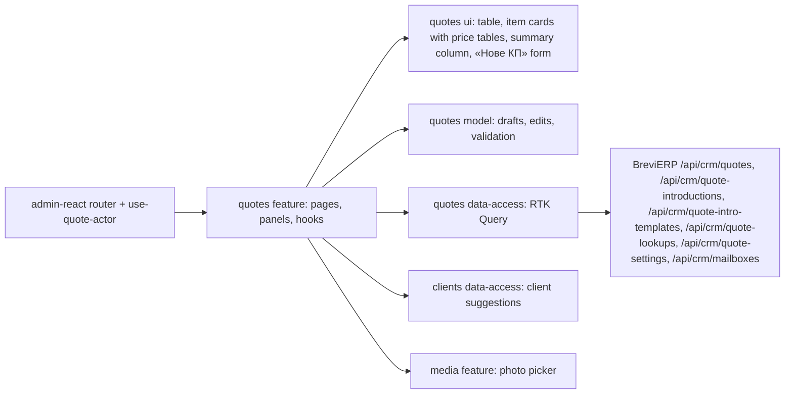

# «КП» — commercial proposals

**State:** stages 1–4 and 5a–5c implemented 2026-11-04 (list with «Архів», «Товари та ціни» editor, «Сформувати КП» PDF, «Налаштування КП», «Надіслати КП» from each person's own Gmail, «КП для знайомства» with «Готові шаблони», «Виріб з нуля», «Змінити склад» of a model, «Історія змін», archive and copy; editor redesigned on 2026-11-04 as variant A «Документ + підсумок» and «Налаштування КП» as variant A «Розділи + перегляд», [canvas](https://claude.ai/artifact/6PgHcivoYcbKubMNki9gM1)), Admin React. Specification: [Admin «КП»](../../specs/admin/quotes/001-quotes/README.md); backend rules R-* in BreviERP `docs/sdd/specs/crm/003-quotes/README.md`. Look: [«Цех»](../../standards/admin/design-system.md).

## Behavior and routes

| Route                          | Purpose                                                                                                                                                                    |
| ------------------------------ | -------------------------------------------------------------------------------------------------------------------------------------------------------------------------- |
| `/crm/quotes`                  | List: tabs «В роботі» and «Архів»; search by number, client or company; «Відповідальний» filter for Director and Admin; «Нове КП» panel                                    |
| `/crm/quotes/new`              | New КП «під запит», filled from «Нове КП»; the number is given on the first save, then the URL becomes `/crm/quotes/:quoteId`; an old `?custom=1` link opens «Новий виріб» |
| `/crm/quotes/:quoteId`         | Editor of a saved КП «під запит»                                                                                                                                           |
| `/crm/quote-introductions/new` | «КП для знайомства»: a new selection; after the first save the URL becomes `/crm/quote-introductions/:quoteId`                                                             |
| `/crm/quote-settings`          | «Налаштування КП» (Director and Admin; others are sent to the list)                                                                                                        |

- Menu «Менеджер сервісу»: «КП» links to the list; «Налаштування КП» is shown only for the Admin role (Director also holds it). «Нове КП» on the list opens a side panel: first «Клієнт або запит» (KeepinCRM suggestions or any text; a chosen client also fills «Підприємство в КП» and «Отримувач»), then the kind, «КП під запит» or «КП для знайомства». «Створити КП» opens that editor filled in (router state `prefill`, nothing is saved yet). A product that is not in the Catalog is an item kind, not a КП kind. The list has a «Вид» column and opens each КП in its own editor.
- Editor of a КП «під запит» (variant A): the header shows the kind and a status pill («Чернетка», «Надіслано <date>», «В архіві»), the client as the `h1`, the mono number and the responsible person; on the right «Історія» and «Ще». The page is two columns from `lg`: content (card «Кому», «Позиції N», «Додати позицію», notes) and a sticky 340 px column with «Підсумок» (items, price rows, prices the client will see; switches «Показувати ціни» до 9 / 10–40 / від 41 шт. that set the tier in every row, «не в усіх» when rows differ), «Перед надсиланням» (only when something is wrong: each problem links to its place) and the actions «Надіслати КП», «Переглянути PDF», «Зберегти». Below `lg` the column goes under the content and the actions become a sticky bottom bar.
- An item is a compact card: photo, number, name, kind tag («Модель», «Новий виріб», «Змінена модель», «ЗІЗ», «Разовий ЗІЗ», «Вишивка»), «Змінити склад», and «⋯» (move up or down, «Прибрати з КП»). Its prices are a table: a row per fabric (one for a PPE), a column per tier, mono and right-aligned; a tier hidden in every row is grey with «· не в КП». The row «⋯» recommends the fabric, shows or hides one price of that row, or removes the fabric. «+ Тканина» adds a fabric; the client description (and a PPE supplier link) opens under «Змінити опис».
- «Додати позицію» has three tiles with a line on when to use each: «З каталогу», «Новий виріб» (the «Виріб з нуля» panel), «Разовий товар ЗІЗ». Notes are plain cards: «Коментар для клієнта» and «Нотатка для себе» (lock icon).
- «КП для знайомства»: four steps (основа, отримувач, лист, сторінки каталогу). Each page starts with the fixed main model of its season (codes in «Налаштування КП», default «Імпульс» and «Прайм») and three more models of that season picked in «Обрати модель»; one fabric each; only the від 41 шт. price from the Catalog, never typed. A saved model keeps its price. «Зберегти як шаблон» and «Готові шаблони» share selections between all staff; applying one takes current Catalog data, and a model or fabric that is gone leaves its slot empty with the reason. Its PDF is the promotional catalogue and «Надіслати КП» starts with the chosen letter and the saved email.
- «Переглянути PDF» saves unsaved changes first, then opens «Перегляд КП» (full screen): the PDF exactly as the client gets it, on the right only problems (an item without a shown price that the PDF leaves out, an item without a photo) and «Надіслати КП», «Завантажити» (`КП <number>.pdf`), «Друкувати», «Повернутися до редагування». The server builds the PDF from the saved КП only (layout «Класика+», backend crm R-30: logo and requisites in the header, «ДЛЯ» client with the opening text, numbered items with only the prices they show, dark note, the responsible manager in the dark footer; [canvas](https://claude.ai/artifact/UedNTgi4ot6h29hRvBS4Ey)).
- «Надіслати КП» (the main action) saves unsaved changes and opens the same «Перегляд КП» first; its «Надіслати КП» opens a side panel: sender (the signed-in person's Gmail), letter variant, «Кому» (several addresses through a comma), subject and text, and the PDF name. The server sends from that Gmail with the PDF of the saved КП, then marks the КП «Надіслано» with the date; a refusal keeps the panel open with the reason and changes nothing. Without a connected Gmail the panel offers «Підключити мій Gmail».
- Gmail is connected in «Налаштування КП» → «Менеджери і Gmail» → «Підключити Gmail» (Director for anyone, a manager for themselves). Google returns to the same page with `?gmail=…`, shown as a notice. Unsaved changes are kept in the tab's session storage for that trip and come back once, only if nobody saved a newer version; a new Gmail address never resets typed fields. Until the Google keys are set on the server (BreviERP `docs/sdd/operations/configuration/crm-gmail.md`) the panel says sending is not on yet.
- «Налаштування КП»: five sections named by what the client gets: «Компанія» (requisites, contacts, logo), «PDF КП під запит» (title, opening text under the client name with `{client}`, empty for the standard text, VAT note, block at the bottom), «Лист клієнту» (the main letter and up to 10 variants in one list; a row opens its fields in place), «КП для знайомства» (accent colour with ready colours, two season boxes with banner, title and the main model picked from the Catalog by name, five «Переваги» with order arrows, texts) and «Менеджери і Gmail» (a row per person, fields in a side panel, empty phone or email falls back to the account). A sticky «Розділи» list on the left marks a section only when it changed or has problems; on wide screens (from 1400 px) a «Перегляд» column shows a sketch of the PDF or the letter with example data, filled marks and the focused field outlined, on narrower ones the «Перегляд» button opens it in a panel. Marks are inserted with «+ Номер КП», «+ Менеджер»… buttons, and an unknown mark such as `{managerNmae}` is an error. A changed field offers «Повернути як було». One «Зберегти» saves everything; the bottom bar names the changed sections or links to the ones with problems, and «Скасувати зміни» puts the saved settings back. Until the first save the server returns the old calculator texts (version 0). Pictures are https links or photos from «Фото». The browser checks the same rules as the server; a 409 offers «Оновити».
- A Manager sees and opens only КП where they are responsible; the server enforces it (404 for others). Director and Admin see all, and «Ще» → «Передати іншому менеджеру» hands a КП to any staff member.
- «Ще» in the header of a saved КП holds every rare action: «Копіювати», «Передати іншому менеджеру», «Перерахувати за новими цінами», «В архів» / «Повернути з архіву», and «Видалити чернетку» last. «Історія» (a button in the КП «під запит» header, a «Ще» item in «КП для знайомства») opens a side panel with who created, saved, sent, repriced, passed, archived or copied it and when; «Копіювати» makes a new draft with the next number and the same items and saved prices and opens it with a notice; «В архів» / «Повернути з архіву». Copy and archive work with the saved КП, so they are disabled while there are unsaved changes.
- An archived КП shows a warning with «Повернути з архіву»; saving, sending, «Перерахувати» and «Передати» are off until it is restored (the server also refuses them). «Переглянути PDF» still works.
- Items: a sewing model with fabric variants, a «Виріб з нуля», a catalogue PPE, a one-off PPE, and an embroidery row that comes only from «Ціна вишивки › Додати в КП» (its price is fixed; description and ticks can change; see [«Ціна вишивки»](embroidery.md)). Each option has three prices (до 9 / 10–40 / від 41 шт.), each with its own «показати в КП» flag (set for the whole КП in «Підсумок» or for one row in its menu). Catalog prices are taken by the server when an option is added and kept on later saves; «Перерахувати за новими цінами» shows old → new first and saves only on confirmation.
- «Виріб з нуля»: a product that is not in the Catalog. Its side panel takes a name, a client description, «Варіанти тканин» (1–20 variant cards, each its own set of fabrics with metres whose costs are summed, with a ★ «рекомендуємо» mark and its own three prices, time, labour and full cost) and, shared by all variants, accessories, services and operations with quantities (minutes for an operation without a fixed norm). The server prices each variant by the Catalog sewing formula (`POST /api/crm/quote-lookups/custom-sewing-price`, nothing saved) a moment after every change; each variant becomes a price row titled by its fabrics («Саржа + Сітка»). The КП keeps the composition and frozen prices; «Змінити склад» reopens the panel, and «Перерахувати» prices it again from current references. Nothing is added to the Catalog.
- «Додати тканину» of a model also has «Інша тканина з довідника»: any active fabric with metres (starting from the model's first variant), priced with the model's shared lines; it becomes a row with `articleId` null and one fabric, and «Перерахувати» prices it again (backend R-27).
- Every item shows «Опис позиції у КП» as an open text field (filled from the product's «Короткий опис для КП»). Prices are numbers without «₴»; the ★ before a sewing row marks it «рекомендуємо», which the PDF shows too.
- «Змінити фото» (CAT-018): a click on the item photo, or «⋯» → «Змінити фото», on an item with a Catalog product opens a side panel with that product's photos from the card tab «Фото» (`GET /api/v1/products/{id}/photos`, main photo marked). The chosen photo is saved as the item photo of this КП only; the product's main photo does not change. A new item takes the product's main photo, full size and never cut to a square; an item without a photo or with an old-site photo (the imported КП) shows the main photo in the editor and the PDF (backend crm R-29).
- «Змінити склад» on a Catalog model card (`GET /api/crm/quote-lookups/catalog/{productId}/composition`) opens the same panel filled with the model's Catalog composition: one variant per fabric already in the КП with its metres, shared accessories, «Додаткові тканини» (for example a lining) and «Послуги», and operations. Extra fabrics and services can be changed or removed but not added. «Зберегти склад» turns the item into a «Виріб з нуля» that keeps the model's code, link and season (subtitle «змінений склад моделі»); the Catalog model does not change.
- A PPE price can be typed over the Catalog one: the cell shows «вручну» and the crossed-out Catalog price, and a «Причина ручної ціни» field appears under the table (tinted while empty). A one-off PPE has only manual prices. A sewing price is never typed.
- The browser checks the same rules before saving (name, prices, reason, at least one shown price above zero); the server checks them again. A 409 shows «КП змінили в іншому вікні» with «Оновити».
- «Клієнт або запит» in «Кому» suggests KeepinCRM clients and accepts any text; it is the page title and the list name, for staff only. Choosing a client fills empty «Отримувач» and «Підприємство в КП».

## Structure diagram



## Code structure

```text
apps/admin-react/src/app/router/
  use-quote-actor.ts                 signed-in user → QuoteActor (Admin role sees all)
  admin-route-definitions.tsx        createQuotesRoutes({ useQuoteActor })
  legacy-menu.ts                     «КП», «Налаштування КП»
libs/admin/quotes/
  model/src/
    entities/                        Quote (with «Виріб з нуля» lines), QuoteSummary, «Виріб з нуля» price, catalogue search, reprice report, QuoteSettings, send draft and form, introduction setup and templates
    models/                          editor drafts, tiers and labels; «Нове КП» kind, prefill and client suggestion; «Виріб з нуля» panel draft; settings draft, template marks with their button names and settings sections (changed sections, problems by section); introduction draft, layouts and seasons; editor path by kind
    mappers/                         saved КП/catalogue → draft, pure draft edits, price text, settings → draft, filled template marks and the preview example; «Виріб з нуля» draft → price request and КП item; introduction draft (layout, slots, templates, price)
    validators/                      editor rules by place; live problems, summary counts and tier visibility for the right column; settings rules by field; recipients and letter rules; introduction rules
  data-access/src/
    api/                             quotes (list, get, create, save, delete, reprice, responsible, history, archive, restore, copy), lookups (catalogue, staff, «Виріб з нуля» price), settings, sending (draft, send, connect and disconnect Gmail), introductions (setup, products by id, create, save, templates)
    mappers/                         contract → model, draft → save input (КП, settings, introduction and template)
    files/quote-pdf.ts               fetch, save and download the КП PDF
    errors/                          Ukrainian API messages
  ui/src/
    tables/quotes-table.tsx          server-paged list
    components/editor/               «Кому» card, status pill, notes, «Додати позицію» tiles, «Ще» menu, archived notice
    components/editor/item/          item card, its menu, price table, price cell, row menu, «Виріб з нуля» composition
    components/editor/summary/       «Підсумок», «Перед надсиланням», actions (card or bar)
    components/start/                «Нове КП» form: client, then kind
    components/history/              «Історія змін» list
    components/custom-sewing/        «Виріб з нуля» panel rows and price summary
    components/picker/               catalogue product row
    components/reprice/              old → new report
    components/settings/             form (field with marks and «Повернути як було», colour, layout), sections, preview (PDF, letter), page (section list, save bar)
    components/introduction/         step card, layout, recipient, letter and pages steps, model slot card
  feature/src/
    quotes.routes.tsx                route factory; the app passes the actor
    pages/{list,editor,settings}/    list page; editor page, its header, notices, right column and side panels; «Налаштування КП»
    pages/introduction/              «КП для знайомства» page and its header actions
    components/picker/               «Додати товар» and «Додати тканину» side panels
    components/editor/               «Передати розрахунок», reprice panel, delete dialog
    components/settings/             section content, picture field with the «Фото» picker, Catalog model picker, manager side panel, notices
    components/sending/              «Надіслати КП» side panel
    components/preview/              «Перегляд КП» with its problems (dialog in ui `components/preview/`)
    components/custom-sewing/        «Виріб з нуля» side panel; «Змінити склад» loader for a Catalog model
    components/photo/                «Змінити фото» side panel: another photo of the item's product
    components/introduction/         «Обрати модель», «Готові шаблони», «Зберегти як шаблон» side panels
    components/lifecycle/            «Історія змін» side panel
    components/start/                «Нове КП» side panel
    hooks/{list,editor,picker,settings,sending,preview}/  list state; draft and save; catalogue search; settings draft, unsaved changes over the Google sign-in, section in view; send panel, Gmail connect and its return notice; PDF preview (save first, object URL, download)
    hooks/custom-sewing/             «Виріб з нуля» draft, reference choices and debounced pricing
    hooks/introduction/              introduction editor (load, draft, save, templates) and Catalog data of its models
    hooks/lifecycle/                 archive, restore and copy; one-time notice passed with navigation
    hooks/clients/                   KeepinCRM client suggestions
    hooks/start/                     the «Нове КП» prefill read from router state
```

The feature library cannot import `core/auth`, so the app passes `useQuoteActor` into the route factory. Generated contract types stay in data-access.

## Tests

- Model: `validators/quote-draft-validation.unit.test.ts`, `validators/quote-draft-problems.unit.test.ts` (КП-level tiers, summary, problems), `models/quote-start.unit.test.ts` (prefill), `validators/quote-settings-validation.unit.test.ts` (with unknown marks), `models/quote-settings-sections.unit.test.ts`, `mappers/quote-template-marks.unit.test.ts`, `mappers/quote-settings-preview.unit.test.ts`, `validators/quote-send-validation.unit.test.ts`, `mappers/quote-price-text.unit.test.ts`, `mappers/quote-intro-draft-mapper.unit.test.ts` (new selection, layout change, repeats, template apply, saved price), `mappers/quote-custom-sewing-mapper.unit.test.ts` («Виріб з нуля» request, rules, КП item, changed model) — `npx nx test admin-quotes-model`.
- Data access: `mappers/quote-input.mapper.unit.test.ts`, `mappers/quote-settings.mapper.unit.test.ts`, `errors/quote-api-error.unit.test.ts` — `npx nx test admin-quotes-data-access`.
- UI: `components/editor/item/quote-price-cell.component.test.tsx` — `npx nx test admin-quotes-ui`.
- Feature: `pages/list/quotes-page.component.test.tsx` (own-only list, responsible filter, «Нове КП» panel with client and kind, «Архів» tab), `components/custom-sewing/quote-custom-sewing-drawer.component.test.tsx` (prices the composition, adds the item; «Змінити склад» starts from the Catalog composition and keeps the model), `pages/editor/quote-editor-page.component.test.tsx` (client as the title with number and status, «Історія» panel, archive locks saving and restore unlocks it, copy opens the new КП, «Разовий товар ЗІЗ» tile and its problem, «Новий виріб» tile, manual price needs a reason, hide a price in a row, hide a tier for the whole КП, 409 reload, «Переглянути PDF» shows the saved КП and downloads it, saves first, «Надіслати КП» goes through the preview and sends, Gmail refusal, no recipient, no Gmail), `components/photo/quote-photo-picker-drawer.component.test.tsx` (current photo marked, another photo picked), `pages/settings/quote-settings-page.component.test.tsx` (manager side panel and new letter saved, problems by section, mark buttons and preview, «Повернути як було» and «Скасувати зміни», 409, Gmail without saving and changes kept), `pages/introduction/quote-introduction-page.component.test.tsx` (summer page built and saved, template applied) — `npx nx test admin-quotes-feature`.
- Menu and routes: `apps/admin-react/src/app/router/*.test.ts(x)` — `npx nx test admin-react -- src/app/router`.
