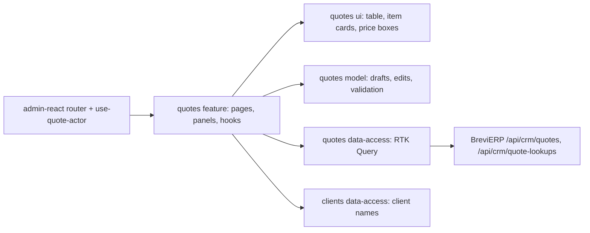

# «КП» — commercial proposals

**State:** stage 1 implemented 2026-11-04 (list and «Товари та ціни» editor), Admin React. Specification: [Admin «КП»](../../specs/admin/quotes/001-quotes/README.md); backend rules R-* in BreviERP `docs/sdd/specs/crm/003-quotes/README.md`. Look: [«Цех»](../../standards/admin/design-system.md).

## Behavior and routes

| Route                  | Purpose                                                                                              |
| ---------------------- | ---------------------------------------------------------------------------------------------------- |
| `/crm/quotes`          | List: search by number, client or company; «Відповідальний» filter for Director and Admin; «Нове КП» |
| `/crm/quotes/new`      | Empty editor; the number is given on the first save, then the URL becomes `/crm/quotes/:quoteId`     |
| `/crm/quotes/:quoteId` | «Товари та ціни» editor of a saved КП                                                                |

- Menu «Менеджер сервісу»: «КП» links to the list; «КП для знайомства» (stage 4) and «Налаштування КП» (stage 2, Admin role, which Director also holds) have no page yet.
- A Manager sees and opens only КП where they are responsible; the server enforces it (404 for others). Director and Admin see all, and «Передати розрахунок» hands a КП to any staff member.
- Items: a sewing model with fabric variants, a catalogue PPE, a one-off PPE. Each option has three prices (до 9 / 10–40 / від 41 шт.), each with «показати в КП». Catalog prices are taken by the server when an option is added and kept on later saves; «Перерахувати за актуальними цінами» shows old → new first and saves only on confirmation.
- A PPE price can be typed over the Catalog one and then needs a reason; a one-off PPE has only manual prices. A sewing price is never typed.
- The browser checks the same rules before saving (name, prices, reason, at least one shown price above zero); the server checks them again. A 409 shows «КП змінили в іншому вікні» with «Оновити».
- The internal name suggests KeepinCRM client names and accepts any text; it is for the manager only.

## Structure diagram



## Code structure

```text
apps/admin-react/src/app/router/
  use-quote-actor.ts                 signed-in user → QuoteActor (Admin role sees all)
  admin-route-definitions.tsx        createQuotesRoutes({ useQuoteActor })
  legacy-menu.ts                     «КП», «КП для знайомства», «Налаштування КП»
libs/admin/quotes/
  model/src/
    entities/                        Quote, QuoteSummary, catalogue search and reprice report
    models/quote-draft.ts            editor drafts, tiers and their labels
    mappers/                         saved КП/catalogue → draft, pure draft edits, price text
    validators/                      editor rules by place (header, item, option)
  data-access/src/
    api/                             quotes (list, get, create, save, delete, reprice, responsible), lookups (catalogue, staff)
    mappers/                         contract → model, draft → save input
    errors/                          Ukrainian API messages
  ui/src/
    tables/quotes-table.tsx          server-paged list
    components/editor/               header, item card, option row, price box, notes
    components/picker/               catalogue product row
    components/reprice/              old → new report
  feature/src/
    quotes.routes.tsx                route factory; the app passes the actor
    pages/{list,editor}/             list page; editor page and its header actions
    components/picker/               «Додати товар» and «Додати тканину» side panels
    components/editor/               «Передати розрахунок», reprice panel, delete dialog
    hooks/{list,editor,picker}/      list state; draft, save and client names; catalogue search
```

The feature library cannot import `core/auth`, so the app passes `useQuoteActor` into the route factory. Generated contract types stay in data-access.

## Tests

- Model: `validators/quote-draft-validation.unit.test.ts`, `mappers/quote-price-text.unit.test.ts` — `npx nx test admin-quotes-model`.
- Data access: `mappers/quote-input.mapper.unit.test.ts` — `npx nx test admin-quotes-data-access`.
- UI: `components/editor/quote-price-box.component.test.tsx` — `npx nx test admin-quotes-ui`.
- Feature: `pages/list/quotes-page.component.test.tsx` (own-only list, responsible filter), `pages/editor/quote-editor-page.component.test.tsx` (manual price needs a reason, hide a price, 409 reload) — `npx nx test admin-quotes-feature`.
- Menu and routes: `apps/admin-react/src/app/router/*.test.ts(x)` — `npx nx test admin-react -- src/app/router`.
