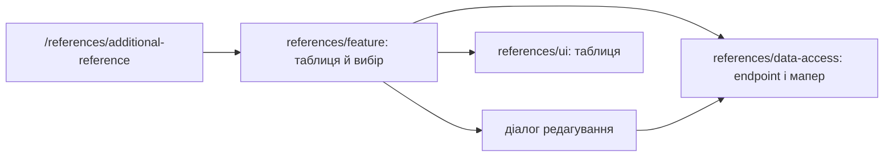

# Admin: додаткові довідники

**Стан:** реалізований маршрут перегляду та редагування, звірено 2026-10-16.

`/references/additional-reference` показує таблицю й діалог редагування вибраного запису. `references/feature` володіє завантаженням, локальним вибором, помилкою і повідомленням після збереження; `references/ui` показує таблицю; `references/data-access` інкапсулює endpoint і мапер. Не припускай повний CRUD лише з назви довідника: поточна сторінка відкриває редагування.

## Схема будови



## Структура в коді

```text
libs/admin/references/
├── data-access/src/
│   ├── api/additional-references/
│   │   └── additional-references.api.ts # API
│   └── mappers/additional-references/
│       └── additional-references.mapper.ts # мапер
├── feature/src/
│   ├── components/additional-references/
│   │   └── additional-reference-dialog.tsx # редактор
│   ├── hooks/additional-references/
│   │   └── use-additional-references.ts # завантаження
│   ├── pages/additional-references/
│   │   └── additional-references-page.tsx # сторінка
│   └── references.routes.tsx # маршрут
├── model/src/entities/additional-references/
│   └── additional-reference.ts # модель
└── ui/src/components/additional-references/
    └── additional-references-grid.tsx # таблиця
```

**Де шукати:** [маршрут](../../../../libs/admin/references/feature/src/references.routes.tsx), [сторінка](../../../../libs/admin/references/feature/src/pages/additional-references/additional-references-page.tsx), [API](../../../../libs/admin/references/data-access/src/api/additional-references/additional-references.api.ts), [SDD](../../../specs/admin/references/011-additional-references-pages/README.md).
