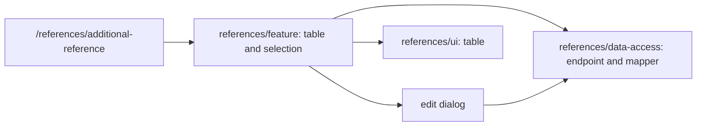

# Admin: Additional Reference Data

**Status:** view and edit route implemented, checked 2026-10-16.

`/references/additional-reference` shows a table and an edit dialog for the
selected record. `references/feature` owns loading, local selection, errors,
and the message after saving; `references/ui` displays the table;
`references/data-access` encapsulates the endpoint and mapper. Do not assume
full CRUD from the reference data name: the current page opens an edit flow.

## Structure diagram



## Code structure

```text
libs/admin/references/
├── data-access/src/
│   ├── api/additional-references/
│   │   └── additional-references.api.ts # API
│   └── mappers/additional-references/
│       └── additional-references.mapper.ts # mapper
├── feature/src/
│   ├── components/additional-references/
│   │   └── additional-reference-dialog.tsx # editor
│   ├── hooks/additional-references/
│   │   └── use-additional-references.ts # loading
│   ├── pages/additional-references/
│   │   └── additional-references-page.tsx # page
│   └── references.routes.tsx # route
├── model/src/entities/additional-references/
│   └── additional-reference.ts # model
└── ui/src/components/additional-references/
    └── additional-references-grid.tsx # table
```

**Where to look:** [route](../../../../libs/admin/references/feature/src/references.routes.tsx), [page](../../../../libs/admin/references/feature/src/pages/additional-references/additional-references-page.tsx), [API](../../../../libs/admin/references/data-access/src/api/additional-references/additional-references.api.ts), [SDD](../../../specs/admin/references/011-additional-references-pages/README.md).

## Tests

- `libs/admin/references/data-access/src/mappers/<additional-references>/*.unit.test.ts`, shared `libs/admin/references/data-access/src/api/integration/references.api.integration.test.ts`
- `libs/admin/references/feature/src/pages/<additional-references>/*.component.test.tsx`
- `libs/admin/references/model/src/validators/additional-references/`
- shared editor `libs/admin/references/ui/src/components/reference-editor/reference-editor-drawer.test.tsx`
- E2E (run only on request): `apps/admin-react-e2e/src/additional-references.spec.ts`

Focused run: `npx nx test admin-references-data-access -- additional-references`; `npx nx test admin-references-feature -- additional-references`; `npx nx test admin-references-model -- additional-references`.
