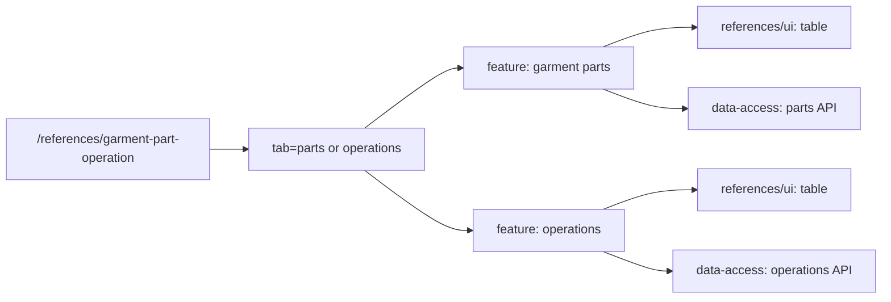

# Admin: Garment Parts and Operations

**Status:** both tabs exist, checked 2026-10-16.

`/references/garment-part-operation` opens parts and operations tabs; the
`tab=parts|operations` query preserves the selection. Each tab has its own
content, hooks, and action dialogs in `references/feature`, tables in
`references/ui`, and separate endpoints and mappers in
`references/data-access`. A shared route does not imply a shared data model.

## Structure diagram



## Code structure

```text
libs/admin/references/
├── data-access/src/api/
│   ├── garment-part-operations/
│   │   └── garment-part-operations.api.ts # operations API
│   └── garment-parts/
│       └── garment-parts.api.ts # parts API
├── feature/src/
│   ├── hooks/
│   │   ├── garment-part-operations/
│   │   │   └── use-garment-part-operations.ts # operations state
│   │   └── garment-parts/
│   │       └── use-garment-parts.ts # parts state
│   ├── pages/
│   │   ├── garment-part-operations/
│   │   │   └── garment-part-operations-content.tsx # operations tab
│   │   └── garment-parts/
│   │       └── garment-parts-page.tsx # tabs
│   └── references.routes.tsx # route
├── model/src/entities/
│   ├── garment-part-operations/
│   │   └── garment-part-operation.ts # operations model
│   └── garment-parts/
│       └── garment-part.ts # parts model
└── ui/src/components/
    ├── garment-part-operations/
    │   └── garment-part-operations-grid.tsx # operations table
    └── garment-parts/
        └── garment-parts-grid.tsx # parts table
```

**Where to look:** [route](../../../../libs/admin/references/feature/src/references.routes.tsx), [tabs](../../../../libs/admin/references/feature/src/pages/garment-parts/garment-parts-page.tsx), [parts API](../../../../libs/admin/references/data-access/src/api/garment-parts/garment-parts.api.ts), [operations API](../../../../libs/admin/references/data-access/src/api/garment-part-operations/garment-part-operations.api.ts), [SDD](../../../specs/admin/references/009-operations-pages/README.md).

## Tests

- `libs/admin/references/data-access/src/mappers/<garment-parts|garment-part-operations>/*.unit.test.ts`, shared `libs/admin/references/data-access/src/api/integration/references.api.integration.test.ts`
- `libs/admin/references/feature/src/pages/<garment-parts|garment-part-operations>/*.component.test.tsx`
- `libs/admin/references/model/src/validators/garment-part-operations/`
- shared editor `libs/admin/references/ui/src/components/reference-editor/reference-editor-drawer.test.tsx`
- E2E (run only on request): `apps/admin-react-e2e/src/garment-parts.spec.ts`, `apps/admin-react-e2e/src/garment-part-operations.spec.ts`

Focused run: `npx nx test admin-references-data-access -- garment-parts garment-part-operations`; `npx nx test admin-references-feature -- garment-parts garment-part-operations`; `npx nx test admin-references-model -- garment-part-operations`.
