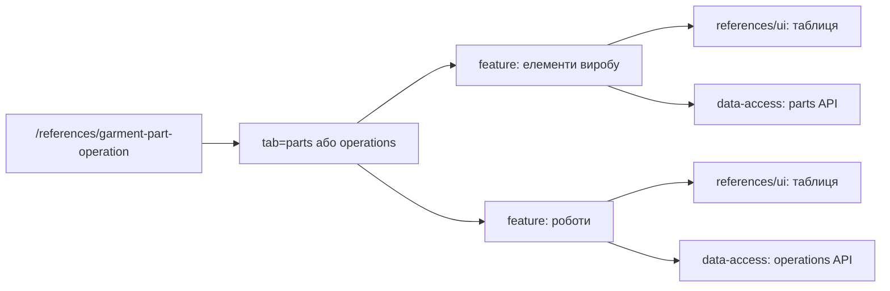

# Admin: елементи виробу і роботи

**Стан:** обидві вкладки наявні, звірено 2026-10-16.

`/references/garment-part-operation` відкриває вкладки елементів і робіт; query `tab=parts|operations` зберігає вибір. Для кожної вкладки `references/feature` має власні content, hooks і діалоги дій, `references/ui` — таблиці, `references/data-access` — окремі endpoints та мапери. Спільний маршрут не означає спільної моделі даних.

## Схема будови



## Структура в коді

```text
libs/admin/references/
├── data-access/src/api/
│   ├── garment-part-operations/
│   │   └── garment-part-operations.api.ts # API робіт
│   └── garment-parts/
│       └── garment-parts.api.ts # API елементів
├── feature/src/
│   ├── hooks/
│   │   ├── garment-part-operations/
│   │   │   └── use-garment-part-operations.ts # стан робіт
│   │   └── garment-parts/
│   │       └── use-garment-parts.ts # стан елементів
│   ├── pages/
│   │   ├── garment-part-operations/
│   │   │   └── garment-part-operations-content.tsx # вкладка робіт
│   │   └── garment-parts/
│   │       └── garment-parts-page.tsx # вкладки
│   └── references.routes.tsx # маршрут
├── model/src/entities/
│   ├── garment-part-operations/
│   │   └── garment-part-operation.ts # модель робіт
│   └── garment-parts/
│       └── garment-part.ts # модель елементів
└── ui/src/components/
    ├── garment-part-operations/
    │   └── garment-part-operations-grid.tsx # таблиця робіт
    └── garment-parts/
        └── garment-parts-grid.tsx # таблиця елементів
```

**Де шукати:** [маршрут](../../../../libs/admin/references/feature/src/references.routes.tsx), [вкладки](../../../../libs/admin/references/feature/src/pages/garment-parts/garment-parts-page.tsx), [API елементів](../../../../libs/admin/references/data-access/src/api/garment-parts/garment-parts.api.ts), [API робіт](../../../../libs/admin/references/data-access/src/api/garment-part-operations/garment-part-operations.api.ts), [SDD](../../../specs/admin/references/009-operations-pages/README.md).
