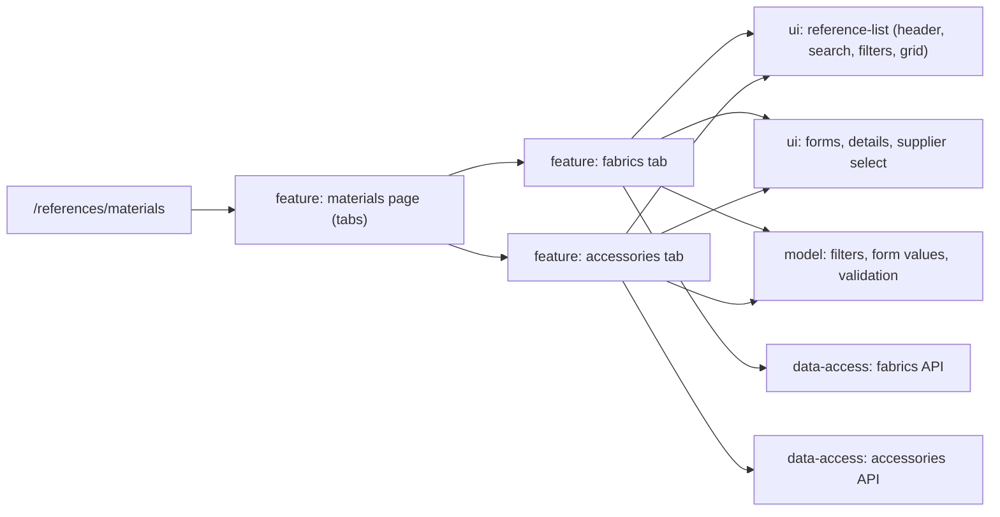

# Admin: Fabrics and Accessories

**Status:** one «Цех» page with the Calculator sheet fields, 2026-11-02.

«Тканини та фурнітура» (`/references/materials`) is one sidebar item with the tabs
«Тканини» and «Фурнітура» (`?tab=accessories`). The old URLs `/references/fabric`,
`/references/garment-accessory` and `?tab=fabrics` redirect to it. Each tab follows the
[reference list pattern](../../../standards/admin/design-system.md):
header with «Видалити» (only while rows are selected) and the add action, a full-width
search row, activity chips and a supplier filter, then a Data Grid with code, names, supplier, price, price date and status pill, a row
menu, bulk deletion, and an editor drawer. Fabrics add RU names, composition,
density and the КП description; accessories add the unit (шт., м, послуга). The
sheet data was moved once through the backend import endpoint; the Admin has no
upload ([SDD 013](../../../specs/admin/references/013-fabrics-accessories-sheet/README.md)).

## Structure diagram



## Code structure

```text
libs/admin/references/
├── data-access/src/
│   ├── api/{fabrics,garment-accessories}/*.api.ts # endpoints
│   ├── contracts/{fabrics,garment-accessories}/ # generated DTO aliases
│   ├── validators/{fabrics,garment-accessories}/ # response validation
│   └── mappers/{fabrics,garment-accessories}/ # DTO -> domain
├── feature/src/
│   ├── components/{fabrics,garment-accessories}/*-drawer.tsx # editor drawers
│   ├── hooks/{fabrics,garment-accessories}/ # list, editor, deletion
│   ├── hooks/reference-lists/use-reference-list-filters.ts # search, activity, supplier state
│   ├── pages/materials/materials-page.tsx # tabs «Тканини / Фурнітура»
│   ├── pages/materials/{fabrics,garment-accessories}-content.tsx # tab content
│   ├── testing/reference-fixtures.ts # API rows for page tests
│   └── references.routes.tsx # route and redirects from the old URLs
├── model/src/
│   ├── entities/{fabrics,garment-accessories}/ # types, units
│   ├── forms/{fabrics,garment-accessories}/ # form values, КП suggestion
│   ├── mappers/reference-lists/reference-format.ts # UAH and date formatting
│   ├── queries/{fabrics,garment-accessories,reference-lists}/ # search, activity, supplier
│   └── validators/{fabrics,garment-accessories}/ # form rules
└── ui/src/components/
    ├── reference-list-controls/ # header, search, filters, bulk delete, alerts
    ├── reference-list/ # data grid, status pill, row menu, footer
    ├── reference-editor/ # drawer, form section, details list, supplier select
    ├── fabrics/ # grid, form, details, delete dialog
    └── garment-accessories/ # grid, form, details, delete dialog
```

**Where to look:** [routes](../../../../libs/admin/references/feature/src/references.routes.tsx), [materials page](../../../../libs/admin/references/feature/src/pages/materials/materials-page.tsx), [fabrics tab](../../../../libs/admin/references/feature/src/pages/materials/fabrics-content.tsx), [accessories tab](../../../../libs/admin/references/feature/src/pages/materials/garment-accessories-content.tsx), [shared grid](../../../../libs/admin/references/ui/src/components/reference-list/reference-data-grid.tsx), [fabrics API](../../../../libs/admin/references/data-access/src/api/fabrics/fabrics.api.ts), [accessories API](../../../../libs/admin/references/data-access/src/api/garment-accessories/garment-accessories.api.ts).

## Tests

- `libs/admin/references/data-access/src/mappers/<fabrics|garment-accessories>/*.unit.test.ts`, shared `libs/admin/references/data-access/src/api/integration/references.api.integration.test.ts`
- `libs/admin/references/feature/src/pages/materials/*.component.test.tsx`, `libs/admin/references/model/src/queries/reference-lists/reference-supplier-filter.unit.test.ts`
- `apps/admin-react/src/app/router/app-router.integration.test.tsx` (sidebar item and redirects)
- E2E (run only on request): `apps/admin-react-e2e/src/garment-accessories.spec.ts`

Focused run: `npx nx test admin-references-data-access -- fabrics garment-accessories`; `npx nx test admin-references-feature -- materials`.
