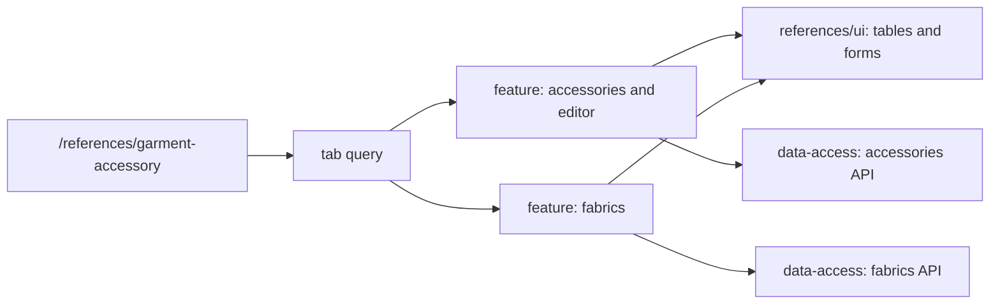

# Admin: Garment Accessories and Fabrics

**Status:** both tabs exist, checked 2026-10-16.

The `/references/garment-accessory` route has `accessories` and `fabrics` tabs,
with selection stored in the `tab` query. Accessories have a table, editor
drawer, and bulk deletion; the fabrics tab uses its own page and data.
`references/feature` orchestrates both scenarios, `references/ui` renders
tables and forms, and `references/data-access` has separate APIs and mappers
for accessories and fabrics.

## Structure diagram



## Code structure

```text
libs/admin/references/
├── data-access/src/api/
│   ├── fabrics/
│   │   └── fabrics.api.ts # fabrics API
│   └── garment-accessories/
│       └── garment-accessories.api.ts # accessories API
├── feature/src/
│   ├── hooks/
│   │   ├── fabrics/
│   │   │   └── use-fabrics.ts # fabrics state
│   │   └── garment-accessories/
│   │       └── use-garment-accessories.ts # accessories state
│   ├── pages/
│   │   ├── fabrics/
│   │   │   └── fabrics-page.tsx # fabrics page
│   │   └── garment-accessories/
│   │       └── garment-accessories-page.tsx # tabs
│   └── references.routes.tsx # route
├── model/src/entities/
│   ├── fabrics/
│   │   └── fabric.ts # fabric model
│   └── garment-accessories/
│       └── garment-accessory.ts # accessory model
└── ui/src/components/
    ├── fabrics/
    │   └── fabrics-grid.tsx # fabrics table
    └── garment-accessories/
        └── garment-accessories-grid.tsx # accessories table
```

**Where to look:** [route](../../../../libs/admin/references/feature/src/references.routes.tsx), [tabs](../../../../libs/admin/references/feature/src/pages/garment-accessories/garment-accessories-page.tsx), [fabrics page](../../../../libs/admin/references/feature/src/pages/fabrics/fabrics-page.tsx), [accessories API](../../../../libs/admin/references/data-access/src/api/garment-accessories/garment-accessories.api.ts), [fabrics API](../../../../libs/admin/references/data-access/src/api/fabrics/fabrics.api.ts), [SDD](../../../specs/admin/references/008-garment-materials-pages/README.md).
