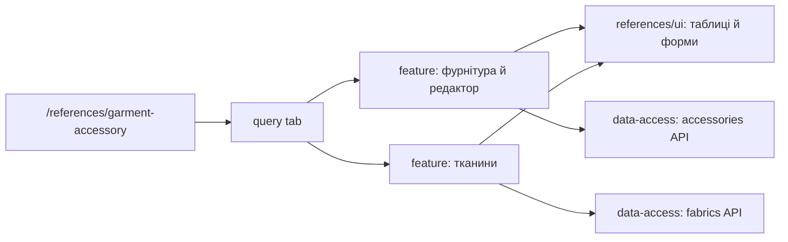

# Admin: фурнітура і тканини

**Стан:** обидві вкладки наявні, звірено 2026-10-16.

Маршрут `/references/garment-accessory` містить вкладки `accessories` і `fabrics`, стан яких записано в query `tab`. Фурнітура має таблицю, drawer редактора та групове видалення; вкладка тканин використовує власну сторінку й дані. `references/feature` оркеструє обидва сценарії, `references/ui` малює таблиці й форми, `references/data-access` має окремі API та мапери для фурнітури й тканин.

## Схема будови



## Структура в коді

```text
libs/admin/references/
├── data-access/src/api/
│   ├── fabrics/
│   │   └── fabrics.api.ts # API тканин
│   └── garment-accessories/
│       └── garment-accessories.api.ts # API фурнітури
├── feature/src/
│   ├── hooks/
│   │   ├── fabrics/
│   │   │   └── use-fabrics.ts # стан тканин
│   │   └── garment-accessories/
│   │       └── use-garment-accessories.ts # стан фурнітури
│   ├── pages/
│   │   ├── fabrics/
│   │   │   └── fabrics-page.tsx # сторінка тканин
│   │   └── garment-accessories/
│   │       └── garment-accessories-page.tsx # вкладки
│   └── references.routes.tsx # маршрут
├── model/src/entities/
│   ├── fabrics/
│   │   └── fabric.ts # модель тканини
│   └── garment-accessories/
│       └── garment-accessory.ts # модель фурнітури
└── ui/src/components/
    ├── fabrics/
    │   └── fabrics-grid.tsx # таблиця тканин
    └── garment-accessories/
        └── garment-accessories-grid.tsx # таблиця фурнітури
```

**Де шукати:** [маршрут](../../../../libs/admin/references/feature/src/references.routes.tsx), [вкладки](../../../../libs/admin/references/feature/src/pages/garment-accessories/garment-accessories-page.tsx), [сторінка тканин](../../../../libs/admin/references/feature/src/pages/fabrics/fabrics-page.tsx), [API фурнітури](../../../../libs/admin/references/data-access/src/api/garment-accessories/garment-accessories.api.ts), [API тканин](../../../../libs/admin/references/data-access/src/api/fabrics/fabrics.api.ts), [SDD](../../../specs/admin/references/008-garment-materials-pages/README.md).
