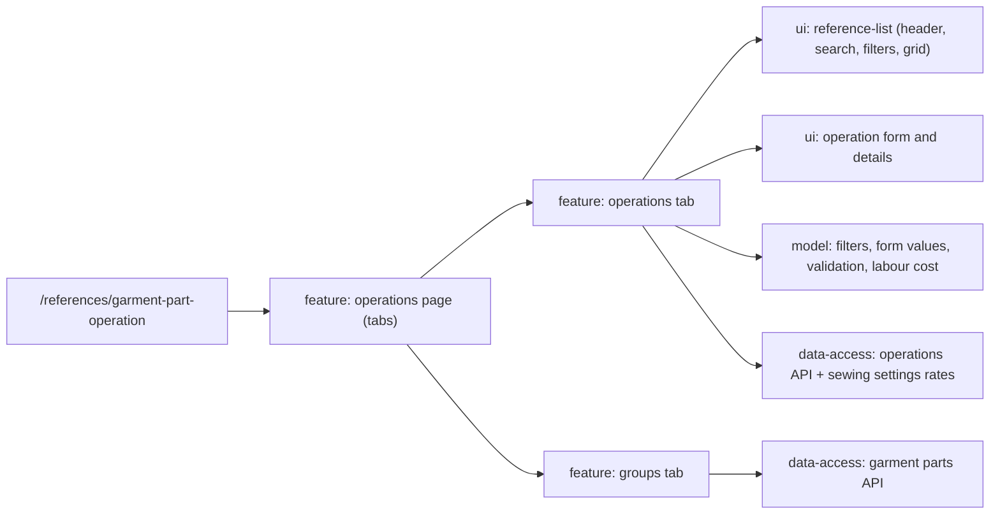

# Admin: Operations

**Status:** one «Цех» page with the Calculator sheet fields, 2026-11-02.

«Операції» (`/references/garment-part-operation`) has the tabs «Операції» and
«Групи деталей» (`?tab=groups`; the old `?tab=parts` opens the same tab). The operations tab
follows the [reference list pattern](../../../standards/admin/design-system.md):

- a header with «Видалити» and «Додати операцію»;
- a full-width search row over code, group, element, variant and name;
- activity chips and a group filter;
- a table with code, group, element, variant, name, norm, the two cost columns, check date and status;
- a row menu and an editor drawer.

The cost columns are not stored. They are computed from the norm and the current sewing settings (`GET /api/v1/pricing/sewing/settings`): «Вартість» is minutes × minute cost, and «Зі збиранням» is that × (1 + assembly rate). If the settings cannot be read, the cells show «—». An operation with «Час вказується для кожного виробу» has no norm and no cost.

The groups tab lists «Група деталей» names. A group that still has operations cannot be deleted. The sheet data is moved once through the backend import endpoint, and the Admin has no upload ([SDD 014](../../../specs/admin/references/014-operations-sheet/README.md)).

## Structure diagram



## Code structure

```text
libs/admin/references/
├── data-access/src/
│   ├── api/garment-part-operations/garment-part-operations.api.ts # operations + labour rates
│   ├── api/garment-parts/garment-parts.api.ts # groups API
│   ├── contracts/garment-part-operations/ # response and body types
│   ├── mappers/garment-part-operations/ # rows and minute cost
│   └── validators/garment-part-operations/ # response checks
├── feature/src/
│   ├── components/garment-part-operations/garment-part-operation-drawer.tsx
│   ├── hooks/garment-part-operations/ # list, labour rates, editor, deletion
│   ├── pages/operations/
│   │   ├── operations-page.tsx # tabs
│   │   ├── garment-part-operations-content.tsx # operations tab
│   │   └── garment-parts-content.tsx # groups tab
│   └── references.routes.tsx
├── model/src/
│   ├── entities/garment-part-operations/garment-part-operation.ts
│   ├── forms/garment-part-operations/garment-part-operation-form.ts # form values, request body
│   ├── mappers/garment-part-operations/operation-labour-cost.ts # cost and minutes format
│   ├── queries/garment-part-operations/garment-part-operation-filters.ts
│   └── validators/garment-part-operations/garment-part-operation-validation.ts
└── ui/src/components/
    ├── garment-part-operations/ # grid, form, details, delete dialog
    └── garment-parts/garment-parts-grid.tsx
```

**Where to look:** [route](../../../../libs/admin/references/feature/src/references.routes.tsx), [page](../../../../libs/admin/references/feature/src/pages/operations/operations-page.tsx), [operations API](../../../../libs/admin/references/data-access/src/api/garment-part-operations/garment-part-operations.api.ts), [labour cost](../../../../libs/admin/references/model/src/mappers/garment-part-operations/operation-labour-cost.ts).

## Tests

- `libs/admin/references/feature/src/pages/operations/*.component.test.tsx`
- `libs/admin/references/data-access/src/mappers/<garment-parts|garment-part-operations>/*.unit.test.ts`
- `libs/admin/references/model/src/{validators,mappers}/garment-part-operations/*.unit.test.ts`
- E2E (run only on request): `apps/admin-react-e2e/src/garment-parts.spec.ts`, `apps/admin-react-e2e/src/garment-part-operations.spec.ts`

Focused run: `npx nx test admin-references-feature -- operations`; `npx nx test admin-references-data-access -- garment-part`; `npx nx test admin-references-model -- garment-part-operations`.
