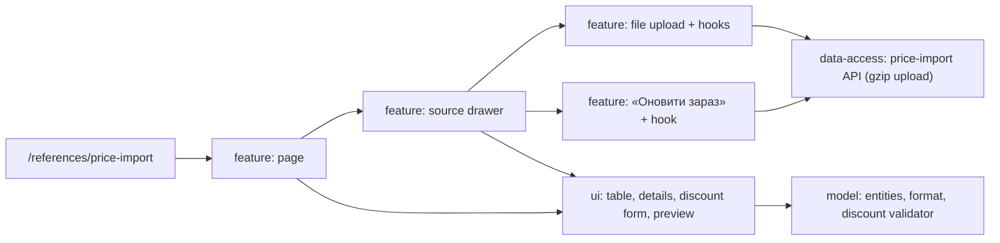

# Admin: «Імпорт цін» (PPE supplier prices)

**Status:** stages 1–2 implemented 2026-11-04. Spec: [018](../../../specs/admin/references/018-price-import/README.md); backend BreviERP CAT-017.

`/references/price-import` lists PPE supplier price sources (АВ-Центр, 3C-Маркет, Перчатка-центр, Insight, Трєле, СЕМТО) with their logic, schedule, discount and last update. A row opens the side panel; the supplier name opens the supplier card ([spec 019](../../../specs/admin/products/019-photos-cost-access-suppliers/README.md)). Administrators and the director change the discount there. File suppliers are updated from their files, and АВ-Центр, 3C-Маркет and Перчатка-центр (updated by the backend every Monday) also with «Оновити зараз»: «Перевірити» previews old and new prices, «Застосувати» saves them.

## Structure diagram



## Code structure

```text
libs/admin/references/
├── model/src/
│   ├── entities/price-import/          # PriceSource, PriceImportResult
│   ├── mappers/price-import/           # labels, sorting, discount and time format
│   └── validators/price-import/        # discount 0–90%
├── data-access/src/
│   ├── api/price-import/               # list, update discount, import files (gzip in the browser), refresh now
│   ├── contracts|validators|mappers/price-import/
├── ui/src/components/price-import/     # sources table, details, discount form, preview table
└── feature/src/
    ├── pages/price-import/             # page
    ├── components/price-import/        # drawer, file upload and «Оновити зараз» sections
    └── hooks/price-import/             # discount edit, file and refresh preview/apply
```

## Tests

`npx nx test admin-references-feature -- price-import`, `admin-references-model -- price-import`, `admin-references-data-access -- price-import`.
