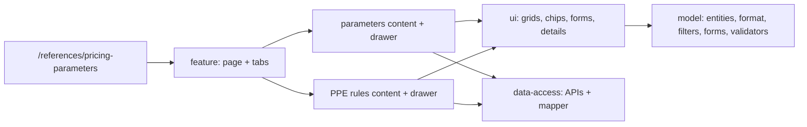

# Admin: Pricing parameters («Параметри ціноутворення»)

**Status:** implemented 2026-11-02 (replaces «Додаткові довідники»).

`/references/pricing-parameters` is the Admin copy of the Calculator sheet tab
«Налаштування цін». It has two tabs on the reference list pattern B:

- «Параметри» — salary, working time, production rates, overheads and profit
  coefficients: group, code, name, value, unit, manual or calculated, update date,
  comment. Section chips (the part of the group before `:`) filter the list.
- «Націнки ЗІЗ» (`?tab=ppe`) — PPE markup rules: retail, wholesale and large
  wholesale markup, price note, which goods the rule covers.

Percent values are stored as fractions (0.25) and shown and typed as percents
(25 %). The code cannot change after create; a calculated parameter
(`MINUTE_COST_SEAMSTRESS`) has no editable value, the backend computes it.
The old URL `/references/additional-reference` redirects here.

## Structure diagram



## Code structure

```text
libs/admin/references/
├── model/src/
│   ├── entities/pricing-parameters/        # PricingParameter, PpeMarkupRule
│   ├── mappers/pricing-parameters/         # percent <-> fraction, value format, section
│   ├── queries/pricing-parameters/         # search and section filters
│   ├── forms/pricing-parameters/           # form values <-> request
│   └── validators/pricing-parameters/      # field rules
├── data-access/src/
│   ├── api/pricing-parameters/             # RTK Query endpoints (both tables)
│   ├── contracts/pricing-parameters/       # OpenAPI response types
│   ├── validators/pricing-parameters/      # response validation
│   └── mappers/pricing-parameters/         # API -> model
├── ui/src/components/pricing-parameters/   # grids, chips, forms, details, delete dialog
└── feature/src/
    ├── hooks/pricing-parameters/           # lists, editors
    ├── hooks/reference-lists/use-reference-deletion.ts
    ├── components/pricing-parameters/      # drawers
    ├── pages/pricing-parameters/           # page, two tab contents
    └── references.routes.tsx               # route + old URL redirect
```

**Where to look:** [route](../../../../libs/admin/references/feature/src/references.routes.tsx), [page](../../../../libs/admin/references/feature/src/pages/pricing-parameters/pricing-parameters-page.tsx), [API](../../../../libs/admin/references/data-access/src/api/pricing-parameters/pricing-parameters.api.ts), [SDD](../../../specs/admin/references/015-pricing-parameters-sheet/README.md), [contract](../../../contracts/openapi/backend/reference/pricing-parameters.openapi.yaml).

Products read the parameter list for the PPE product editor lookups
(`admin-products-feature`, `use-product-lookups.ts`).

## Tests

- `libs/admin/references/model/src/forms/pricing-parameters/*.unit.test.ts`
- `libs/admin/references/data-access/src/mappers/pricing-parameters/*.unit.test.ts`
- `libs/admin/references/feature/src/pages/pricing-parameters/*.component.test.tsx`
- `apps/admin-react/src/app/router/app-router.integration.test.tsx` (menu and old URL)
- E2E (run only on request): `apps/admin-react-e2e/src/pricing-parameters.spec.ts`

Focused run: `npx nx test admin-references-model -- pricing-parameters`; `npx nx test admin-references-data-access -- pricing-parameters`; `npx nx test admin-references-feature -- pricing-parameters`.
