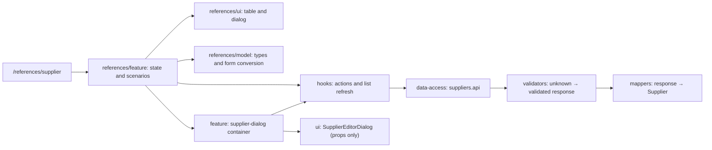

# Admin: Suppliers

**Status:** route and CRUD interface implemented; «Цех» page revision checked 2026-11-02; KeepinCRM sync and new fields added 2026-11-02 ([SDD 012](../../../specs/admin/references/012-suppliers-keepincrm/README.md)).

`/references/supplier` shows the supplier table; a dialog creates or edits a
record, and a separate flow confirms deletion of selected rows.
`references/feature` contains state and scenarios, `references/ui` contains the
table, editor presentation, and delete dialog, `references/model` contains types
and pure form conversion, and `references/data-access` contains the endpoint,
private response contract, validator, and mapper. The page handles
errors and list refresh through hooks.

The «Цех» page has a title and add action above one outlined table panel. Its
toolbar filters the loaded list by name, contact person, or phone (case-insensitive,
trimmed), reports the matching/total count, refreshes the API list, and confirms
bulk deletion. Filtering preserves hidden selections; refresh preserves the query.
Each row has a keyboard-accessible actions button in addition to the existing
context menu and Shift+F10. Escape restores focus. The table renders HTTP(S)
supplier links safely, uses mono IDs/phones and Ukrainian pagination, and scrolls
horizontally inside the panel on narrow screens. No mock records are supplied by
the page. The current form remains a dialog. Search has its own empty result;
list failures keep the retry action instead of presenting an empty directory.
The editor presentation receives its draft, errors, save state, and callbacks
through props; only the feature hook performs mutations. The grid merges its
empty-state messages with the current Brevi theme's locale, preserving shared
translations in light and dark modes.

**KeepinCRM.** Most suppliers come from KeepinCRM (backend job daily, or the
«Оновити з KeepinCRM» button, `POST /api/reference/suppliers/keepin-sync`). The
table shows «Що закуповуємо», site, contact, phone, email and a status pill
(«Активний» / «Не використовується»); the name cell shows the KeepinCRM ID. Filter
chips «Активні / Не використовуються / Усі» (default «Активні») sit in the toolbar,
and search also matches email and purchase categories. For a KeepinCRM supplier the
editor disables the card fields and saves only «Використовувати в проєкті» and notes
through `PUT /api/reference/suppliers/{id}/brevi-fields`; a manual supplier keeps
full editing. The subtitle shows the last sync time.

## Structure diagram



## Code structure

```text
libs/admin/references/
├── data-access/src/
│   ├── api/suppliers/
│   │   └── suppliers.api.ts # API
│   ├── contracts/suppliers/
│   │   └── suppliers-response.ts # private generated response type
│   ├── validators/suppliers/
│   │   └── suppliers-response.ts # unknown payload validation
│   └── mappers/suppliers/
│       └── suppliers.mapper.ts # validated response to domain model
├── feature/src/
│   ├── components/suppliers/
│   │   └── supplier-dialog.tsx # editor orchestration only
│   ├── hooks/suppliers/
│   │   ├── use-suppliers.ts # loading
│   │   ├── use-supplier-editor.ts # draft and create/update mutations
│   │   ├── use-supplier-keepin-sync.ts # «Оновити з KeepinCRM» action and notice
│   │   └── use-supplier-deletion.ts # selection and deletion
│   ├── pages/suppliers/
│   │   └── suppliers-page.tsx # page
│   └── references.routes.tsx # route
├── model/src/entities/suppliers/
│   └── supplier.ts # model
├── model/src/mappers/suppliers/
│   └── supplier-link.ts # shared HTTP(S) link normalization
├── model/src/forms/suppliers/
│   └── supplier-form.ts # mode contract, draft conversion, KeepinCRM-owned fields
├── model/src/queries/suppliers/
│   └── supplier-filters.ts # search and activity filter
├── model/src/mappers/suppliers/
│   └── supplier-keepin-sync.ts # sync summary text, last sync time
├── ui/src/components/suppliers/
│   ├── suppliers-toolbar.tsx # search, count, refresh, bulk action
│   ├── suppliers-grid.tsx # table, selection, empty states
│   ├── supplier-status-pill.tsx # active / not used pill
│   ├── suppliers-grid-footer.tsx # selection count and pagination
│   ├── supplier-row-menu.tsx # view/edit/delete actions
│   └── supplier-link-cell.tsx # safe external link presentation
└── ui/src/dialogs/suppliers/
    └── supplier-editor-dialog.tsx # form presentation without API hooks
```

**Where to look:** [route](../../../../libs/admin/references/feature/src/references.routes.tsx), [page](../../../../libs/admin/references/feature/src/pages/suppliers/suppliers-page.tsx), [API](../../../../libs/admin/references/data-access/src/api/suppliers/suppliers.api.ts), [base SDD](../../../specs/admin/references/001-suppliers/README.md), [closed next-stage SDD](../../../specs/admin/references/010-suppliers-pages/README.md).

## Tests

- `libs/admin/references/data-access/src/mappers/suppliers/suppliers.mapper.unit.test.ts`, shared `libs/admin/references/data-access/src/api/integration/references.api.integration.test.ts`
- `libs/admin/references/feature/src/pages/suppliers/suppliers-page.component.test.tsx`
- `libs/admin/references/ui/src/components/suppliers/supplier-link-cell.component.test.tsx`
- `libs/admin/references/model/src/mappers/suppliers/supplier-link.unit.test.ts`
- `libs/admin/references/ui/src/dialogs/suppliers/supplier-editor-dialog.component.test.tsx`
- `libs/admin/references/data-access/src/validators/suppliers/suppliers-response.unit.test.ts`
- `apps/admin-react/src/app/theme/suppliers-grid.integration.test.tsx` (real Brevi theme and shared locale)
- `apps/admin-react/src/app/router/app-router.integration.test.tsx` (direct supplier URL inside the shell with a native mock Response)

Focused run: `npx nx test admin-references-data-access -- suppliers`; `npx nx test admin-references-feature -- suppliers`.
For link presentation: `npx nx test admin-references-ui`; normalization: `npx nx test admin-references-model -- supplier-link`.
Focused audit regression: `npx nx test admin-react -- suppliers-grid.integration.test.tsx`;
`npx nx test admin-references-ui -- supplier-editor-dialog.component.test.tsx`;
`npx nx test admin-references-data-access -- suppliers.mapper.unit.test.ts suppliers-response.unit.test.ts references.api.integration.test.ts`.
