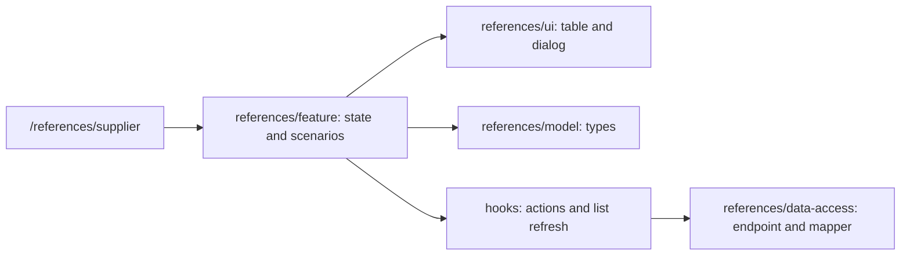

# Admin: Suppliers

**Status:** route and CRUD interface implemented, checked 2026-10-16.

`/references/supplier` shows the supplier table; a dialog creates or edits a
record, and a separate flow confirms deletion of selected rows.
`references/feature` contains state and scenarios, `references/ui` contains the
table and delete dialog, `references/model` contains types, and
`references/data-access` contains the endpoint and mapper. The page handles
errors and list refresh through hooks.

## Structure diagram



## Code structure

```text
libs/admin/references/
├── data-access/src/
│   ├── api/suppliers/
│   │   └── suppliers.api.ts # API
│   └── mappers/suppliers/
│       └── suppliers.mapper.ts # mapper
├── feature/src/
│   ├── components/suppliers/
│   │   └── supplier-dialog.tsx # editor
│   ├── hooks/suppliers/
│   │   └── use-suppliers.ts # loading
│   ├── pages/suppliers/
│   │   └── suppliers-page.tsx # page
│   └── references.routes.tsx # route
├── model/src/entities/suppliers/
│   └── supplier.ts # model
└── ui/src/components/suppliers/
    └── suppliers-grid.tsx # table
```

**Where to look:** [route](../../../../libs/admin/references/feature/src/references.routes.tsx), [page](../../../../libs/admin/references/feature/src/pages/suppliers/suppliers-page.tsx), [API](../../../../libs/admin/references/data-access/src/api/suppliers/suppliers.api.ts), [base SDD](../../../specs/admin/references/001-suppliers/README.md), [closed next-stage SDD](../../../specs/admin/references/010-suppliers-pages/README.md).
