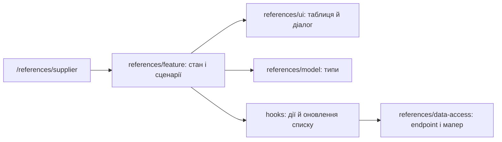

# Admin: постачальники

**Стан:** реалізований маршрут і CRUD-інтерфейс, звірено 2026-10-16.

`/references/supplier` показує таблицю постачальників; діалог створює або редагує запис, окремий потік підтверджує видалення вибраних. `references/feature` містить стан і сценарій, `references/ui` — таблицю й діалог видалення, `references/model` — типи, `references/data-access` — endpoint і мапер. Помилки й оновлення списку обробляє сторінка через hooks.

## Схема будови



## Структура в коді

```text
libs/admin/references/
├── data-access/src/
│   ├── api/suppliers/
│   │   └── suppliers.api.ts # API
│   └── mappers/suppliers/
│       └── suppliers.mapper.ts # мапер
├── feature/src/
│   ├── components/suppliers/
│   │   └── supplier-dialog.tsx # редактор
│   ├── hooks/suppliers/
│   │   └── use-suppliers.ts # завантаження
│   ├── pages/suppliers/
│   │   └── suppliers-page.tsx # сторінка
│   └── references.routes.tsx # маршрут
├── model/src/entities/suppliers/
│   └── supplier.ts # модель
└── ui/src/components/suppliers/
    └── suppliers-grid.tsx # таблиця
```

**Де шукати:** [маршрут](../../../../libs/admin/references/feature/src/references.routes.tsx), [сторінка](../../../../libs/admin/references/feature/src/pages/suppliers/suppliers-page.tsx), [API](../../../../libs/admin/references/data-access/src/api/suppliers/suppliers.api.ts), [SDD](../../../specs/admin/references/010-suppliers-pages/README.md).
