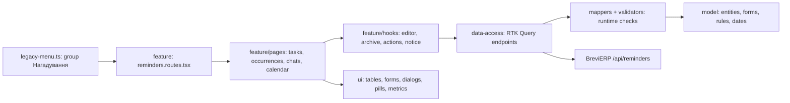

# Admin: Telegram reminders

**Status:** implementation exists, checked 2026-11-01. [SDD](../../specs/admin/reminders/001-telegram-reminders/README.md), [consumer contract](../../specs/admin/reminders/001-telegram-reminders/contracts/api-contract.md).

The sidebar group «Нагадування» has four pages. «Задачі» lists deadline tasks with an organization filter, the next deadline and the assigned chat, and opens a dialog with a live preview of the next three deadlines. «Періоди» shows each task period with who closed it, admin close/reopen and the action history, plus a metric strip of open, overdue, due today and postponed periods. «Чати Telegram» approves and renames chats found by the bot, ticks «Надсилати сюди заявки з сайту» for the groups that get the site's requests (LEAD-002), sends a test message, assigns a chat to organizations and connects the bot webhook. «Неробочі дні» manages extra days off. Data comes from the BreviERP Reminders API; Telegram sending happens in the backend. Routes: «Задачі» `/reminders/tasks`, «Періоди» `/reminders/periods`, «Чати Telegram» `/reminders/chats`, «Неробочі дні» `/reminders/non-working-days`.

## Structure diagram



## Code structure

```text
libs/admin/reminders/
  model/src/
    entities/{tasks,occurrences,chats,calendar}/   # types, code lists, Ukrainian labels, limits
    forms/tasks/reminder-task-form.ts             # form values ↔ API input
    validators/tasks/reminder-task-validation.ts  # same limits as the backend
    mappers/{schedules,dates,occurrences}/        # rule text, dd.MM.yyyy, Kyiv today, period state
  data-access/src/
    api/{tasks,occurrences,chats,calendar}/       # endpoint groups; reminders.api.ts composes hooks
    mappers/**                                    # validated response → model, model → request body
    validators/reminder-response.ts               # runtime primitives
    cache/reminder-cache-tags.ts                  # tags; calendar changes refresh tasks and periods
    errors/reminder-api-error.ts                  # keeps backend 409 reason
  ui/src/
    tables/{tasks,occurrences,chats,calendar}/    # grids with cells/
    forms/{tasks,calendar}/  dialogs/**  details/occurrences/
    components/{layout,status,metrics,filters,schedule,chats}/  feedback/
  feature/src/
    reminders.routes.tsx  pages/**  hooks/**  model/{occurrence,task}-filters.ts  errors/
apps/admin-react/src/app/router/{legacy-menu.ts,admin-route-definitions.tsx}
```

## Tests

Model, data-access mappers and the HTTP/cache boundary, UI components and feature pages: `npx nx run-many -t test -p admin-reminders-model admin-reminders-data-access admin-reminders-ui admin-reminders-feature`. Menu wiring: `npx nx test admin-react -- navigation-config`.
