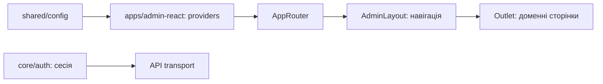

# Admin: оболонка, навігація і сесія

**Стан:** наявна реалізація, звірено 2026-10-16.

`apps/admin-react` запускає React, складає providers і `AppRouter`. `AdminLayout` із `libs/admin/core/shell` показує навігацію та `Outlet`; список пунктів залежить від фактично доступних маршрутів. `libs/admin/core/auth` надає сесію для API transport, а `libs/admin/shared/config` — runtime-конфігурацію. Це спільна основа для доменних сторінок, а не окреме місце для їхніх бізнес-правил.

## Схема будови



## Структура в коді

```text
apps/admin-react/
└── src/app/
    ├── router/
    │   ├── app-router.tsx # маршрутизатор
    │   └── navigation-config.ts # навігація
    └── app.tsx # композиція
```

```text
libs/admin/core/
├── auth/src/
│   ├── session/
│   │   └── auth-session.ts # сесія
│   └── index.ts # сесія
└── shell/src/
    ├── layout/
    │   └── admin-layout.tsx # оболонка та Outlet
    └── navigation/
        └── admin-navigation.tsx # навігація
```

```text
libs/admin/shared/
└── config/src/config/
    └── app-config.ts # runtime-конфігурація
```

**Де шукати:** [композиція](../../../apps/admin-react/src/app/app.tsx), [маршрутизатор](../../../apps/admin-react/src/app/router/app-router.tsx), [навігація](../../../apps/admin-react/src/app/router/navigation-config.ts), [сесія](../../../libs/admin/core/auth/src/index.ts), [архітектура маршрутів](../../architecture/admin/runtime/application.md), [специфікація оболонки](../../specs/admin/shell/001-react-admin-shell-theme/README.md).
