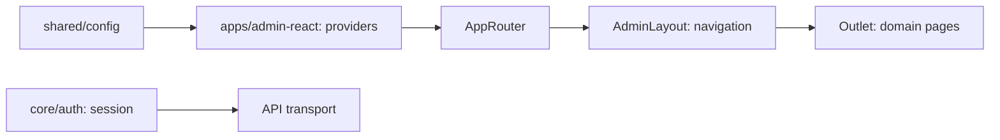

# Admin: Shell, Navigation, and Session

**Status:** implementation exists, checked 2026-10-16.

`apps/admin-react` starts React and composes providers and `AppRouter`.
`AdminLayout` from `libs/admin/core/shell` displays navigation and `Outlet`; the
list of items depends on routes that are actually available.
`libs/admin/core/auth` provides the session for API transport, while
`libs/admin/shared/config` provides runtime configuration. This is the shared
foundation for domain pages, not a separate place for their business rules.

## Structure diagram



## Code structure

```text
apps/admin-react/
└── src/app/
    ├── router/
    │   ├── app-router.tsx # router
    │   └── navigation-config.ts # navigation
    └── app.tsx # composition
```

```text
libs/admin/core/
├── auth/src/
│   ├── session/
│   │   └── auth-session.ts # session
│   └── index.ts # session
└── shell/src/
    ├── layout/
    │   └── admin-layout.tsx # shell and Outlet
    └── navigation/
        └── admin-navigation.tsx # navigation
```

```text
libs/admin/shared/
└── config/src/config/
    └── app-config.ts # runtime configuration
```

**Where to look:** [composition](../../../apps/admin-react/src/app/app.tsx), [router](../../../apps/admin-react/src/app/router/app-router.tsx), [navigation](../../../apps/admin-react/src/app/router/navigation-config.ts), [session](../../../libs/admin/core/auth/src/index.ts), [routing architecture](../../architecture/admin/runtime/application.md), [shell specification](../../specs/admin/shell/001-react-admin-shell-theme/README.md).

## Tests

- `libs/admin/core/shell/src/**/*.component.test.tsx`
- `libs/admin/core/auth/src/session/*.test.ts`
- `apps/admin-react/src/app/**/*.test.ts(x)` (router, providers, navigation, theme)
- E2E (run only on request): `apps/admin-react-e2e/src/admin-react.shell.spec.ts`

Focused run: `npx nx test admin-core-shell`; `npx nx test admin-core-auth`; `npx nx test admin-react -- src/app`.
