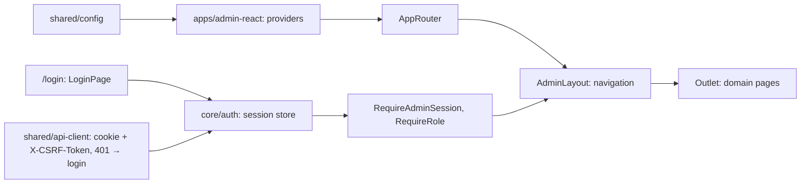

# Admin: Shell, Navigation, and Session

**Status:** implementation exists, checked 2026-11-04 (design system «Цех»; cookie sign-in, [SDD](../../specs/admin/auth/002-cookie-sign-in/README.md)).

`apps/admin-react` starts React and composes providers and `AppRouter`.
`AdminLayout` from `libs/admin/core/shell` displays the graphite sidebar, the top
bar (breadcrumbs, search, notifications, theme menu, and profile menu), and `Outlet`;
search and notifications are placeholders until a backend exists; the profile menu
shows the signed-in person and opens «Мій кабінет» or «Вийти» ([profile](profile.md));
the list of items depends on
routes that are actually available. The sidebar collapses to icons on desktop (group
flyouts, choice remembered) and opens as a drawer on phones. Look and behavior follow
the [design system «Цех»](../../standards/admin/design-system.md).
`libs/admin/core/auth` owns sign-in: the `/login` page, the cookie session restored
from `GET /api/auth/session/me`, the route guards and «Немає доступу»;
`libs/admin/shared/config` provides runtime configuration. This is the shared
foundation for domain pages, not a separate place for their business rules.

## Structure diagram



## Code structure

```text
apps/admin-react/
├── index.html # title, favicon links, fonts
├── public/ # favicon.ico, favicon-32x32.png, apple-touch-icon.png, assets/logo/ (wordmark, mark)
└── src/app/
    ├── router/
    │   ├── app-router.tsx # router provider
    │   ├── create-admin-router.tsx # /login, session guard, Admin-only users route
    │   ├── legacy-menu.ts # groups, icons, sections
    │   └── navigation-config.ts # navigation
    ├── theme/ # palette, typography, motion, components
    └── app.tsx # composition
```

```text
libs/admin/core/
├── auth/src/
│   ├── session/ # auth-session (login, logout, start), session-store, transport, roles
│   ├── routes/ # RequireAdminSession, RequireRole, safe return path
│   ├── pages/ # login page and its error texts, «Немає доступу»
│   └── index.ts # public API
└── shell/src/
    ├── layout/
    │   └── admin-layout.tsx # shell, collapse state, and Outlet
    ├── components/top-bar/ # top bar and breadcrumbs; actions/ search, notifications, theme, profile
    └── navigation/
        ├── navigation-palette.ts # palette.navigation type
        ├── menu/ # «Робочий стіл» tile, groups, items, collapsed flyout, route matching
        └── sidebar/ # drawers, panel, logo (wordmark or mark when collapsed), collapse hook
```

```text
libs/admin/shared/
├── config/src/config/
│   └── app-config.ts # runtime configuration
└── api-client/src/
    ├── csrf/csrf-token.ts # reads brevi.csrf
    └── interceptors/ # CSRF header, 401 → end of session, logging
```

**Where to look:** [composition](../../../apps/admin-react/src/app/app.tsx), [router](../../../apps/admin-react/src/app/router/app-router.tsx), [navigation](../../../apps/admin-react/src/app/router/navigation/navigation-config.ts), [session](../../../libs/admin/core/auth/src/index.ts), [routing architecture](../../architecture/admin/runtime/application.md), [shell specification](../../specs/admin/shell/001-react-admin-shell-theme/README.md), [design system specification](../../specs/admin/shell/002-workshop-design-system/README.md).

## Tests

- `libs/admin/core/shell/src/**/*.component.test.tsx`
- `libs/admin/core/auth/src/**/*.test.ts(x)` (session, transport, return path, guard, login page)
- `libs/admin/shared/api-client/src/interceptors/auth-interceptors.integration.test.ts`
- `apps/admin-react/src/app/**/*.test.ts(x)` (router, providers, navigation, theme)
- E2E (run only on request): `apps/admin-react-e2e/src/admin-react.shell.spec.ts`

Focused run: `npx nx test admin-core-shell`; `npx nx test admin-core-auth`; `npx nx test admin-react -- src/app`.

## Sign-in and session

The session is the HttpOnly cookie `__Host-brevi.session` of `api.brevi.com.ua`; the Admin keeps no token. `initializeAdminAuth()` asks `me` before the first render; a guest goes to `/login?returnTo=…`, and after sign-in returns there (only in-app paths). A `401` from any data request ends the local session and drops cached data; a `User` account sees «Немає доступу». Requests that change data carry `X-CSRF-Token` from the `brevi.csrf` cookie. «Вийти» in the profile menu calls `POST /api/auth/cookie/logout`. Navigation hides Admin-only entries by the signed-in user's roles; Sewing access still reads roles from `me`.

Local development: run BreviERP over HTTPS (`https://localhost:7142`); a local Admin cannot sign in against the production API.
